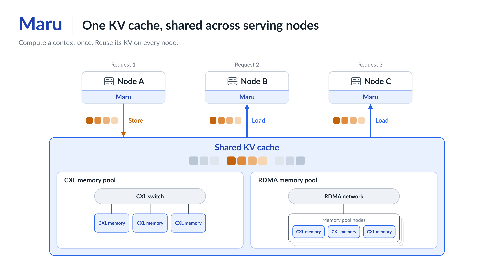
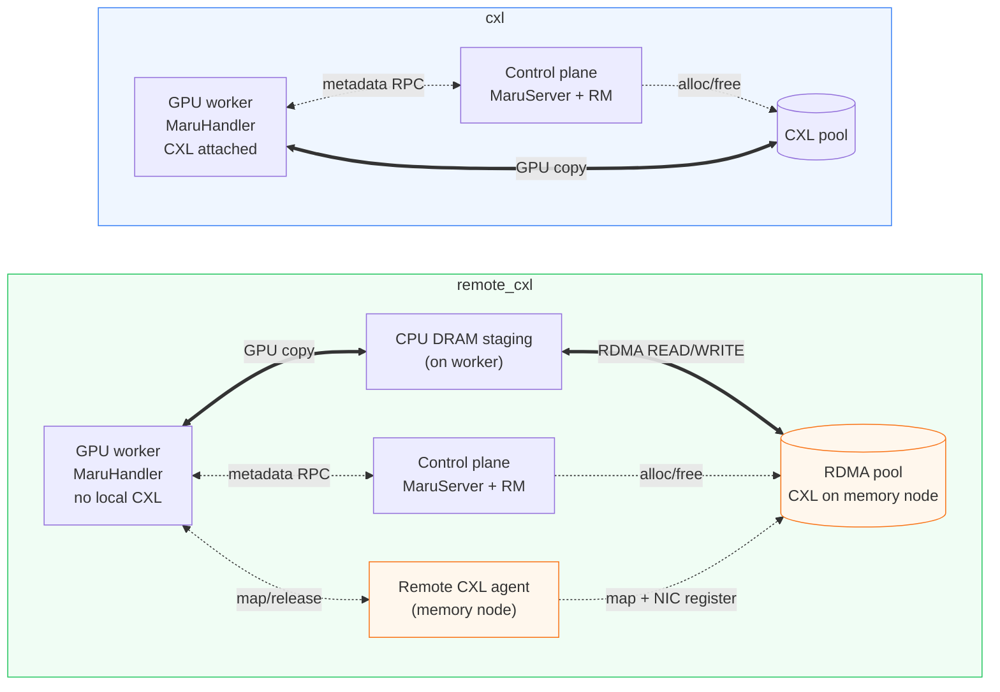

<p align="center">
  
</p>

<h3 align="center">Maru: High-Performance KV Cache Storage Engine on CXL and RDMA Memory Pools</h3>

<p align="center">
  <a href="https://xcena-dev.github.io/maru/"></a>
  <a href="https://opensource.org/licenses/Apache-2.0"></a>
</p>

**Maru** is a high-performance **KV cache storage engine built on shared memory pools**, designed for LLM inference scenarios where multiple instances need to share a KV cache with minimal latency. Maru supports two kinds of pool. A **CXL memory pool** is CXL memory that nodes attached to CXL reach through a CXL switch. An **RDMA memory pool** is the CXL memory of memory nodes, which GPU nodes without CXL reach over an RDMA network.

Maru stores reusable KV in a shared pool. With the `cxl` backend, CXL-attached nodes map that pool directly, avoiding KV payload transfers between compute nodes over an RDMA or IP network. GPU loads and stores still copy bytes between GPU memory and CXL. With `remote_cxl`, GPU nodes reach a memory node's CXL over one-sided RDMA through a worker-side CPU DRAM staging buffer. The memory node's NIC transfers the payload; MaruServer and the remote CXL agent handle metadata and region setup rather than relaying KV bytes.

Node A stores the KV it computes in a shared KV cache, and nodes B and C load it instead of recomputing. The shared KV cache lives in either kind of pool: nodes use the `cxl` backend for a CXL memory pool and the `remote_cxl` backend for an RDMA memory pool, and each node shares KV with the other nodes that use the same pool through the same backend.

The native vLLM connector also offers worker-private `cpu` and `mixed` caches.
Those modes do not provide cross-worker sharing in the current implementation.
See the [backend guide](https://xcena-dev.github.io/maru/source/integration/vllm.html)
to choose the storage path before following the default CXL quick start.

<p align="center">
  
</p>

| [**Documentation**](https://xcena-dev.github.io/maru/) |

## Why Maru?

- **Shared KV Storage** — Instances reuse KV stored in a common pool instead of recomputing the cached prefix. Each instance still loads the KV it needs into its own GPU cache.

- **Two Access Paths** — CXL-attached workers map the pool directly (`cxl`). Workers without CXL use GPU ↔ CPU staging copies and staging ↔ CXL RDMA transfers (`remote_cxl`). Neither path relays the payload through MaruServer.

- **Shared Pool Capacity** — Instances on a pool can reuse one stored KV object. Per-worker GPU caches and transfer buffers remain separate from that shared storage.

- **Measured Performance** — The published [LMCache benchmark](https://xcena-dev.github.io/maru/source/performance/lmcache.html) compares the `cxl` backend with LMCache P2P in a single-node setup. Latency, scaling and energy results depend on the backend, transport and workload; those measurements do not establish `remote_cxl` performance or an advantage over RDMA-based systems.

- **GPU Nodes without CXL** — With the `remote_cxl` storage backend, vLLM workers on GPU nodes without CXL keep their KV in an RDMA memory pool, the CXL memory of memory nodes. A remote CXL agent on each memory node maps regions and registers them with the node's NIC, and workers read and write them with one-sided RDMA. An RDMA memory pool can span several memory nodes that share the same CXL memory, and a worker can use several RDMA memory pools. See the [remote CXL example](examples/vllm/remote_cxl/README.md).

## Overview

| KV access | `cxl` | `remote_cxl` |
|---|---|---|
| Worker access to the pool | Direct CXL mapping on a CXL-attached node | One-sided RDMA to CXL on a memory node |
| GPU payload path | GPU ↔ mapped CXL region | GPU ↔ worker CPU DRAM staging ↔ RDMA ↔ CXL region |
| Meaning of zero-copy | A CPU reader can view mapped KV without another host copy; GPU transfers still copy bytes | Retrieved bytes occupy a staging slot after an RDMA READ; this is not an end-to-end zero-copy path |
| Metadata traffic | MaruServer RPC | MaruServer RPC plus remote CXL agent mapping and registration |

These are the storage access paths. Connector packing, CUDA registration and fallback copies can add temporary buffers; neither backend eliminates GPU data movement.

The diagram shows two example pools and their worker access paths. Workers share KV with other workers using the same pool and backend. Each control-plane box groups the pool's metadata and allocation services; it does not represent one process or one physical node. RM means Resource Manager.



> **Control Plane** (dashed arrows) — KV metadata operations and region allocation.
>
> **Data Plane** (thick solid arrows) — `cxl` copies KV between GPU memory and mapped CXL. `remote_cxl` copies it between GPU memory and worker CPU staging, then transfers it between staging and memory-node CXL over RDMA. Payload arrows bypass the control plane and remote CXL agent.

GPU nodes without CXL use the `remote_cxl` storage backend. Their KV stays in an RDMA memory pool, the CXL memory of memory nodes: a remote CXL agent on each memory node maps the regions a worker asks for and registers them with the node's NIC, and the worker reads and writes them with one-sided RDMA (NIXL/UCX). The agent is needed because one-sided RDMA reaches only memory that a process on the memory node has mapped and registered with its NIC, and a worker without CXL cannot map the region itself. Only control messages go to maru-server and the remote CXL agent. See [Remote CXL](https://xcena-dev.github.io/maru/source/design_doc/architecture_overview.html#remote-cxl-cxl-memory-of-other-nodes-over-rdma) in the architecture overview.

## Quick Start

### System Components

Maru consists of two server components and a client library. A deployment with GPU nodes without CXL adds a remote CXL agent on each memory node:

| Component | Role | Package |
|-----------|------|---------|
| **Resource Manager** | Manages the CXL memory of a memory pool | `maru-resource-manager` (C++) |
| **Metadata Server** | Manages KV metadata | `maru-server` (Python) |
| **MaruHandler** | Client library embedded in LLM instances | `maru` Python package |
| **Remote CXL Agent** | On memory nodes: maps CXL regions for LLM instances on nodes without CXL and registers them with the NIC (`remote_cxl` backend) | `maru-remote-cxl-agent` (needs NIXL) |

All components run on the same machine in a single-node setup. For multi-node deployment, see the [installation guide](https://xcena-dev.github.io/maru/source/getting_started/installation.html#multi-node-configuration).


### Prerequisites

- OS: Ubuntu 24.04 LTS+
- Python: 3.12+
- gcc: 13.3.0+, cmake: 3.28.3+
- [uv](https://docs.astral.sh/uv/) (recommended; `install.sh` falls back to pip)
- CXL DAX device (`/dev/dax*`) or emulation environment, on the nodes that hold the pool and the nodes that read it over CXL
- For the `remote_cxl` backend:
  - An RDMA NIC (RoCE or InfiniBand) on every worker and memory node; the maru-server node must reach the remote CXL agents on the memory nodes' RDMA network addresses
  - A compatible NIXL/Torch/CUDA stack before `./install.sh`; use the [NIXL stack instructions](docs/source/getting_started/installation.md#nixl-stack), including constraints for the provided vLLM 0.22.1 example

```bash
sudo apt-get update
sudo apt-get install -y python3 python3-venv python3-pip git \
    build-essential cmake libnuma-dev

# uv — used for all Python installs below
curl -LsSf https://astral.sh/uv/install.sh | sh
```

### Installation

```bash
git clone https://github.com/xcena-dev/maru
cd maru

uv venv --python 3.12 .venv
source .venv/bin/activate
./install.sh
```

### 1. Start the Resource Manager

The resource manager must be running before any other Maru service.

**Production** — start as a systemd daemon:

```bash
# Default (127.0.0.1:9850)
sudo systemctl start maru-resource-manager

# With custom host/port
sudo systemctl edit maru-resource-manager

[Service]
ExecStart=
ExecStart=/usr/local/bin/maru-resource-manager --host <ip> --port <port>

sudo systemctl restart maru-resource-manager
```

**Development/debugging** — run directly with custom options:

```bash
# Default (127.0.0.1:9850)
sudo maru-resource-manager --log-level debug

# With custom host/port
sudo maru-resource-manager --host <ip> --port <port> --log-level debug
```

> If you change the RM port, pass the same address to `maru-server`: `maru-server --rm-address 127.0.0.1:9851`

### 2. Start the Metadata Server

```bash
# Default (127.0.0.1:5555, connects to resource manager at 127.0.0.1:9850)
maru-server

# With custom host/port
maru-server --host <ip> --port <port>

# With custom resource manager address (default: 127.0.0.1:9850)
maru-server --rm-address <rm-ip>:<rm-port>
```

### Basic Usage

```python
from maru import MaruConfig, MaruHandler

config = MaruConfig(
    server_url="tcp://localhost:5555",
    pool_size=1024 * 1024 * 100,  # 100MB
)

with MaruHandler(config) as handler:
    data = b"A" * (1024 * 1024)  # 1MB KV chunk

    # 1. Allocate a page in CXL shared memory
    handle = handler.alloc(size=len(data))

    # 2. Copy the payload into the directly mapped CXL page
    handle.buf[:] = data

    # 3. Register the key — only metadata (key → region, offset) is sent
    handler.store(key="example-key", handle=handle)

    # Retrieve: returns a memoryview pointing into CXL memory
    result = handler.retrieve(key="example-key")
    assert result is not None
    assert bytes(result.view[:5]) == b"AAAAA"
```

## LMCache Integration

Maru works as a native [LMCache](https://github.com/LMCache/LMCache) storage backend via the `maru_path` and `maru_pool_size` config fields. Requires LMCache [`5502419`](https://github.com/LMCache/LMCache/commit/550241961be6edae295cd0a374db1e46f96fe388) (2026-04-03) or later. It supports both **P2P KV cache sharing** and **disaggregated prefill** scenarios.

```yaml
# LMCache config
maru_path: "maru://localhost:${MARU_SERVER_PORT}"
maru_pool_size: 4
```

For details on LMCache integration, see the [documentation](https://xcena-dev.github.io/maru/source/integration/lmcache.html).

LMCache integration uses a CXL memory pool (`cxl` backend); GPU nodes without CXL use the vLLM connector with `maru_storage_backend: "remote_cxl"`.

## vLLM Integration

`MaruKVConnector` is a KV connector that plugs Maru into vLLM directly, without LMCache. vLLM loads it from the `maru_vllm` package, and its settings go in `kv_connector_extra_config`. Requires vLLM v0.14 or later.

```bash
vllm serve <model> --kv-transfer-config '{
    "kv_connector": "MaruKVConnector",
    "kv_connector_module_path": "maru_vllm",
    "kv_role": "kv_both",
    "kv_connector_extra_config": {"maru_server_url": "tcp://localhost:5555", "maru_pool_size": "4G"}
}'
```

On GPU nodes without CXL, set `"maru_storage_backend": "remote_cxl"` to keep the KV in the CXL memory of memory nodes; the [remote CXL example](examples/vllm/remote_cxl/README.md) lists the settings it needs. For details, see the [vLLM guide](https://xcena-dev.github.io/maru/source/integration/vllm.html).


## Plugins

Maru core is vendor-neutral. Hardware- or vendor-specific behaviour lives in
separate packages that register a `maru.handler_plugins` entry point;
`MaruHandler` discovers them at construction time and calls their hooks —
loading is soft-fail, so a missing or broken plugin never breaks KV-cache
operation. Select plugins at runtime with `MARU_PLUGINS` (unset → load all).

```python
# In the plugin package's pyproject.toml
[project.entry-points."maru.handler_plugins"]
my_plugin = "my_pkg.plugin:MyPlugin"
```

A plugin implements any subset of `MaruHandlerPlugin` (`on_init`,
`on_batch_retrieve`, `on_close`, `contribute_stats`). See
[`maru_handler/plugin.py`](maru_handler/plugin.py) for the interface.

## Tools

`marutop` — a single command (installed with the package) for monitoring and
device admin. With no arguments it shows a unified `top`-style view combining
physical DAX pools and per-instance usage; subcommands select a focused view or
the device admin tool:

```bash
marutop                    # unified live view: DEVICES (pool) + INSTANCES
marutop pool               # physical DAX pool gauges (CSV export with --csv)
marutop usage              # per-instance allocated/used/slack
marutop stats              # per-operation latency/throughput dashboard
marutop device init /dev/dax0.0   # DAX device UUID header: init | show | clear
```

See [`tools/README.md`](tools/README.md) for full options. (The older
`python -m tools.pool_monitor` invocations still work via thin shims.)

## License

Copyright 2026 [XCENA Inc.](https://xcena.com) Licensed under the Apache License 2.0.
