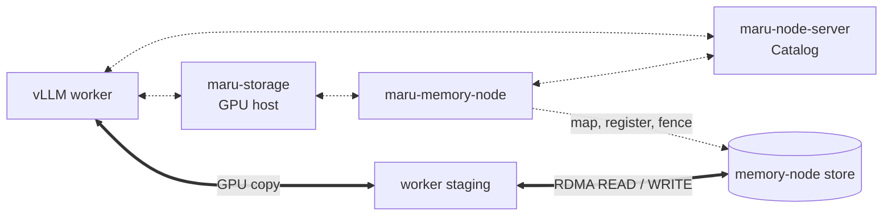

<p align="center">
  
</p>

<h3 align="center">Maru: High-Performance KV Cache Storage Engine on CXL and RDMA Memory Pools</h3>

<p align="center">
  <a href="https://xcena-dev.github.io/maru/"></a>
  <a href="https://opensource.org/licenses/Apache-2.0"></a>
</p>

**Maru** stores reusable KV cache in shared memory for LLM inference. The native vLLM connector supports node-owned DRAM, local CXL and remote memory through `maru_node`. Each node serves one store. The directly mapped `cxl` backend also supports LMCache and SGLang.

| Path | Storage and GPU access | Services |
|---|---|---|
| `maru_node`, `dram` | Node-owned DRAM, mapped by local workers | `maru-node-server` and GPU-host `maru-storage` |
| `maru_node`, `local_cxl` | Node-owned CXL, mapped by local workers | Catalog, `maru-storage` and Resource Manager |
| `maru_node`, `remote` | GPU ↔ worker staging ↔ RDMA ↔ memory-node DRAM or CXL | Catalog, GPU-host `maru-storage` and `maru-memory-node`; CXL needs Resource Manager |
| `cxl` | GPU ↔ directly mapped shared CXL | `maru-server` and Resource Manager |

KV payloads bypass metadata services. Remote workers issue RDMA READ and WRITE directly through their own registered staging. Memory nodes own the remote pages and publish keys only after COMMIT. Reads do not create cached copies on GPU nodes.



Compatible engines reuse keys within the selected store and namespace. GPU-local stores skip new writes when full; memory nodes use a shared LRU. GPU copies and RDMA staging still move bytes. Node components use the same release, and their Catalog is separate from the `cxl` registry.

See [Node StorageService](docs/source/design_doc/node_storage_service.md) for configuration, and [Moving to maru_node](docs/source/getting_started/migrating_to_maru_node.md) for process and setting replacements.

## Quick Start

### System Components

Node deployments use the processes in the table above. The quick start below describes `cxl`; it needs a Resource Manager, `maru-server` and a CXL-attached client. For node-owned DRAM or remote storage, use the [node setup](docs/source/integration/vllm.md#node-storageservice-maru_node).

### Prerequisites

- OS: Ubuntu 24.04 LTS+
- Python: 3.12+
- gcc: 13.3.0+, cmake: 3.28.3+
- [uv](https://docs.astral.sh/uv/) (recommended; `install.sh` falls back to pip)
- CXL DAX device (`/dev/dax*`) or emulation environment, on the nodes that hold the pool and the nodes that read it over CXL
- For node remote storage: an RDMA NIC and compatible NIXL/UCX runtime on GPU workers and memory nodes; see the [NIXL stack instructions](docs/source/getting_started/installation.md#nixl-stack)

```bash
sudo apt-get update
sudo apt-get install -y python3 python3-venv python3-pip git \
    build-essential cmake libnuma-dev

# uv — used for all Python installs below
curl -LsSf https://astral.sh/uv/install.sh | sh
```

### Installation

```bash
git clone https://github.com/xcena-dev/maru
cd maru

uv venv --python 3.12 .venv
source .venv/bin/activate
./install.sh
```

### 1. Start the Resource Manager

The resource manager must be running before any other Maru service.

**Production** — start as a systemd daemon:

```bash
# Default (127.0.0.1:9850)
sudo systemctl start maru-resource-manager

# With custom host/port
sudo systemctl edit maru-resource-manager

[Service]
ExecStart=
ExecStart=/usr/local/bin/maru-resource-manager --host <ip> --port <port>

sudo systemctl restart maru-resource-manager
```

**Development/debugging** — run directly with custom options:

```bash
# Default (127.0.0.1:9850)
sudo maru-resource-manager --log-level debug

# With custom host/port
sudo maru-resource-manager --host <ip> --port <port> --log-level debug
```

> If you change the RM port, pass the same address to `maru-server`: `maru-server --rm-address 127.0.0.1:9851`

### 2. Start the Metadata Server

```bash
# Default (127.0.0.1:5555, connects to resource manager at 127.0.0.1:9850)
maru-server

# With custom host/port
maru-server --host <ip> --port <port>

# With custom resource manager address (default: 127.0.0.1:9850)
maru-server --rm-address <rm-ip>:<rm-port>
```

### Basic Usage

```python
from maru import MaruConfig, MaruHandler

config = MaruConfig(
    server_url="tcp://localhost:5555",
    pool_size=1024 * 1024 * 100,  # 100MB
)

with MaruHandler(config) as handler:
    data = b"A" * (1024 * 1024)  # 1MB KV chunk

    # 1. Allocate a page in CXL shared memory
    handle = handler.alloc(size=len(data))

    # 2. Copy the payload into the directly mapped CXL page
    handle.buf[:] = data

    # 3. Register the key — only metadata (key → region, offset) is sent
    handler.store(key="example-key", handle=handle)

    # Retrieve: returns a memoryview pointing into CXL memory
    result = handler.retrieve(key="example-key")
    assert result is not None
    assert bytes(result.view[:5]) == b"AAAAA"
```

## LMCache Integration

Maru works as a native [LMCache](https://github.com/LMCache/LMCache) storage backend via the `maru_path` and `maru_pool_size` config fields. Requires LMCache [`5502419`](https://github.com/LMCache/LMCache/commit/550241961be6edae295cd0a374db1e46f96fe388) (2026-04-03) or later. It supports both **P2P KV cache sharing** and **disaggregated prefill** scenarios.

```yaml
# LMCache config
maru_path: "maru://localhost:${MARU_SERVER_PORT}"
maru_pool_size: 4
```

For details on LMCache integration, see the [documentation](https://xcena-dev.github.io/maru/source/integration/lmcache.html).

LMCache uses directly mapped `cxl`. GPU nodes without CXL use the native vLLM connector with `maru_node` and a `dram` or `remote` store.

## vLLM Integration

`MaruKVConnector` is a KV connector that plugs Maru into vLLM directly, without LMCache. vLLM loads it from the `maru_vllm` package, and its settings go in `kv_connector_extra_config`. Requires vLLM v0.14 or later.

```bash
vllm serve <model> --kv-transfer-config '{
    "kv_connector": "MaruKVConnector",
    "kv_connector_module_path": "maru_vllm",
    "kv_role": "kv_both",
    "kv_connector_extra_config": {"maru_server_url": "tcp://localhost:5555", "maru_pool_size": "4G"}
}'
```

For node-owned stores, configure `maru_node`, `maru_engine_id`, `maru_cache_namespace` and `kv_load_failure_policy="recompute"` as shown in the [vLLM guide](docs/source/integration/vllm.md#node-storageservice-maru_node).

## Plugins

Maru core is vendor-neutral. Hardware- or vendor-specific behaviour lives in separate packages that register a `maru.handler_plugins` entry point; `MaruHandler` discovers them at construction time and calls their hooks — loading is soft-fail, so a missing or broken plugin never breaks KV-cache operation. Select plugins at runtime with `MARU_PLUGINS` (unset → load all).

```python
# In the plugin package's pyproject.toml
[project.entry-points."maru.handler_plugins"]
my_plugin = "my_pkg.plugin:MyPlugin"
```

A plugin implements any subset of `MaruHandlerPlugin` (`on_init`, `on_batch_retrieve`, `on_close`, `contribute_stats`). See [`maru_handler/plugin.py`](maru_handler/plugin.py) for the interface.

## Tools

`marutop` — a single command (installed with the package) for monitoring and device admin. With no arguments it shows a unified `top`-style view combining physical DAX pools and per-instance usage; subcommands select a focused view or the device admin tool:

```bash
marutop                    # unified live view: DEVICES (pool) + INSTANCES
marutop pool               # physical DAX pool gauges (CSV export with --csv)
marutop usage              # per-instance allocated/used/slack
marutop stats              # per-operation latency/throughput dashboard
marutop device init /dev/dax0.0   # DAX device UUID header: init | show | clear
```

See [`tools/README.md`](tools/README.md) for full options. (The older `python -m tools.pool_monitor` invocations still work via thin shims.)

## License

Copyright 2026 [XCENA Inc.](https://xcena.com) Licensed under the Apache License 2.0.
