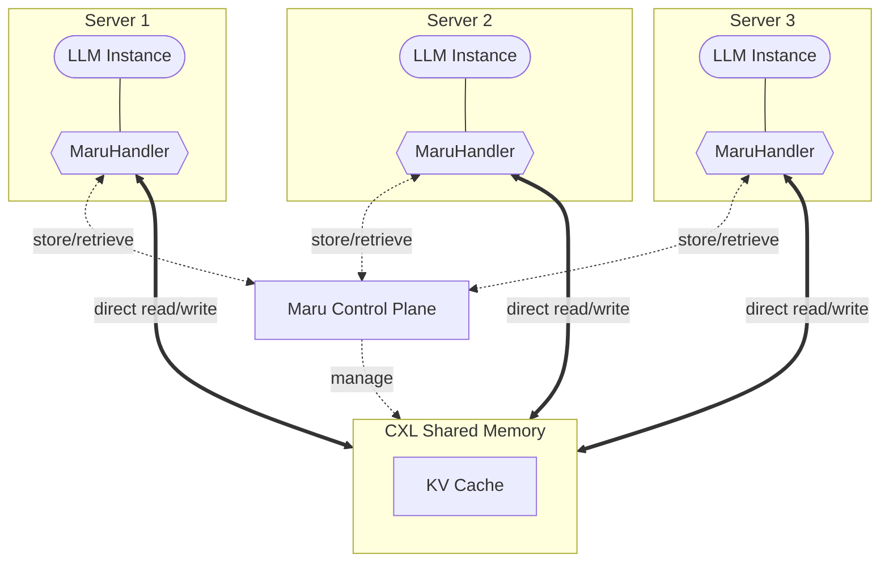

# Maru

**Maru** is a high-performance **KV cache storage engine built on CXL shared memory**, designed for LLM inference scenarios where multiple instances need to share a KV cache with minimal latency.

Transfer-based sharing copies the KV across the network to every node that reuses it, byte by byte. As models get larger and contexts get longer, those copies become a structural bottleneck. On nodes attached to CXL, Maru takes the opposite approach: **don't move data, share the memory.** Instances on those nodes read and write KV cache data directly in CXL shared memory, and only lightweight metadata (tens of bytes) travels between components. GPU nodes without CXL reach the CXL memory of memory nodes with one-sided RDMA: the NICs move the bytes, and no Maru process is on that path.

Node A stores the KV it computes in one shared KV cache, and nodes B and C load it instead of recomputing. Nodes reach the cache through a CXL switch or an RDMA network; the nodes that use one pool share its KV.

:::{image} source/image/maru_shared_kv_cache.png
:alt: Node A stores the KV of request 1 in a shared KV cache, and nodes B and C load that KV for requests 2 and 3. The shared KV cache holds a CXL memory pool, CXL memory behind a CXL switch, and an RDMA memory pool, CXL memory in memory pool nodes reached over an RDMA network
:align: center
:::

## Key Features

- **Zero-Copy Sharing** — Transfer-based systems — whether CPU-mediated or GPU-direct — require the receiver to allocate staging buffers and move data across an interconnect. On nodes attached to CXL, Maru eliminates this entire path: every instance reads from the same shared memory region directly. No buffer allocation, no data copy, no serialization. Nodes that reach the pool over RDMA add one copy, between the GPU and a host staging buffer.

- **Scales with Context Length and Concurrency** — Network-based sharing degrades as contexts grow and more consumers hit the same KV. On nodes attached to CXL, Maru never fans out KV payloads — scaling is bounded by shared-memory bandwidth, not network transfer.

- **Higher Hardware Utilization** — Instead of duplicating KV caches per instance, all instances draw from a shared CXL pool, whether they reach it over CXL or over RDMA. Less duplication means more usable memory and higher effective cache capacity.

- **Lower System Energy** — On nodes attached to CXL, eliminating bulk data transfer cuts NIC and CPU power draw, and shorter data paths reduce GPU idle time per request.

- **GPU Nodes without CXL** — With the `remote_cxl` storage backend, vLLM workers on GPU nodes without CXL keep their KV in the CXL memory of memory nodes. A region mapper on each memory node maps regions and registers them with the node's NIC, and workers read and write them with one-sided RDMA. Several memory nodes can share one CXL pool, and a worker can use several pools. See the [remote CXL example](https://github.com/xcena-dev/maru/blob/main/examples/vllm/remote_cxl/README.md).

---

## Architecture



> **Control Plane** (dashed arrows) — KV metadata operations and region allocation.
>
> **Data Plane** (solid arrows) — on nodes attached to CXL, direct access to CXL shared memory, zero-copy. The data path is identical regardless of control plane mode.

GPU nodes without CXL use the `remote_cxl` storage backend. Their KV stays in the CXL memory of memory nodes: a region mapper on each memory node maps the regions a worker asks for and registers them with the node's NIC, and the worker reads and writes them with one-sided RDMA (NIXL/UCX). Only control messages go to maru-server and the region mapper.

See {doc}`Architecture Overview <source/design_doc/architecture_overview>` for the full design, including the `remote_cxl` backend.

---

## Benchmark


*P2P KV cache reuse, meta-llama/Llama-3.1-8B-Instruct, single-node. TTFT P50 (ms), lower is better. Multi-node results coming soon.*

See {doc}`full benchmark results <source/performance/lmcache>` for detailed TTFT, concurrency, and power efficiency comparisons.

---

::::admonition Name

<br>

:::{image} source/image/maru.png
:width: 250px
:alt: Maru
:align: center
:::

<br>

Maru (/mɑːruː/) — named after the *maru* (마루), the central open floor in traditional Korean architecture where all rooms connect and people freely gather and share.
::::

---

## Getting Started

- {doc}`System Setup <source/getting_started/bios_setup>`
- {doc}`Installation <source/getting_started/installation>`
- {doc}`Quick Start <source/getting_started/quick_start>` — Single-host and multi-host KV sharing
- {doc}`Examples <source/getting_started/examples/index>`
- {doc}`Architecture Overview <source/design_doc/architecture_overview>`

```{toctree}
:maxdepth: 2
:caption: Getting Started
:hidden:

System Setup <source/getting_started/bios_setup>
Installation <source/getting_started/installation>
Quick Start <source/getting_started/quick_start>
Examples <source/getting_started/examples/index>
```

```{toctree}
:maxdepth: 2
:caption: Design Docs
:hidden:

Architecture Overview <source/design_doc/architecture_overview>
Memory Model <source/design_doc/memory_model>
KV Cache Management <source/design_doc/kv_cache_management>
Consistency and Safety <source/design_doc/consistency_and_safety>
CPU/CXL L1 and SSD L2 (Proposal) <source/design_doc/tiered_kv_cache>
```

```{toctree}
:maxdepth: 2
:caption: Integration
:hidden:

LMCache <source/integration/lmcache>
vLLM <source/integration/vllm>
NVIDIA Dynamo <source/integration/dynamo>
SGLang HiCache <source/integration/sglang>
```

```{toctree}
:maxdepth: 1
:caption: API Reference
:hidden:

Python API <source/api_reference/api>
Configuration <source/api_reference/config>
Handler Plugins <source/api_reference/plugins>
```

## Future Work

- **NUMA node support for CXL memory** — Currently Maru requires CXL memory to be exposed as devdax devices (`/dev/dax*`). We plan to support CXL memory mapped as NUMA nodes, enabling broader hardware compatibility and simplified deployment.

- **Direct integration with more inference frameworks** — Native KV cache connector for SGLang, enabling zero-copy shared memory without intermediate middleware dependencies.

- **CXL-based Near Data Processing (NDP)** — Offloading KV cache operations — such as compression/decompression, prefix matching, and eviction scoring — to compute-capable CXL devices, reducing host CPU overhead and data movement.

```{toctree}
:maxdepth: 1
:caption: Performance
:hidden:

LMCache Benchmark <source/performance/lmcache>
```

```{toctree}
:caption: Contact
:hidden:

Contact Us <https://xcena.com/Contact>
```
