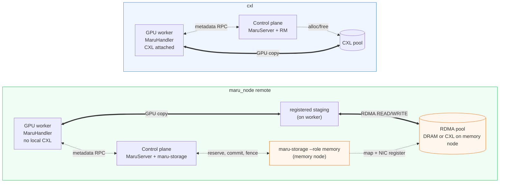
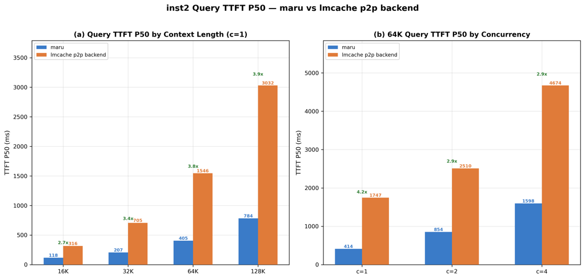

# Maru

**Maru** is a high-performance **KV cache storage engine built on shared memory pools**, designed for LLM inference scenarios where multiple instances need to share a KV cache with minimal latency. Maru supports two kinds of pool. A **CXL memory pool** is CXL memory that nodes attached to CXL reach through a CXL switch. An **RDMA memory pool** is the DRAM or CXL memory of memory nodes, which GPU nodes without CXL reach over an RDMA network.

Maru stores reusable KV in a shared pool. With the `cxl` backend, CXL-attached nodes map that pool directly, avoiding KV payload transfers between compute nodes over an RDMA or IP network. GPU loads and stores still copy bytes between GPU memory and CXL. With the node backend (selected by `maru_node`) and a `remote` store, GPU workers reach a memory node's pool over one-sided RDMA through their own registered staging buffer. The NICs transfer the payload. MaruServer (`maru-server --backend node`), GPU StorageService (`maru-storage --role gpu`) and memory StorageService (`maru-storage --role memory`) handle metadata, credit and registration.

Node A stores the KV it computes in a shared KV cache, and nodes B and C load it instead of recomputing. The shared KV cache lives in either kind of pool: nodes use the `cxl` backend for a CXL memory pool and the node backend with a `remote` store for an RDMA memory pool, and each node shares KV with the other nodes that use the same pool through the same backend.

On a single GPU node, engines can also share a node-owned DRAM or local CXL store. Choose a setup in {doc}`Deployments <source/getting_started/deployments/index>`. The example below shows a memory node backed by CXL.

:::{image} source/image/maru_shared_kv_cache.png
:alt: Node A stores the KV of request 1 in a shared KV cache, and nodes B and C load that KV for requests 2 and 3. The shared KV cache holds a CXL memory pool, CXL memory behind a CXL switch, and an RDMA memory pool, CXL memory in memory pool nodes reached over an RDMA network
:align: center
:::

## Key Features

- **Shared KV Storage** — Instances reuse KV stored in a common pool instead of recomputing the cached prefix. Each instance still loads the KV it needs into its own GPU cache.

- **Two Storage Backends** — CXL-attached workers map the pool directly (`cxl`). With the node backend, workers map a local DRAM or CXL pool, or reach a memory node over RDMA through their own staging. Neither backend relays the payload through MaruServer.

- **Shared Pool Capacity** — Instances on a pool can reuse one stored KV object. Per-worker GPU caches and transfer buffers remain separate from that shared storage.

- **Measured Performance** — The published {doc}`LMCache benchmark <source/performance/lmcache>` compares the `cxl` backend with LMCache P2P in a single-node setup. Latency, scaling and energy results depend on the backend, transport and workload; those measurements do not establish `maru_node` performance or an advantage over RDMA-based systems.

- **GPU Nodes without CXL** — With `maru_node` and a `remote` store, vLLM workers on GPU nodes without CXL keep their KV in an RDMA memory pool, the DRAM or CXL memory of a memory node. `maru-storage --role memory` maps its pool and registers it with the node's NIC, and workers read and write it with one-sided RDMA. Several GPU nodes can share one memory node. See {doc}`Node StorageService <source/design_doc/node_storage_service>`.

---

## Architecture

| KV access | `cxl` | node, `remote` |
|---|---|---|
| Worker access to the pool | Direct CXL mapping on a CXL-attached node | One-sided RDMA to DRAM or CXL on a memory node |
| GPU payload path | GPU ↔ mapped CXL region | GPU ↔ worker registered staging ↔ RDMA ↔ memory-node pool |
| Meaning of zero-copy | A CPU reader can view mapped KV without another host copy; GPU transfers still copy bytes | Retrieved bytes occupy a staging slot after an RDMA READ; this is not an end-to-end zero-copy path |
| Metadata traffic | RPC to MaruServer (`maru-server --backend cxl`) | RPC to MaruServer plus GPU and memory StorageService control |

The table compares two cross-host setups. Connector packing, CUDA registration and fallback copies can add temporary buffers; neither backend eliminates GPU data movement.

The diagram shows two example pools and how workers access them. Workers share KV with other workers using the same pool and backend. Each control-plane box groups the pool's metadata and allocation services; it does not represent one process or one physical node. RM means Resource Manager.



> **Control Plane** (dashed arrows) — KV metadata operations and region allocation.
>
> **Data Plane** (thick solid arrows) — `cxl` copies KV between GPU memory and mapped CXL. `maru_node` with a `remote` store copies it between GPU memory and worker registered staging, then transfers it between staging and the memory-node pool over RDMA. Payload arrows bypass the control plane and the memory-node service.

GPU nodes that share KV through a memory node use a `remote` store. Their KV stays in an RDMA memory pool, the DRAM or CXL memory of a memory node: `maru-storage --role memory` maps its pool and registers it with the node's NIC, and workers read and write it with one-sided RDMA (NIXL/UCX) through their own registered staging. The memory-node service is needed because one-sided RDMA reaches only memory that a process on the memory node has mapped and registered with its NIC, and a worker without CXL cannot map that memory itself. Only control messages go to MaruServer and the node services.

See {doc}`Architecture Overview <source/design_doc/architecture_overview>` for the full design, including `maru_node`.

---

## Benchmark



*P2P KV cache reuse with the `cxl` backend, meta-llama/Llama-3.1-8B-Instruct, single-node. The LMCache P2P baseline uses NIXL/UCX with TCP loopback. TTFT P50 (ms), lower is better. This chart does not measure `maru_node` or an RDMA P2P baseline.*

See {doc}`full benchmark results <source/performance/lmcache>` for detailed TTFT, concurrency, and power efficiency comparisons.

---

::::admonition Name

<br>

:::{image} source/image/maru.png
:width: 250px
:alt: Maru
:align: center
:::

<br>

Maru (/mɑːruː/) — named after the *maru* (마루), the central open floor in traditional Korean architecture where all rooms connect and people freely gather and share.
::::

---

## Getting Started

- {doc}`Installation <source/getting_started/installation>`
- {doc}`Quick Start <source/getting_started/quick_start>` — Share KV cache between two vLLM engines on one GPU node
- {doc}`Deployments <source/getting_started/deployments/index>` — Choose a setup for your nodes
- {doc}`CXL System Setup <source/getting_started/bios_setup>`
- {doc}`Examples <source/getting_started/examples/index>`
- {doc}`Supported Models <source/integration/supported_models>` — Models Maru stores with vLLM, by KV cache structure
- {doc}`Architecture Overview <source/design_doc/architecture_overview>`

```{toctree}
:maxdepth: 2
:caption: Getting Started
:hidden:

Installation <source/getting_started/installation>
Quick Start <source/getting_started/quick_start>
Deployments <source/getting_started/deployments/index>
CXL System Setup <source/getting_started/bios_setup>
Examples <source/getting_started/examples/index>
```

```{toctree}
:maxdepth: 2
:caption: Design Docs
:hidden:

Architecture Overview <source/design_doc/architecture_overview>
Memory Model <source/design_doc/memory_model>
KV Cache Management <source/design_doc/kv_cache_management>
Consistency and Safety <source/design_doc/consistency_and_safety>
Prefetch Hints (Read and Write) <source/design_doc/read_hints>
Maru FS <source/design_doc/maru_fs>
```

```{toctree}
:maxdepth: 2
:caption: Integration
:hidden:

Supported Models <source/integration/supported_models>
LMCache <source/integration/lmcache>
vLLM <source/integration/vllm>
NVIDIA Dynamo <source/integration/dynamo>
SGLang HiCache <source/integration/sglang>
```

```{toctree}
:maxdepth: 1
:caption: API Reference
:hidden:

Python API <source/api_reference/api>
Configuration <source/api_reference/config>
Handler Plugins <source/api_reference/plugins>
Resource Manager Admin (maru-rm-ctl) <source/api_reference/maru_rm_ctl>
```

## Future Work

- **NUMA node support for CXL memory** — Currently Maru requires CXL memory to be exposed as devdax devices (`/dev/dax*`). We plan to support CXL memory mapped as NUMA nodes, enabling broader hardware compatibility and simplified deployment.

- **Direct integration with more inference frameworks** — Native KV cache connectors for additional frameworks, with the supported storage backend and copy path documented for each integration.

- **CXL-based Near Data Processing (NDP)** — Offloading KV cache operations — such as compression/decompression, prefix matching, and eviction scoring — to compute-capable CXL devices, reducing host CPU overhead and data movement.

```{toctree}
:maxdepth: 1
:caption: Performance
:hidden:

LMCache Benchmark <source/performance/lmcache>
```

```{toctree}
:caption: Contact
:hidden:

Contact Us <https://xcena.com/Contact>
```
