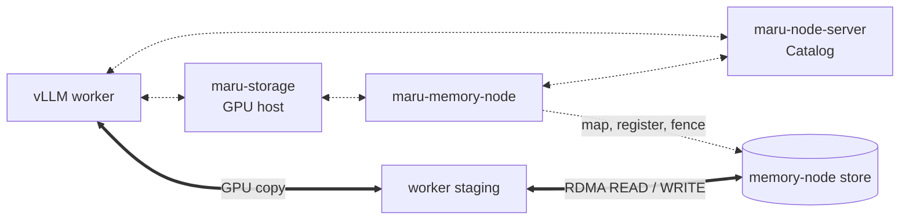

# Maru

**Maru** stores reusable KV cache in shared memory for LLM inference. The native vLLM connector supports node-owned DRAM, local CXL and remote memory through `maru_node`. Each node serves one store. The directly mapped `cxl` backend also supports LMCache and SGLang.

| Path | Storage and GPU access | Services |
|---|---|---|
| `maru_node`, `dram` | Node-owned DRAM, mapped by local workers | `maru-node-server` and GPU-host `maru-storage` |
| `maru_node`, `local_cxl` | Node-owned CXL, mapped by local workers | Catalog, `maru-storage` and Resource Manager |
| `maru_node`, `remote` | GPU ↔ worker staging ↔ RDMA ↔ memory-node DRAM or CXL | Catalog, GPU-host `maru-storage` and `maru-memory-node`; CXL needs Resource Manager |
| `cxl` | GPU ↔ directly mapped shared CXL | `maru-server` and Resource Manager |

KV payloads bypass metadata services. Remote workers issue RDMA READ and WRITE directly through their own registered staging. Memory nodes own the remote pages and publish keys only after COMMIT. Reads do not create cached copies on GPU nodes.



Compatible engines reuse keys within the selected store and namespace. GPU-local stores skip new writes when full; memory nodes use a shared LRU. GPU copies and RDMA staging still move bytes. Node components use the same release, and their Catalog is separate from the `cxl` registry.

See {doc}`Node StorageService <source/design_doc/node_storage_service>` for configuration and {doc}`Moving to maru_node <source/getting_started/migrating_to_maru_node>` for migration.

::::admonition Name

<br>

:::{image} source/image/maru.png
:width: 250px
:alt: Maru
:align: center
:::

<br>

Maru (/mɑːruː/) — named after the *maru* (마루), the central open floor in traditional Korean architecture where all rooms connect and people freely gather and share.
::::

---

## Getting Started

- {doc}`System Setup <source/getting_started/bios_setup>`
- {doc}`Installation <source/getting_started/installation>`
- {doc}`Quick Start <source/getting_started/quick_start>` — Single-host and multi-host KV sharing
- {doc}`Examples <source/getting_started/examples/index>`
- {doc}`Supported Models <source/integration/supported_models>` — Models Maru stores with vLLM, by KV cache structure
- {doc}`Architecture Overview <source/design_doc/architecture_overview>`

```{toctree}
:maxdepth: 2
:caption: Getting Started
:hidden:

System Setup <source/getting_started/bios_setup>
Installation <source/getting_started/installation>
Quick Start <source/getting_started/quick_start>
Moving to maru_node <source/getting_started/migrating_to_maru_node>
Examples <source/getting_started/examples/index>
```

```{toctree}
:maxdepth: 2
:caption: Design Docs
:hidden:

Architecture Overview <source/design_doc/architecture_overview>
Memory Model <source/design_doc/memory_model>
Memory Node Service <source/design_doc/memory_node>
KV Cache Management <source/design_doc/kv_cache_management>
Consistency and Safety <source/design_doc/consistency_and_safety>
Prefetch Hints (Read and Write) <source/design_doc/read_hints>
Node StorageService <source/design_doc/node_storage_service>
```

```{toctree}
:maxdepth: 2
:caption: Integration
:hidden:

Supported Models <source/integration/supported_models>
LMCache <source/integration/lmcache>
vLLM <source/integration/vllm>
NVIDIA Dynamo <source/integration/dynamo>
SGLang HiCache <source/integration/sglang>
```

```{toctree}
:maxdepth: 1
:caption: API Reference
:hidden:

Python API <source/api_reference/api>
Configuration <source/api_reference/config>
Handler Plugins <source/api_reference/plugins>
Resource Manager Admin (maru-rm-ctl) <source/api_reference/maru_rm_ctl>
```

```{toctree}
:maxdepth: 1
:caption: Performance
:hidden:

LMCache Benchmark <source/performance/lmcache>
```

```{toctree}
:caption: Contact
:hidden:

Contact Us <https://xcena.com/Contact>
```
