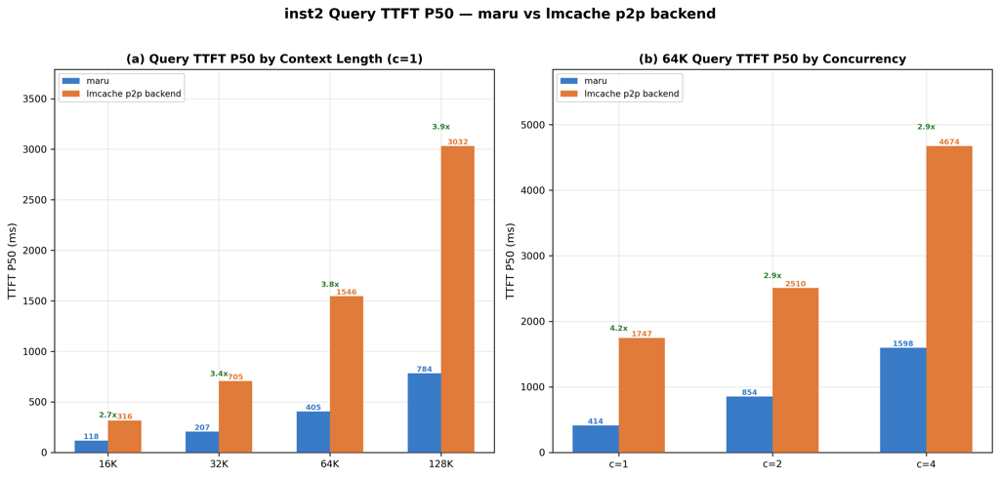

# Maru

**Maru** is a high-performance **KV cache storage engine built on shared memory pools**, designed for LLM inference scenarios where multiple instances need to share a KV cache with minimal latency. Maru supports two kinds of pool. A **CXL memory pool** is CXL memory that nodes attached to CXL reach through a CXL switch. An **RDMA memory pool** is the CXL memory of memory nodes, which GPU nodes without CXL reach over an RDMA network.

Maru stores reusable KV in a shared pool. With the `cxl` backend, CXL-attached nodes map that pool directly, avoiding KV payload transfers between compute nodes over an RDMA or IP network. GPU loads and stores still copy bytes between GPU memory and CXL. With `remote_cxl`, GPU nodes reach a memory node's CXL over one-sided RDMA through a worker-side CPU DRAM staging buffer. The memory node's NIC transfers the payload; MaruServer and the remote CXL agent handle metadata and region setup rather than relaying KV bytes.

Node A stores the KV it computes in a shared KV cache, and nodes B and C load it instead of recomputing. The shared KV cache lives in either kind of pool: nodes use the `cxl` backend for a CXL memory pool and the `remote_cxl` backend for an RDMA memory pool, and each node shares KV with the other nodes that use the same pool through the same backend.

:::{image} source/image/maru_shared_kv_cache.png
:alt: Node A stores the KV of request 1 in a shared KV cache, and nodes B and C load that KV for requests 2 and 3. The shared KV cache holds a CXL memory pool, CXL memory behind a CXL switch, and an RDMA memory pool, CXL memory in memory pool nodes reached over an RDMA network
:align: center
:::

## Key Features

- **Shared KV Storage** — Instances reuse KV stored in a common pool instead of recomputing the cached prefix. Each instance still loads the KV it needs into its own GPU cache.

- **Two Access Paths** — CXL-attached workers map the pool directly (`cxl`). Workers without CXL use GPU ↔ CPU staging copies and staging ↔ CXL RDMA transfers (`remote_cxl`). Neither path relays the payload through MaruServer.

- **Shared Pool Capacity** — Instances on a pool can reuse one stored KV object. Per-worker GPU caches and transfer buffers remain separate from that shared storage.

- **Measured Performance** — The published {doc}`LMCache benchmark <source/performance/lmcache>` compares the `cxl` backend with LMCache P2P in a single-node setup. Latency, scaling and energy results depend on the backend, transport and workload; those measurements do not establish `remote_cxl` performance or an advantage over RDMA-based systems.

- **GPU Nodes without CXL** — With the `remote_cxl` storage backend, vLLM workers on GPU nodes without CXL keep their KV in an RDMA memory pool, the CXL memory of memory nodes. A remote CXL agent on each memory node maps regions and registers them with the node's NIC, and workers read and write them with one-sided RDMA. An RDMA memory pool can span several memory nodes that share the same CXL memory, and a worker can use several RDMA memory pools. See the [remote CXL example](https://github.com/xcena-dev/maru/blob/main/examples/vllm/remote_cxl/README.md).

---

## Architecture

| KV access | `cxl` | `remote_cxl` |
|---|---|---|
| Worker access to the pool | Direct CXL mapping on a CXL-attached node | One-sided RDMA to CXL on a memory node |
| GPU payload path | GPU ↔ mapped CXL region | GPU ↔ worker CPU DRAM staging ↔ RDMA ↔ CXL region |
| Meaning of zero-copy | A CPU reader can view mapped KV without another host copy; GPU transfers still copy bytes | Retrieved bytes occupy a staging slot after an RDMA READ; this is not an end-to-end zero-copy path |
| Metadata traffic | MaruServer RPC | MaruServer RPC plus remote CXL agent mapping and registration |

These are the storage access paths. Connector packing, CUDA registration and fallback copies can add temporary buffers; neither backend eliminates GPU data movement.

The following diagram shows the directly mapped `cxl` path. The `remote_cxl` path is described below and in the architecture overview.


> **Control Plane** (dashed arrows) — KV metadata operations and region allocation.
>
> **Data Plane** (solid arrows) — direct access to mapped CXL memory with the `cxl` backend. GPU reads and writes copy bytes between that memory and GPU VRAM. The control plane alternatives share this directly mapped path; `remote_cxl` uses the staging and RDMA path described above.

GPU nodes without CXL use the `remote_cxl` storage backend. Their KV stays in an RDMA memory pool, the CXL memory of memory nodes: a remote CXL agent on each memory node maps the regions a worker asks for and registers them with the node's NIC, and the worker reads and writes them with one-sided RDMA (NIXL/UCX). The agent is needed because one-sided RDMA reaches only memory that a process on the memory node has mapped and registered with its NIC, and a worker without CXL cannot map the region itself. Only control messages go to maru-server and the remote CXL agent.

See {doc}`Architecture Overview <source/design_doc/architecture_overview>` for the full design, including the `remote_cxl` backend.

---

## Benchmark



*P2P KV cache reuse with the `cxl` backend, meta-llama/Llama-3.1-8B-Instruct, single-node. The LMCache P2P baseline uses NIXL/UCX with TCP loopback. TTFT P50 (ms), lower is better. This chart does not measure `remote_cxl` or an RDMA P2P baseline.*

See {doc}`full benchmark results <source/performance/lmcache>` for detailed TTFT, concurrency, and power efficiency comparisons.

---

::::admonition Name

<br>

:::{image} source/image/maru.png
:width: 250px
:alt: Maru
:align: center
:::

<br>

Maru (/mɑːruː/) — named after the *maru* (마루), the central open floor in traditional Korean architecture where all rooms connect and people freely gather and share.
::::

---

## Getting Started

- {doc}`System Setup <source/getting_started/bios_setup>`
- {doc}`Installation <source/getting_started/installation>`
- {doc}`Quick Start <source/getting_started/quick_start>` — Single-host and multi-host KV sharing
- {doc}`Examples <source/getting_started/examples/index>`
- {doc}`Architecture Overview <source/design_doc/architecture_overview>`

```{toctree}
:maxdepth: 2
:caption: Getting Started
:hidden:

System Setup <source/getting_started/bios_setup>
Installation <source/getting_started/installation>
Quick Start <source/getting_started/quick_start>
Examples <source/getting_started/examples/index>
```

```{toctree}
:maxdepth: 2
:caption: Design Docs
:hidden:

Architecture Overview <source/design_doc/architecture_overview>
Memory Model <source/design_doc/memory_model>
KV Cache Management <source/design_doc/kv_cache_management>
Consistency and Safety <source/design_doc/consistency_and_safety>
CPU/CXL L1 and SSD L2 (Proposal) <source/design_doc/tiered_kv_cache>
```

```{toctree}
:maxdepth: 2
:caption: Integration
:hidden:

LMCache <source/integration/lmcache>
vLLM <source/integration/vllm>
NVIDIA Dynamo <source/integration/dynamo>
SGLang HiCache <source/integration/sglang>
```

```{toctree}
:maxdepth: 1
:caption: API Reference
:hidden:

Python API <source/api_reference/api>
Configuration <source/api_reference/config>
Handler Plugins <source/api_reference/plugins>
Resource Manager Admin (maru-rm-ctl) <source/api_reference/maru_rm_ctl>
```

## Future Work

- **NUMA node support for CXL memory** — Currently Maru requires CXL memory to be exposed as devdax devices (`/dev/dax*`). We plan to support CXL memory mapped as NUMA nodes, enabling broader hardware compatibility and simplified deployment.

- **Direct integration with more inference frameworks** — Native KV cache connectors for additional frameworks, with the supported storage backend and copy path documented for each integration.

- **CXL-based Near Data Processing (NDP)** — Offloading KV cache operations — such as compression/decompression, prefix matching, and eviction scoring — to compute-capable CXL devices, reducing host CPU overhead and data movement.

```{toctree}
:maxdepth: 1
:caption: Performance
:hidden:

LMCache Benchmark <source/performance/lmcache>
```

```{toctree}
:caption: Contact
:hidden:

Contact Us <https://xcena.com/Contact>
```
