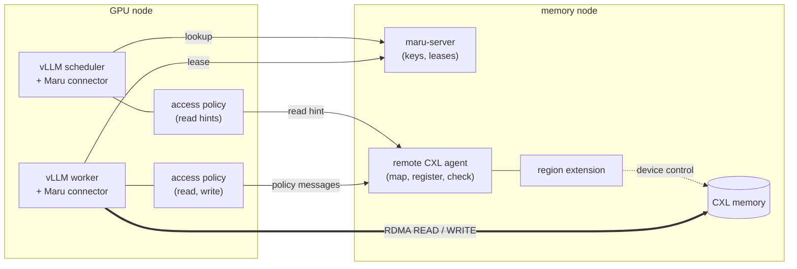
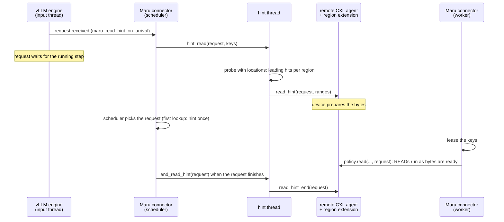

# Access Policies and Read Hints

Some CXL memory answers every address but not at the same speed: a device may
keep a small fast cache in front of larger, slower media, so bytes have to be
brought into the cache before a read and written back after a write. Maru keeps
no knowledge of such devices. The `remote_cxl` backend instead offers two
extension points that a separately installed package fills in, and a read hint
that tells that package early which bytes a load will read.

## Who owns what

- **Maru** decides which keys hit, which pages hold them, which bytes move and
  whether a key is published. It maps and registers regions on the memory node
  and checks every policy message against the regions it maps.
- **The access policy** (entry point group `maru.access_policies`, selected with
  `maru_access_policy`) runs in the engine's processes. In the worker it decides
  *when* each READ runs and whether a page may be written or reused. In the
  scheduler it only hears read hints.
- **The region extension** (entry point group `maru.region_extensions`, selected
  with `--region-extension` on the agent) is the policy's counterpart next to
  the memory. It receives the policy's messages after the agent checked them,
  and whatever it does to the device is its own business.

Installing a package selects nothing; only the configured names are loaded.
The hook contracts are documented in `maru_handler/storage/access_policy.py`,
`maru_handler/storage/remote_cxl/hints.py` and
`maru_remote_cxl_agent/extension.py`.

## Why read hints

A policy that is told about a read only when the worker starts it has no time
to prepare: the first bytes are not in the fast cache yet, and if the device
fills the cache about as fast as the network reads it, the READs follow the
fill chunk by chunk for the whole load.

The engine knows much earlier which keys a request will load. A request that
arrives while an engine step runs waits for that step to end before the
scheduler picks it, and the scheduler then admits the load before the worker
starts it. A read hint hands that knowledge to the policy at the earliest of
these points, so the device can fill while the request waits.

- **Where hints come from.** By default the scheduler connector hints a request
  the first time it finds an asynchronous load for it. With
  `maru_read_hint_on_arrival` it hints as soon as vLLM's engine receives the
  request, by wrapping `EngineCore.preprocess_add_request`; the first lookup
  then finds the request hinted. A request is hinted at most once, never after
  it finished, and its end follows its hint.
- **No waiting.** The caller only queues the hint. One thread per backend looks
  the keys up at maru-server (a probe that also returns where each hit is and a
  read handle of its region; it takes no lease) and calls the policy, in the
  order hints were given.
- **Advice only.** The agent accepts a hint for a region it maps even from a
  process that holds no region (the scheduler has no data path), but never as a
  write. A hint that is late, lost or wrong costs only the time it would have
  saved: the load still leases and reads every key, and the policy's `read`
  hook learns the request id it serves, so it can match the load with its hint.
- **Off without a policy.** Without an access policy that defines `read_hint`,
  no thread starts and no probe is sent.
