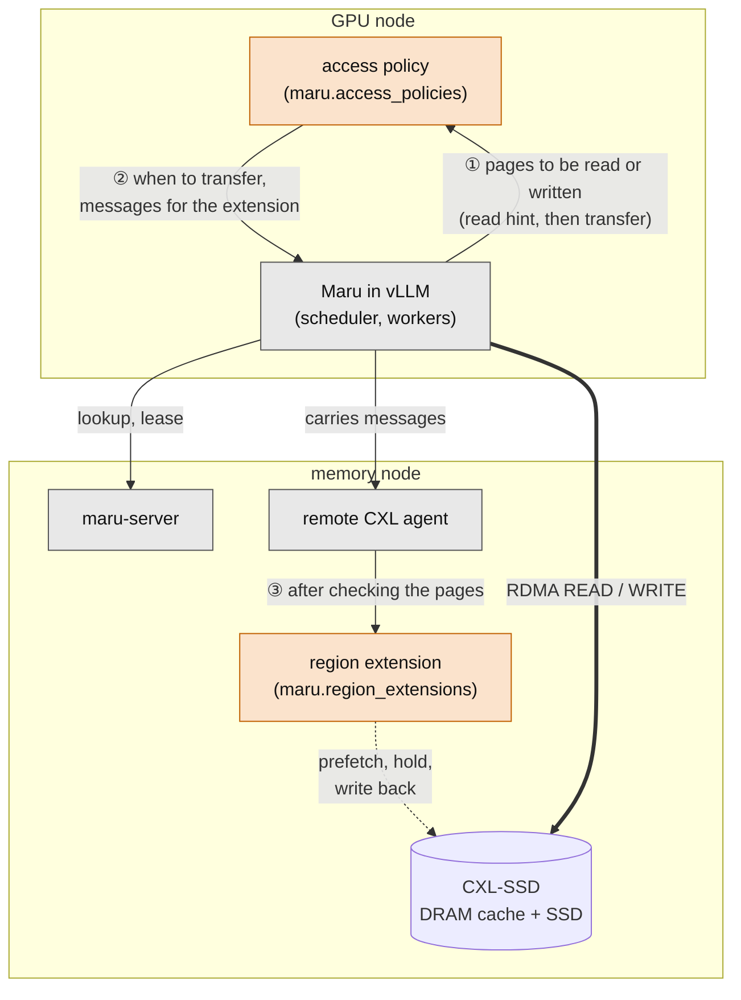
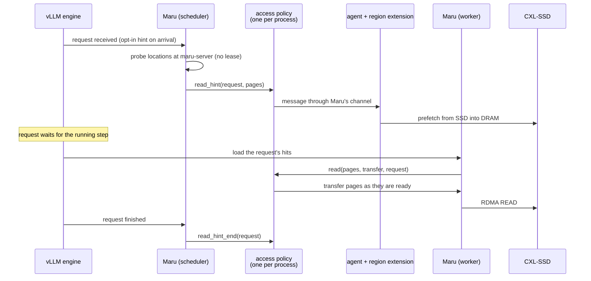

# Access Policies and Read Hints

Some CXL memory makes a page fast to reach only after the device has prepared
it. A CXL-SSD, for example, keeps a DRAM cache in front of an SSD: an RDMA READ
runs at DRAM speed only on a page already prefetched from the SSD into DRAM,
and an RDMA WRITE needs its page held in DRAM and written back to the SSD
before the page holds new data. Only software next to the device can prepare a
page, and it needs to know early which pages are coming.

Maru keeps no knowledge of such devices. The `remote_cxl` backend instead
offers two extension points that a separately installed package implements:

- an **access policy** on the GPU node, which decides when each RDMA transfer
  runs, and
- a **region extension** in the memory node's remote CXL agent, which drives
  the device.

A **read hint** tells the policy, before the load starts, which pages a
request will read, so the device can prefetch them while the request waits.

## Who owns what

Grey boxes are Maru; orange boxes are the installed package. Every message
between the package's two halves passes through Maru.

- **Maru** decides which keys hit, which pages hold them, which bytes move and
  whether a key is published. It maps and registers regions on the memory node
  and checks every policy message against the regions it maps.
- **① Maru → access policy.** Maru tells the policy which pages each transfer
  touches, and, with read hints, which pages a request will read before the
  load. The policy sees pages and regions, never keys. The scheduler and every
  worker build their own instance (entry point group `maru.access_policies`,
  selected with `maru_access_policy`).
- **② Access policy → Maru.** The policy decides when each transfer runs: it
  can delay a READ until its page is prefetched and a WRITE until its pages are
  held, but cannot skip or reorder a READ. It also decides when a page given
  back may hold new data. It sends messages to its counterpart through a
  channel; Maru carries them to the agent over an authenticated connection
  without reading their content.
- **③ Remote CXL agent → region extension.** The agent hands a message to the
  extension (entry point group `maru.region_extensions`, selected with
  `--region-extension`) only after checking that every page lies inside a
  region it maps, under that region's own capability, and that a read-only
  capability does not prepare a write. The extension may also refuse to map a
  region, and keep a region from going back while the device still works on it.

Installing a package selects nothing; only the configured names are loaded.
The hook contracts, locks and failure outcomes are documented in
`maru_handler/storage/access_policy.py`,
`maru_handler/storage/remote_cxl/hints.py` and
`maru_remote_cxl_agent/extension.py`.

## Why read hints

A policy that learns about a read only when the worker starts the load has no
time to prepare. If the device prefetches about as fast as the network reads,
the READs trail the prefetch page by page for the whole load.

The engine knows much earlier which pages a request will load. A request that
arrives while an engine step runs waits for that step to end before the
scheduler picks it, and the scheduler then admits the load before the worker
starts it. A read hint hands that knowledge to the policy at one of these
points, so the device can prefetch while the request waits.

- **Where hints come from.** By default the scheduler connector hints a request
  the first time it finds an asynchronous load for it. With
  `maru_read_hint_on_arrival` it hints as soon as vLLM's engine receives the
  request, by wrapping `EngineCore.preprocess_add_request`; the first lookup
  then finds the request hinted. A request is hinted at most once, never after
  it finished, and its end follows its hint. Hints need `maru_async_load`.
- **No waiting.** The caller only queues the hint. One thread per backend looks
  the keys up at maru-server (a probe that also returns where each remote hit
  is and a read handle of its region; it takes no lease) and calls the policy,
  in the order hints were given.
- **Advice only.** The agent accepts a hint from any connection for a region it
  maps and some connection holds (the scheduler holds none), but never as a
  write, so the extension must treat every hint as read-only. A hint that is
  late, lost or wrong costs only the time it would have saved: the load still
  leases and reads every key, and the policy's `read` hook is passed
  `request_id=`, so it can match the load with its hint.
- **Inexact by design.** A hint on arrival covers the leading hits from the
  first chunk, before vLLM's own prefix cache is consulted, so the load may
  read fewer chunks than the hint named. While 1024 hints wait, further hints
  are dropped with a warning; ends are never dropped. A process that dies
  sends no end, so a policy should also expire what it prepared.
- **Off without a policy.** Without an access policy that defines `read_hint`,
  no hint is sent, no probe runs and the scheduler keeps no hint state.

## Scope

The need is not specific to `remote_cxl`: a CXL-SSD attached to the GPU node's
own host has the same problem. `remote_cxl` comes first because there the GPU
node cannot reach the device software at all, and Maru's storage client itself
issues every RDMA transfer, so it can hold one back. On the local path the
engine's connector copies the bytes, and the handler plugins
(`maru.handler_plugins`) see a batch only after its lookup. Read hints are sent
only by the vLLM connector; LMCache and SGLang on `remote_cxl` get the policy's
timing but no hints.
