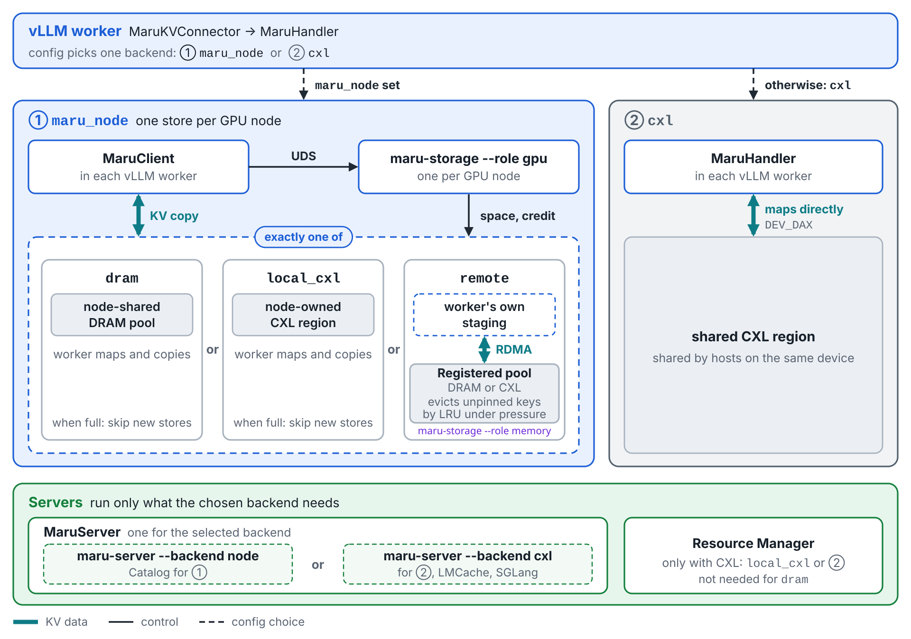
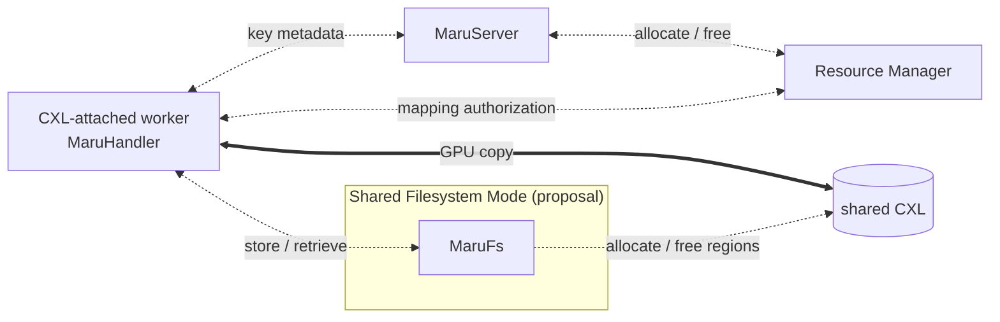
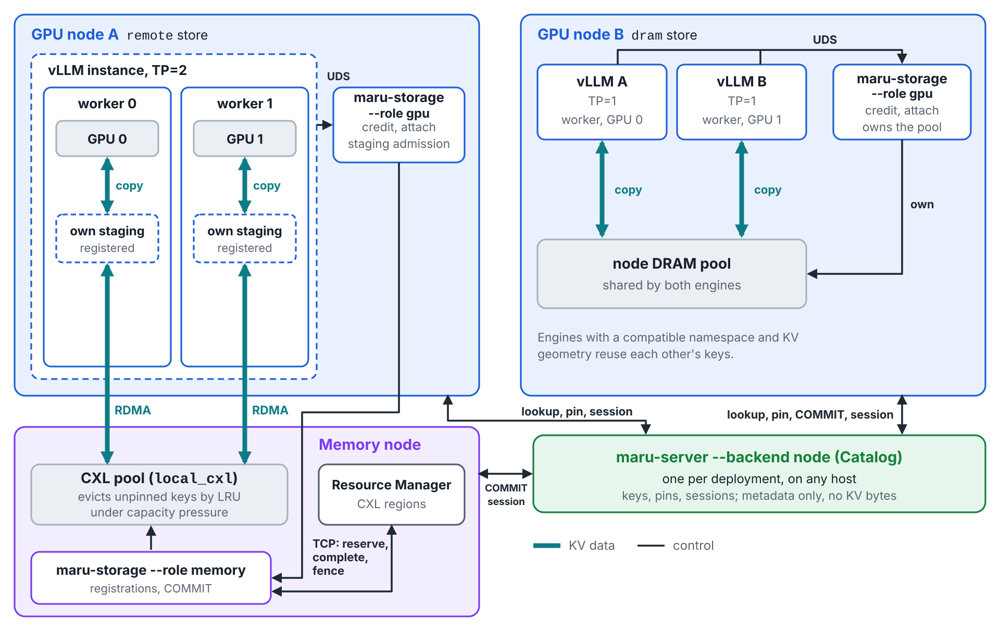

# Architecture Overview

**Maru** stores reusable KV cache in shared memory for LLM inference. The native vLLM connector supports the node backend (selected by `maru_node`). Each GPU node serves one store in DRAM, local CXL or remote memory. The directly mapped `cxl` backend also supports LMCache and SGLang.

| Backend | Storage and GPU access | Services |
|---|---|---|
| node, `dram` | Node-owned DRAM, mapped by local workers | MaruServer (`maru-server --backend node`) and GPU StorageService (`maru-storage --role gpu`) |
| node, `local_cxl` | Node-owned CXL, mapped by local workers | MaruServer, GPU StorageService and Resource Manager |
| node, `remote` | GPU ↔ worker staging ↔ RDMA ↔ memory-node DRAM or CXL | MaruServer, GPU StorageService and memory StorageService (`maru-storage --role memory`). Local CXL needs a Resource Manager on the memory host. |
| `cxl` | GPU ↔ directly mapped shared CXL | MaruServer (`maru-server --backend cxl`) and Resource Manager |

Each deployment uses one backend. Each MaruServer instance manages only its selected backend's key registry. Engines sharing KV use the same backend.

KV payloads bypass metadata services. Remote workers issue RDMA READ and WRITE directly through their own registered staging. Memory nodes own the remote pages and publish keys only after COMMIT. Reads do not create cached copies on GPU nodes.



Compatible engines reuse keys within the selected store and namespace. GPU-local stores skip new writes when full; memory nodes use a shared LRU. GPU copies and RDMA staging still move bytes. Node components use the same release, and their Catalog is separate from the `cxl` registry.

## Directly mapped CXL

With `cxl`, `MaruHandler` owns regions allocated through MaruServer and the Resource Manager. Workers map those regions and publish key locations after writing their payload. Other CXL-attached workers can map the same regions to retrieve keys.

| Component | Role |
|---|---|
| `MaruHandler` | Region mapping, page allocation and application API |
| MaruServer | Key registry and region allocation coordination |
| Resource Manager | Physical CXL regions, authorization, holds and allocation recovery |
| `maru_kv_ops` | GPU copies between stored objects and vLLM's paged KV cache |



The CXL pool can span hosts attached through a CXL switch. Host-cache visibility depends on the platform; see {doc}`consistency_and_safety` and {doc}`../getting_started/bios_setup`.

**Control-plane proposal.** The current shared-pool control plane uses MaruServer and MaruResourceManager. The proposed MaruFs design would replace their directly mapped `cxl` control path with filesystem operations. It is not a shipping backend or an RDMA transport; kernel-mediated permissions are a design goal, not a demonstrated security comparison with RPC.

| Layer | Role | Components |
|-------|------|------------|
| **Metadata** | Key registry, allocation lifecycle | MaruServer (Remote) / marufs (Filesystem) |
| **Memory** | Shared memory pool, capability issuance, crash recovery | MaruResourceManager (Remote) / marufs (Filesystem) |

## Node-owned stores

`maru-storage` owns one GPU-node store. Workers attach over its local socket and receive pool descriptors, page size, credit and transfer settings. The Catalog tracks published objects and source pins. A worker with `dram` or `local_cxl` maps the node pool; a worker with `remote` directly accesses memory-node pages through RDMA staging.



In this example the two workers of GPU node A each own registered staging, so its `staging_max_bytes` must be at least twice `staging_size`. The two engines on GPU node B share one DRAM pool. The vLLM scheduler only looks up metadata; workers move KV bytes. The per-request sequences are in {doc}`node_storage_service`.

`maru-storage --role memory` owns DRAM or local CXL pages and their read and write registrations. Write registration is per vLLM instance within a GPU-node run. The service revokes only that domain's registration before reclaiming its unconfirmed writes; source pins protect pages being read. Memory-node extension hooks provide advisory hints and memory-generation checks.

Node-local sharing is limited to workers that can map that node's pools. Remote sharing uses a common memory node, MaruServer and compatible namespace. A GPU service accepts one memory endpoint; memory nodes own separate regions.

See {doc}`node_storage_service` for data flows, configuration, capacity and lifetime rules of the GPU-node and memory-node services.

## Integrations

The native {doc}`vLLM connector <../integration/vllm>` selects the node or `cxl` backend. {doc}`LMCache <../integration/lmcache>` and {doc}`SGLang HiCache <../integration/sglang>` use the directly mapped CXL adapter. {doc}`Dynamo <../integration/dynamo>` uses its selected vLLM connector.

## Identity and trust

Keys name immutable payloads. The node namespace must identify the exact weights revision and compatible KV geometry. The MaruServer epoch, pool registration, pool generation and service run identify a location; a byte offset alone is insufficient.

Remote services mutually authenticate with a deployment key, and workers receive RDMA metadata from their GPU service. This is a trusted deployment: possession of memory registration metadata is not general tenant isolation. CXL access also depends on DAX permissions and Resource Manager authorization. Metadata heartbeat success does not establish payload availability or GPU-copy completion.

```{toctree}
:hidden:

Node StorageService <node_storage_service>
Maru Handler <maru_handler>
MaruServer <maru_server>
Maru Resource Manager <maru_resource_manager>
```
