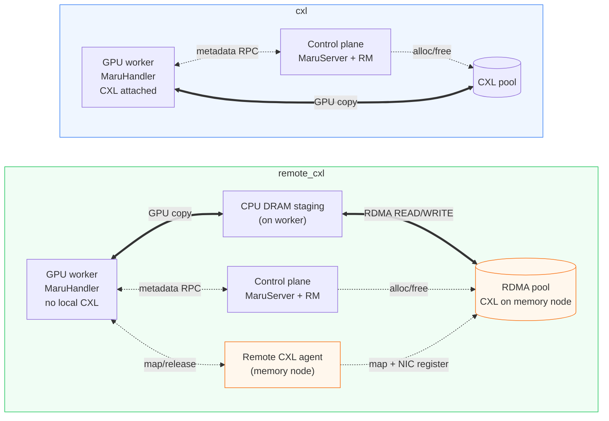
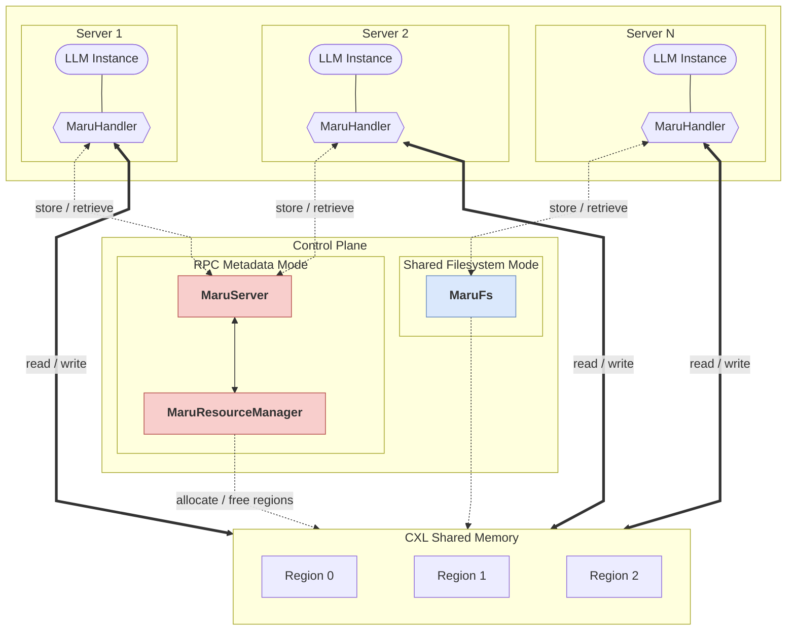
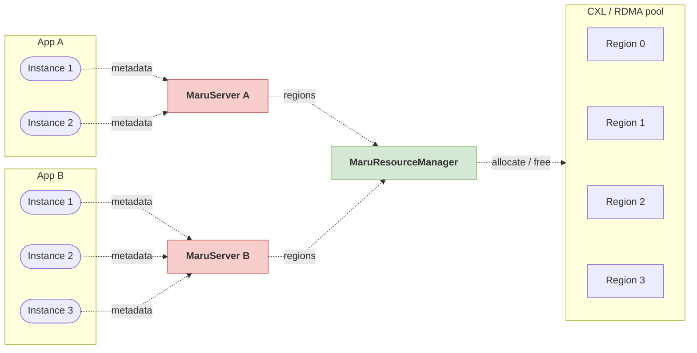
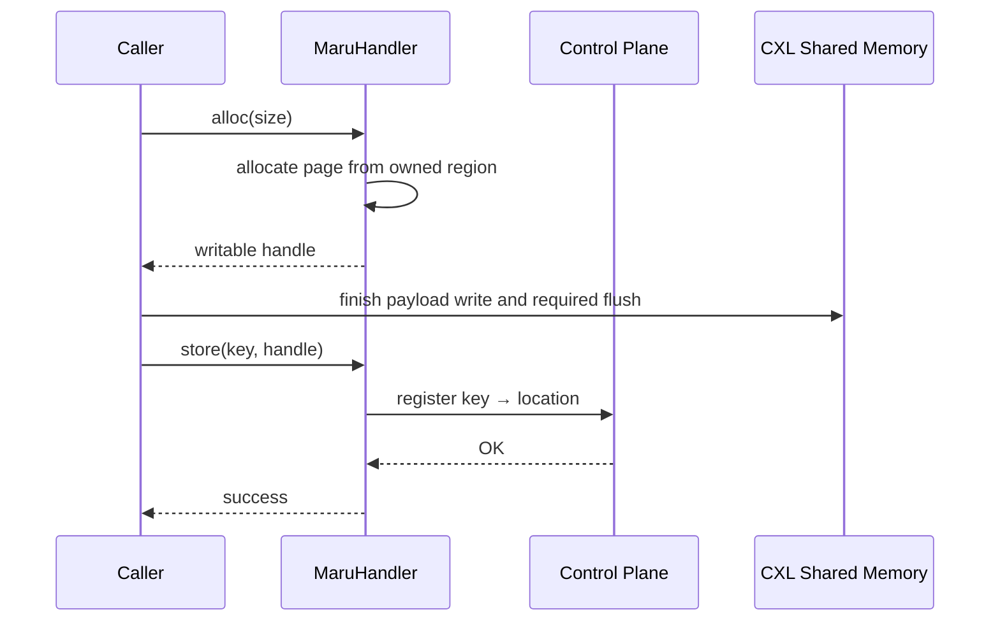
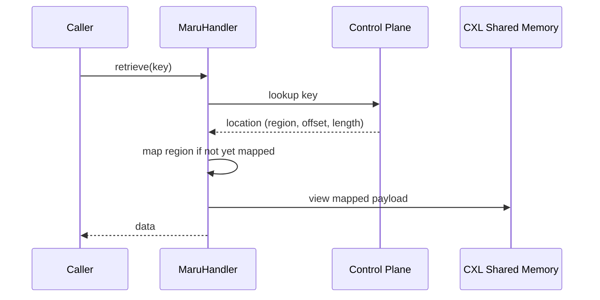
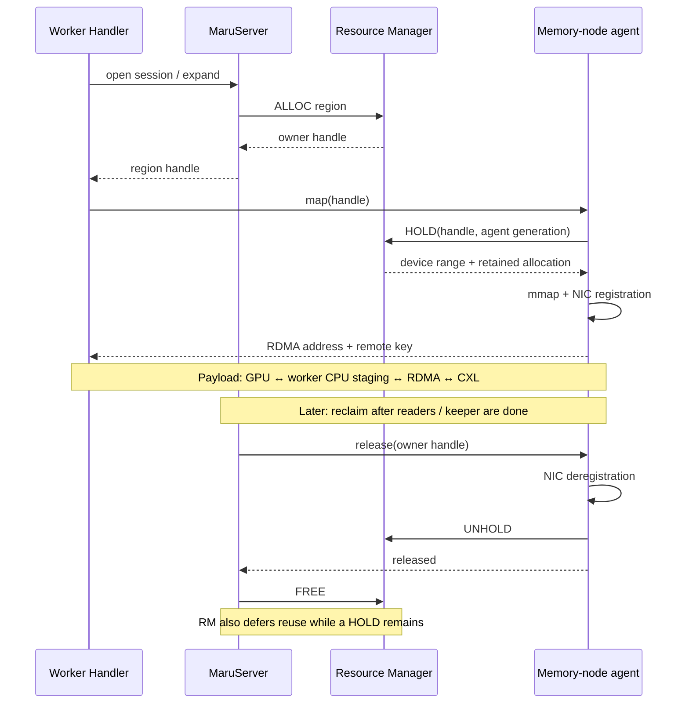
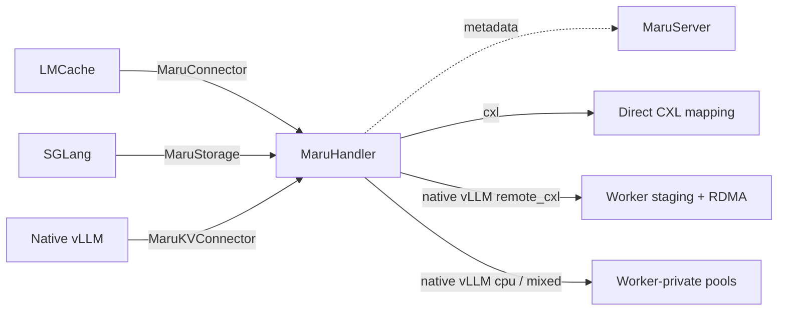

# Architecture Overview

Maru manages shared KV storage with two access paths. CXL-attached nodes map the pool directly with `cxl`, while nodes without CXL read and write a memory node's pool over RDMA with `remote_cxl`. GPU transfers copy bytes in both cases.

---

## System Architecture

The first diagram shows both access paths as separate example pools. Workers share KV within the same pool and backend. Each control-plane box groups metadata and allocation services; it is not one process or one physical node. RM means Resource Manager.



Thick solid arrows carry KV payloads; dotted arrows are control requests. The `remote_cxl` payload travels through worker CPU staging and the memory node's NIC, while the remote CXL agent handles mapping and registration. Neither payload path passes through MaruServer.

### cxl control plane alternatives

The following diagram details the directly mapped `cxl` backend and its RPC or proposed filesystem control plane. The filesystem proposal is not an alternative RDMA transport.



> **Control Plane** (dashed arrows) — KV metadata operations and region allocation.
>
> **Data Plane** (solid arrows) — direct access to mapped CXL memory with `cxl`. GPU transfers still copy bytes. The control plane alternatives in this diagram share that data path; `remote_cxl` uses a different payload path.

The system has three layers:

| Layer | Role | Components |
|-------|------|------------|
| **Client** | KV operations, page allocation, region mapping (with `remote_cxl`, the remote CXL agent on the memory node maps regions) | MaruHandler; remote CXL agent (`remote_cxl`) |
| **Metadata** | Key registry, allocation lifecycle | MaruServer (Remote) / marufs (Filesystem) |
| **Memory** | Shared memory pool, capability issuance, crash recovery | MaruResourceManager (Remote) / marufs (Filesystem) |

---

## Key Design Properties

**Payload bypasses the metadata server.** With `cxl`, a CPU reader can view a mapped KV object without an additional host copy. This avoids sending that payload between compute nodes over an RDMA or IP network, but CPU writes and GPU ↔ CXL transfers still move bytes. With `remote_cxl`, a worker copies KV between GPU memory and CPU DRAM staging, and its NIC transfers the bytes between staging and the memory node's CXL. MaruServer and the remote CXL agent do not relay the payload. Mapping, registration, metadata RPC, copies and transfer scheduling still consume time; the control/data plane split alone does not establish a latency, scaling or energy advantage.

**Per-application control plane.** Each application group runs its own metadata service per pool for isolation (e.g., app A with 2 instances, app B with 3 instances). A single Resource Manager manages that pool across all groups. The following diagram shows control requests for one pool, which can be a directly mapped CXL pool or an RDMA memory pool; it does not draw either payload path.



**Control-plane proposal.** The current shared-pool control plane uses MaruServer and MaruResourceManager. The proposed MaruFs design would replace their directly mapped `cxl` control path with filesystem operations. It is not a shipping backend or an RDMA transport; kernel-mediated permissions are a design goal, not a demonstrated security comparison with RPC.

**Region handles.** The Resource Manager issues handles for allocated regions. With `cxl`, the Handler checks a handle and opens the DAX device to map that region on its own node. With `remote_cxl`, the memory node's agent performs the mapping and NIC registration; the worker uses the returned RDMA access information. The worker therefore needs no local DAX device for that backend.

---

## Data Flow

These sequences describe the directly mapped `cxl` backend. The Remote CXL section below describes the additional staging, RDMA completion and lease lifetimes of `remote_cxl`.

### Store



The caller must finish the payload transfer and required visibility operations **before** registering the key. Readers then discover a completed object through the registry. This assumes the published payload remains immutable; metadata ordering does not finish an outstanding GPU copy or make non-coherent host caches coherent.

### Retrieve (cross-instance)



Every retrieve requires one metadata lookup via the control plane. Once a region is mapped, the mapping is cached for subsequent accesses to the same region — only the first access to a given region incurs the mmap cost.

---

## Remote CXL: CXL Memory of Other Nodes over RDMA

LLM instances on nodes without CXL use the `remote_cxl` storage backend: their
KV cache stays in the CXL memory of *memory nodes* and moves over RDMA. The
three layers and the resource flow stay as above: the Resource Manager gives
regions to MaruServer, and MaruServer gives them to each MaruHandler, one when
its storage session opens and one more whenever its regions are full. One step
moves: mapping a region. One-sided RDMA reaches only memory that a process on
the target node has mapped and registered with that node's NIC, and a node
without CXL cannot map the region itself. A **remote CXL agent** on every memory
node is that process: it maps the regions Handlers ask for and registers them
with the node's NIC (the job DaxMapper does inside a Handler on a CXL-attached
node), and returns each region's address and remote key. The Handler then reads and
writes a region with one-sided RDMA between its staging buffer and the region,
and the bytes go from NIC to NIC without passing through a process on the
memory node.

![The nodes of a remote_cxl deployment. GPU worker nodes without CXL, outside the pool, run vLLM with MaruKVConnector and MaruHandler (remote_cxl backend) and have a NIC. The metadata node runs maru-server, one per app per pool, which the Handler reaches with the storage session RPC for regions and keys. The memory nodes form the RDMA memory pool: one of them runs the resource-manager, which MaruServer asks to allocate and free regions, and every one runs a remote CXL agent. The agent's RegionMapService answers the Handler's map request with region R's address and remote key, checks R's handle with the resource manager, maps R from the CXL memory and registers it with the memory node's NIC. KV bytes go from the Handler through the worker's NIC to the memory node's NIC with one-sided RDMA READ and WRITE, and from there into region R.](../image/remote_cxl_overview.png)

The sequence below shows a remote region's first mapping and eventual reclamation.
Ordinary worker shutdown can transfer the region to MaruServer's keeper instead
of freeing it. A read or store reuses the mapping; it does not repeat this sequence.



How the properties above carry over:

- **Data path.** MaruServer and the memory-node agent do not relay payloads.
  The worker's connector copies between its GPU cache and CPU staging; the
  two NICs transfer between staging and CXL by RDMA. Packing and fallback
  paths can use additional temporary buffers. The remote CXL agent uses CPU when it maps a
  region and while a worker sets up its RDMA connection. It does not busy-poll
  while idle; periodic sweeps still progress UCX and check regions.
- **Capability-based access.** The remote CXL agent is the process that opens
  the DAX device on a memory node, and it checks a handle with the Resource
  Manager (`HOLD`, a `GET_ACCESS` that also keeps the region's range out of
  use until the agent lets go of it) before it maps a region. Who may ask it is bound as
  who may open a DAX device is: it listens on the node's RDMA network address,
  and every connection proves the remote CXL agent key, a file that only the
  users running workers and maru-server can read. A reader gets a read handle,
  which maps a region but cannot release it.

  
- **Region lifetime.** A region goes back to the Resource Manager only after
  its remote CXL agent has deregistered it from the NIC, so an RDMA WRITE of the old
  owner that is still in flight fails at the NIC instead of landing in the
  next owner's KV. When a worker leaves, MaruServer keeps its regions that hold
  keys, as it keeps a cxl Handler's regions while keys refer to them, and gives
  them back when the pool needs the space.

The {ref}`MaruHandler <maru-handler-remote-cxl>` and
{ref}`MaruServer <maru-server-remote-cxl>` designs describe the parts; the
[vLLM integration](../integration/vllm.md) guide shows how to run it.

---

## Extensibility

MaruHandler exposes string-keyed storage operations that framework adapters can
call. Backend support still belongs to each adapter: these LMCache and SGLang
guides use directly mapped `cxl`; the native vLLM connector also supports
`remote_cxl` and private `cpu`/`mixed` modes. A new adapter must honor the selected
backend's layout, completion and read-lease contract.



> **See also:** [LMCache](../integration/lmcache.md),
> [SGLang HiCache](../integration/sglang.md),
> [MaruHandler Design](maru_handler.md)

```{toctree}
:hidden:

Maru Handler <maru_handler>
Maru Server <maru_server>
Maru Resource Manager <maru_resource_manager>
Maru FS <maru_fs>
```
