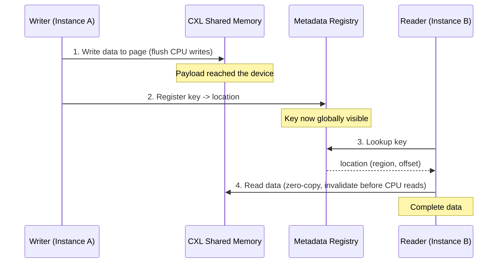
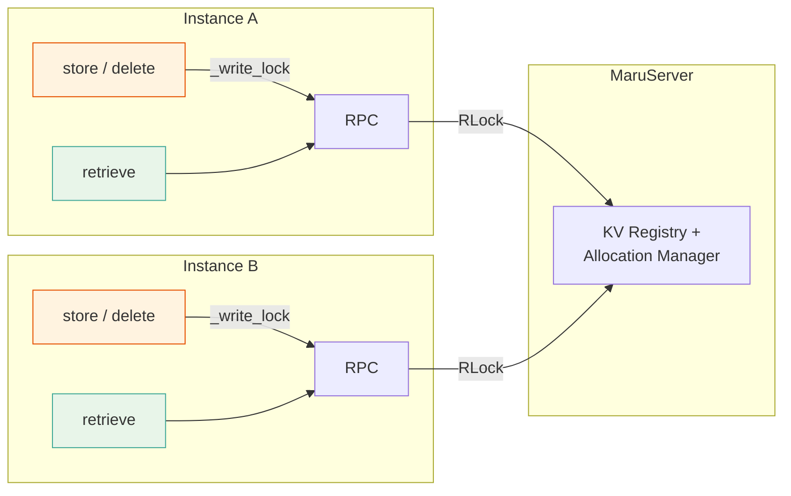
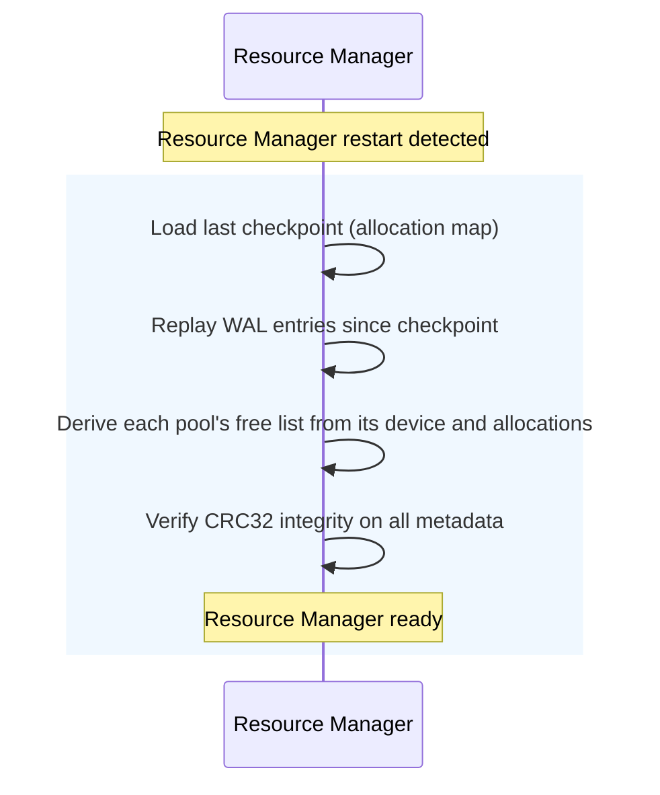

# Consistency and Safety

## 1. Data Visibility

The sequence and cache-flush steps below describe directly mapped `cxl`. Node remote workers fill their own staging and issue RDMA WRITE; the memory node publishes keys only after Catalog COMMIT. Staging writes alone do not publish data. See {doc}`node_storage_service` for node protections.

Maru publishes an object's location after the writer finishes writing its payload. Once `store()` returns successfully, other instances can look up that location through the metadata server.

This relies on **write-then-register** ordering. Every store completes these steps in sequence:

1. **Write** — the caller writes the payload into a page from `alloc()`, by CPU through `handle.buf` or by GPU DMA.
2. **Register** — `store()` records in the metadata registry that the key now maps to that page.

The caller must finish its write before calling `store()`. Publishing only after the write completes prevents readers from discovering an in-progress object through the registry, provided the written data is visible to the reader (see {ref}`cross-host-visibility`).

The visibility point is when `register_kv` RPC completes. The server holds the key in an in-memory registry protected by a lock, ensuring that concurrent lookups always see a fully committed entry or no entry at all.

(cross-host-visibility)=

### Cross-Host Visibility

The ordering above assumes that writes reach the shared memory device and readers cannot consume stale host-cache copies. On a non-coherent multi-host CXL platform, metadata ordering alone does not establish those conditions. See {doc}`../getting_started/bios_setup` for the platform settings that GPU DMA writes depend on.

On Intel GNR, the BIOS option `Allocating Write Flows` controls where device writes to CXL memory, such as GPU DMA writes, land. With the default `Allocating` policy, a write can stay in the writing host's cache, so other hosts read stale data. `Non-Allocating` stops these writes from allocating new lines in the host cache. It does not change lines the host already caches, for example after CPU access to the same memory, so CPU access still needs the explicit write-back and invalidation below.

CPU access to a shared payload can leave cached copies that other hosts do not invalidate, so CPU writers and readers must write back and invalidate explicitly. `flush_range` from `maru_shm._cxl_flush` does both: it runs `clflush` over each cache line of the buffer, then `mfence`.

1. **Writer:** write the payload to `handle.buf`, call `flush_range(handle.buf)`, then `store()`.
2. **Reader:** `retrieve()`, call `flush_range(result.view)` to drop local cached copies, then read `result.view`.

The {doc}`../getting_started/quick_start` producer and consumer follow this pattern. The CPU-based `examples/basic/producer.py` and `consumer.py` are single-host examples and do not flush.

For multi-node use, validate the deployed transfer path across repeated updates and memory reuse, including any CPU access performed by the runtime or driver.

Remote node processes default to `UCX_TLS=rc,dc,cuda_copy` and `UCX_RCACHE_ENABLE=n`. RC/DC checks remote registration keys. `cuda_copy` supplies local CUDA memory-type support; it does not carry the remote payload. Explicit settings must retain checked transports and disable registration caching so revocation fences late writes.

> **See also:** [MaruHandler Architecture](maru_handler.md)

---

## 2. Concurrency

The following lock diagram describes the legacy `cxl` Handler and registry. Node clients use Catalog pins and explicit staging ownership. Remote transfers can run outside the client lock while their resources remain owned until completion.

- **Client**: `_write_lock` serializes all writes (store, delete) within a single handler instance. Retrieval does not take that write lock, but can still wait on RPC, mapping and other synchronization.
- **Server**: A single `RLock` serializes all metadata mutations (register, delete, ref-count updates) across instances.

These two locks, combined with write-then-register ordering (Section 1), produce the following guarantees:

| Scenario | Behavior |
|----------|----------|
| Same-key store (cross-instance) | First registration wins; losing writer frees its page |
| Different-key store (cross-instance) | Payload writes can use independent pages; metadata updates remain serialized |
| Store within one instance | Serialized by client write lock |
| Store + retrieve (same key) | No partial read — key invisible until data committed |
| Concurrent retrieve | Can overlap, subject to RPC/mapping synchronization and the platform's visibility rules |

---

## 3. Crash Recovery

RM allocation metadata can be reconstructed from its checkpoint and WAL. Both the `cxl` registry and node Catalog are in memory. RM recovery does not restore lost keys or make CXL DRAM payloads durable. Cache availability after a failure depends on the component and backend.

### 3.1 Recovery Sequence

**Resource Manager** persists every allocation and free operation to a write-ahead log (WAL) before modifying in-memory state. Every 100 operations, a checkpoint is taken: the global allocation map of every pool, served or not, is saved with CRC32 integrity verification. On restart, the last checkpoint is loaded and any subsequent WAL entries are replayed, fully reconstructing the allocation state; each pool's free list is its device's data range minus its allocations. See the Resource Manager design document, §4, for how each device is then judged.

### 3.2 Client Crash Recovery

Process exit, session expiry and network loss are different events. The legacy `cxl` region owner tracked by the RM is usually MaruServer. The RM checks local owners by PID and start time and tracks remote owners through their connections and a grace period. A worker can still use its mapping after the owner loses the allocation. The RM keeps the range out of use while any mapping or NIC registration holds it (see {doc}`maru_resource_manager`, §5).

| Component | Detection | Reclamation |
|-----------|-----------|-------------|
| Resource Manager | Local liveness or remote disconnect/grace period | Ends allocation ownership; a held range remains draining until every NIC registration is confirmed gone and every process that maps it has unmapped it or ended |
| Legacy `cxl` registry | Owner disconnect and KV ref counts | Defers return while registered keys still reference the region |
| Node Catalog | Worker/run identity and source pins | Keeps orphan pins while old workers can still read |
| Memory node | Worker loss, uncertain write, lost connection or a silent GPU-node run | Revokes the instance's write registration within its GPU-node run before reclaiming that domain's pages; failed revocation quarantines them |

The reaper defends against PID reuse by caching each client's process start time at allocation time. If the PID is recycled by the OS, the start-time mismatch triggers reclamation.

> **See also:** [MaruResourceManager Architecture](maru_resource_manager.md), [MaruServer Architecture](maru_server.md)

---

## 4. Failure Modes

| Failure | Impact | Recovery boundary |
|---|---|---|
| Worker exit | Node-owned committed keys can remain; in-flight writes need fencing | Recompute unavailable keys; restart affected vLLM instances after confirming old worker exit |
| Metadata server restart | Volatile key metadata is lost | Node services and workers open new sessions; recompute and repopulate the cache |
| Resource Manager restart | Allocation operations pause while the ledger and holds are recovered | Restore allocation metadata and revalidate devices; this does not establish payload durability |
| Network partition or uncertain native transfer | Reads can miss and unknown NIC accesses can retain staging | Use recompute; recover a persistently affected worker by stopping its whole engine and confirming process exit |
| Memory-node reboot or device failure | Cached bytes can be lost or invalid | Invalidate affected regions and recompute; this implementation does not promise automatic cross-device replication |

See the {doc}`vLLM recovery procedure <../integration/vllm>` for persistent native errors and {doc}`memory_model` for source-pin, staging and RM-hold lifetimes. A successful metadata heartbeat is not a device read, a GPU-ready result or proof that a cache survived a restart.
