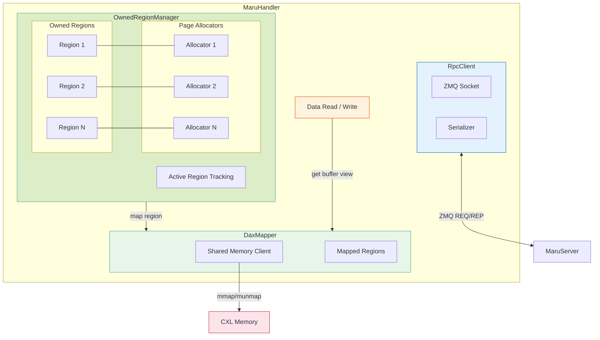
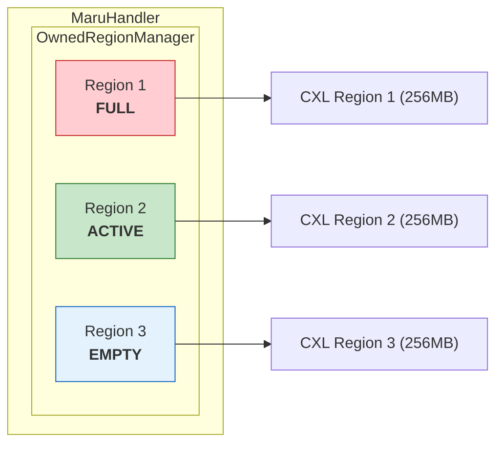
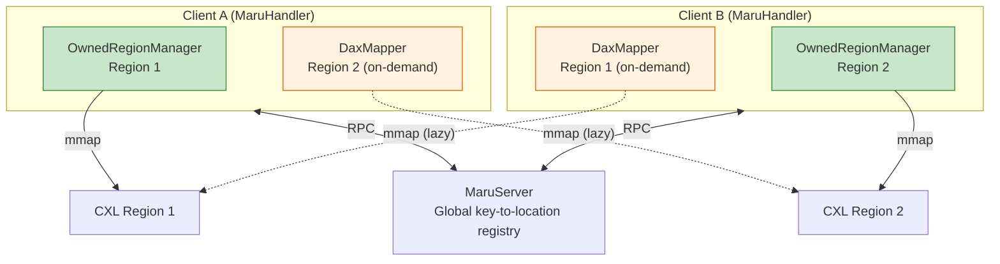
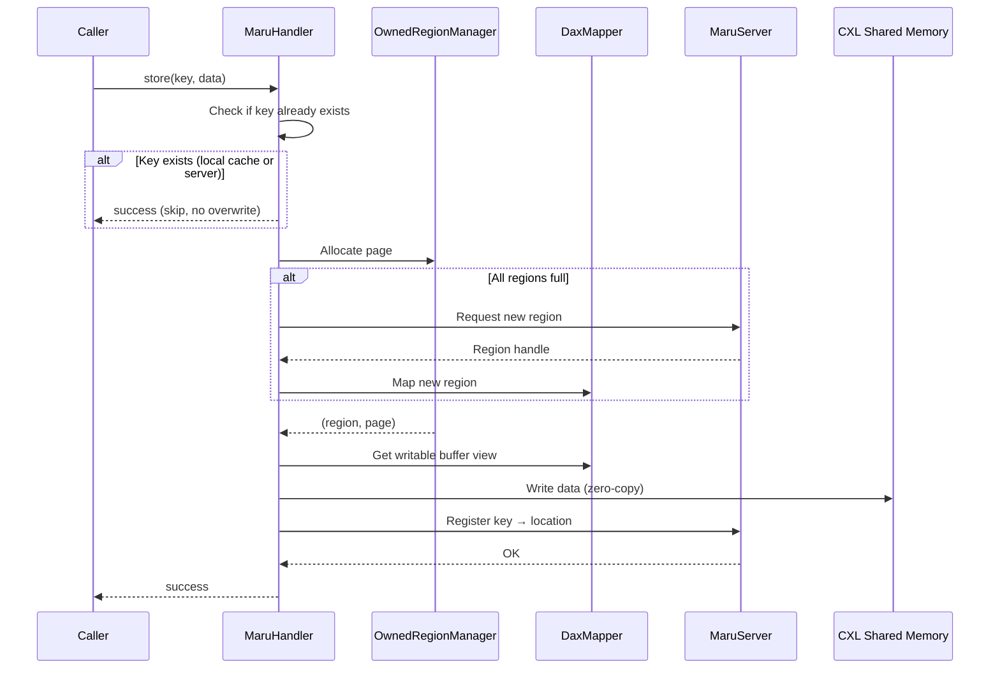
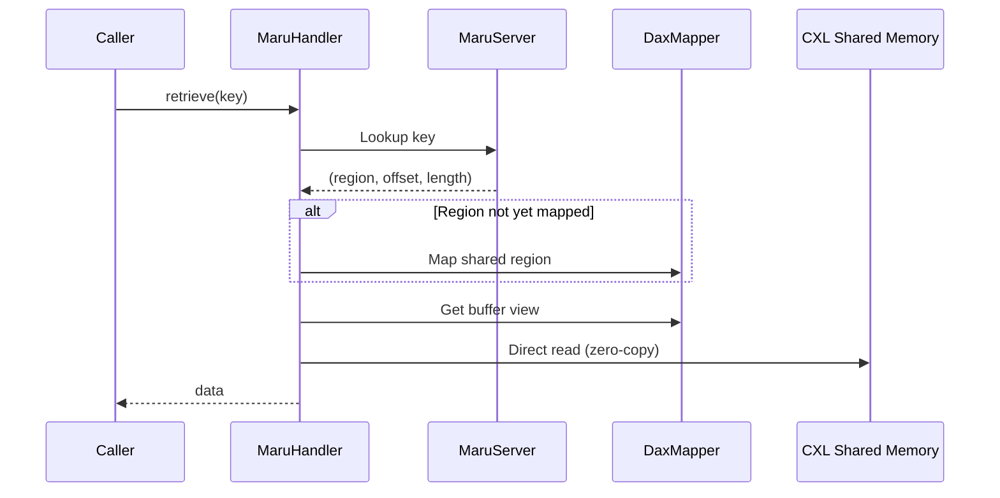
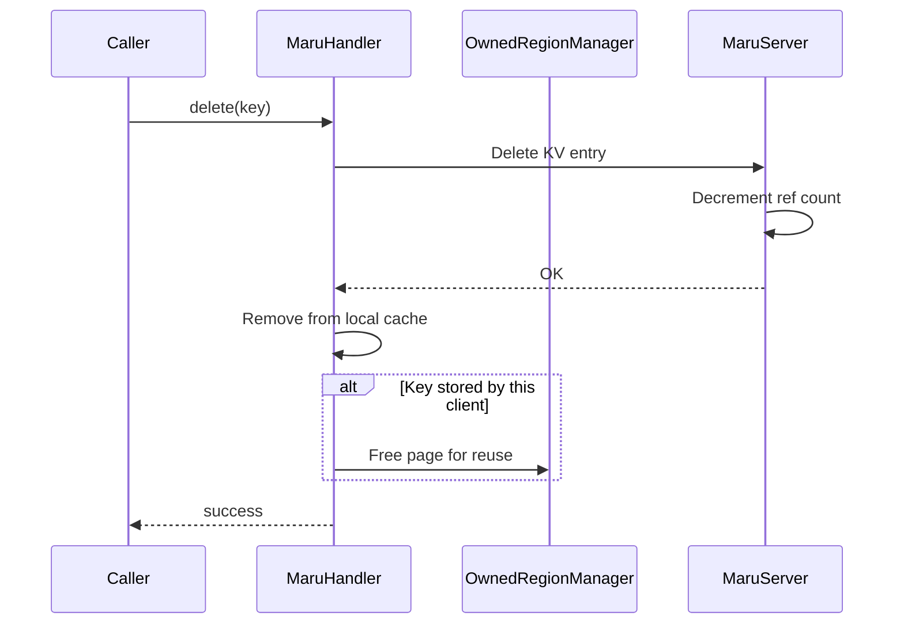
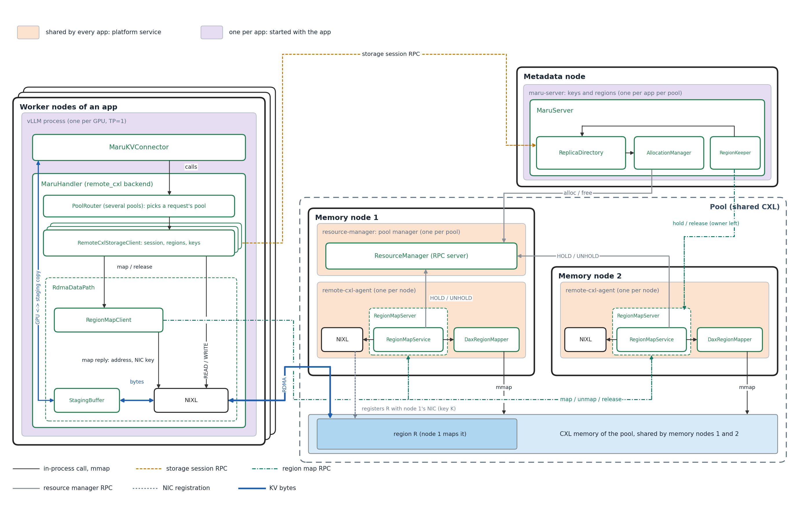
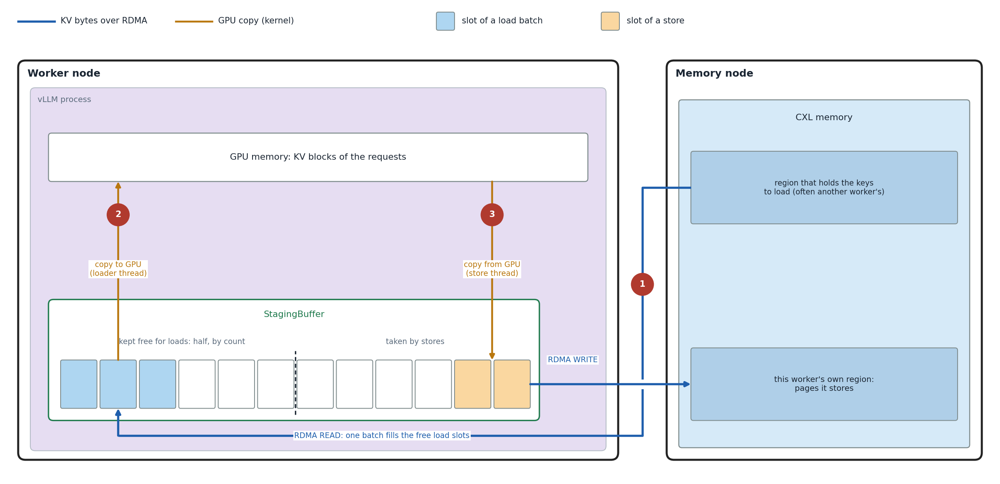

# MaruHandler Architecture

The `MaruHandler` is the client-side library that applications (e.g., LMCache/vLLM) use to interact with Maru. It serves two roles:

1. **KV cache client** — provides `store`/`retrieve`/`exists`/`delete` APIs.
2. **Memory manager** — owns CXL memory regions, manages paged allocation within them, and auto-expands when space runs out.

Data flows directly between the handler and CXL shared memory via memory-mapped regions — neither the MaruServer nor the resource manager is involved in the data path.

## 1. Component Hierarchy



**MaruHandler** orchestrates the overall data flow. It is the sole owner of `RpcClient` and coordinates region expansion, deallocation, shared region mapping, and data read/write.

**RpcClient** handles all communication with the MaruServer over ZeroMQ. It serializes requests using a binary header plus MessagePack payload, and supports both synchronous and asynchronous modes. The handler is the sole owner of the RPC client — no other component communicates with the server directly.

**DaxMapper** manages the mmap/munmap lifecycle of CXL regions. It creates mapped region objects that provide buffer views for direct memory access. It performs bulk unmap of all regions (both owned and shared) on `close()`.

**OwnedRegionManager** tracks the set of regions owned by this client. Each region is paired 1:1 with a page allocator that manages free pages. The manager exposes add, allocate, and free operations, and returns all region IDs on `close()` so the handler can release them back to the MaruServer.

---

## 2. Memory Management

Each CXL region is divided into fixed-size pages. A page allocator tracks free pages using a free-list, providing O(1) allocation and deallocation.

```
Region (e.g. 256 MB)
│
├── Page 0   ← KV Entry A
├── Page 1   ← KV Entry B
├── Page 2   ← (free)
├── Page 3   ← KV Entry C
├── ...
└── Page N-1
```

### Multi-Region Expansion

A single handler can own multiple CXL regions. When the active region runs out of free pages, the OwnedRegionManager scans other owned regions. If all are full, the handler requests a new region from the MaruServer.



The allocation strategy follows a fast-path pattern: try the active region first, scan other regions if it is full, and expand via RPC only as a last resort.

---

## 3. Owned vs Shared Regions

Each handler owns one or more regions for writing, and may map other clients' regions on demand for cross-instance retrieval.



Owned regions are mapped during connection or region expansion, and managed by OwnedRegionManager with a page allocator for each. Shared regions are mapped by DaxMapper on demand during retrieve, when the requested key resides in another client's region. On `close()`, owned regions are returned to the MaruServer, while all mapped regions (both owned and shared) are bulk-unmapped by DaxMapper.

---

## 4. Data Flows

### 4.1 Store



If the key already exists (in the local cache or on the server), the store is **skipped without overwrite** — same key implies same content (content-addressed). Otherwise, data is written to shared memory **before** the key is registered. Other instances can never observe a partial write — the key only becomes visible after the data is fully committed.

### 4.2 Retrieve



If the region is owned by this client, it is already mapped and can be used directly. If the region belongs to another client, DaxMapper maps it on demand. The region mapping is cached for subsequent accesses.

### 4.3 Delete



---

(maru-handler-remote-cxl)=
## 5. Remote CXL Backend

With `storage_backend="remote_cxl"` the Handler keeps its KV in the CXL memory
of memory nodes and moves it over RDMA. It gets regions the way a cxl Handler
does, but through a storage session: one region when the session opens and one
more (`expand`) whenever all of them are full. The region mapper on a region's
memory node maps the region and registers it with that node's NIC; the Handler
reaches the region with one-sided RDMA.



| Component | Role |
|-----------|------|
| `RemoteCxlStorageClient` | The storage session: regions, pages, stores, loads, eviction |
| `RdmaDataPath` | The worker's staging buffer, its NIXL agent and its connections to the region mappers |
| `RegionMapClient` | One connection to a region mapper: proves the region mapper key, then `map`, `unmap`, `release` |
| `StagingBuffer` | Host memory registered with the NIC and with CUDA; KV moves GPU ↔ staging by copy, staging ↔ region by RDMA |
| `PoolRouter` | Several pools (one MaruServer each): routes a request to one pool by its first chunk key |

**Store.** The Handler takes a staging slot and a free page of an own region,
the Connector copies the KV into the slot, and the Handler WRITEs it to the
page. It commits the key only after the WRITE completed. A WRITE whose end is
not confirmed keeps its page and slot out of use until NIXL releases the
transfer, and the page of a WRITE that ended in an error stays out of use
while the Handler owns the region (that WRITE may still be in the network,
and the memory node's NIC still accepts the region's key), so a late WRITE
never lands on reused memory.

**Retrieve.** The Handler takes a server lease on the keys (`acquire`), which
returns each key's location and, for another worker's region, a *read handle*.
It maps that region at its region mapper on first use, READs the pages into
staging slots, and ends the lease (`release`). It uses the bytes only if the
lease was held to the end. A location longer than a staging slot, or past the
end of its region, loads as a miss without a READ. A `release` whose reply is
lost is sent again by the heartbeat thread, so the lease does not keep the
owner from evicting the key.

**Eviction.** When its regions are full and the Resource Manager has no room,
the Handler asks MaruServer for its least recently used unleased keys
(`victims`) and removes them. A page is reused only after MaruServer
confirmed that no key refers to it.

**A memory node that stops answering.** A region whose region mapper cannot
map it is set aside, and a background retry maps it again. If the retry
succeeds within 30 seconds (a region mapper restart), the region is used
again with its keys; otherwise its keys are removed, so probes stop reporting
hits that would fail to read, as MaruServer does for a region it took over.
A region mapper that left a request unanswered stays so until a later request
to it (a map, or the heartbeat's boot check every 10 seconds) is answered.
Until then stores take no pages in its regions, eviction picks no keys there
and no new region is asked for; with no other region the store is skipped,
since no WRITE could reach the freed pages. When the memory node answers again, the Handler maps its regions anew.
Before it loads a map reply into a NIXL peer (NIXL's record of a remote agent:
its metadata and its UCX connection) that it already knows, it checks that
the connection has not failed and otherwise drops the peer and connects anew.
UCX fails an unanswered connection on its own, even an idle one, and NIXL
1.2.0 keeps the closed connection in the peer, so loading into it would crash
the process:


**Giving regions back.** A region goes back to the Resource Manager only after
its region mapper deregistered it from the NIC (`release`):


- A region the Handler gives back while it runs (for example a new region
  whose memory node it cannot reach) is released first, then returned with
  `return_region`.
- A region whose memory node rebooted (its region mapper reports a new boot
  id) goes back the same way at once, since bytes that sat in the node's CPU
  cache may be lost. MaruServer then stops finding its keys and ends the
  leases on them, so a reader holding one drops what it read; the next store
  gets a new region.
- When the Handler leaves (it closes, or its session expired), it waits for
  its WRITEs, closes the session drained and drops its holds at the region
  mappers. MaruServer takes its regions over: it keeps those that hold keys,
  so other workers and the restarted worker keep reading them, and releases
  the others before it frees them.
- If MaruServer restarted, nobody takes the regions over, so the Handler
  releases them itself.

**Staging slots.** Loads and stores share the staging buffer. With
asynchronous transfers, stores leave a share of the slots free for loads:



> **See also:** [Architecture Overview](architecture_overview.md),
> [Memory Model](memory_model.md),
> [KV Cache Management](kv_cache_management.md),
> [Consistency and Safety](consistency_and_safety.md)
