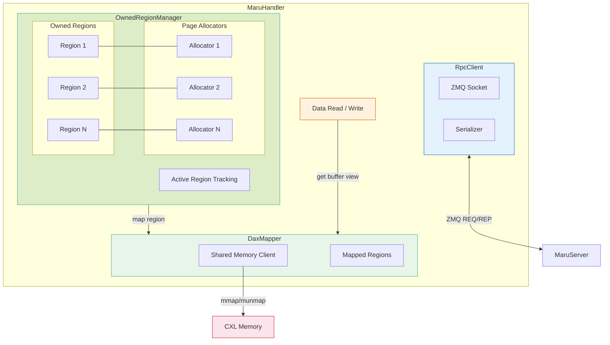
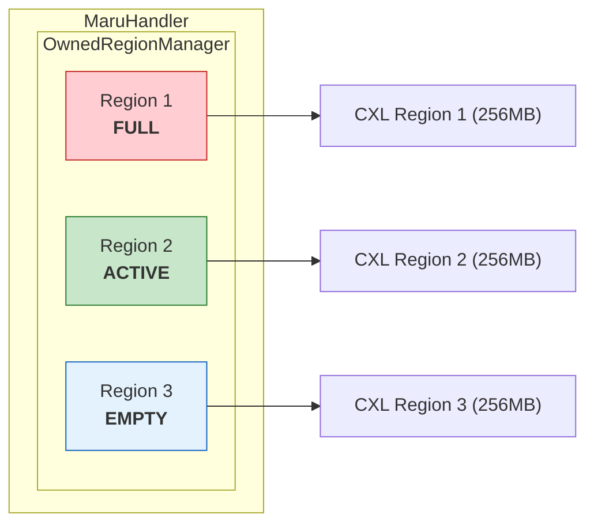
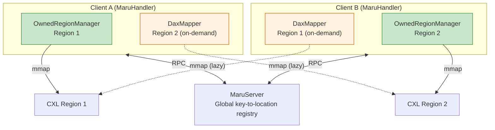
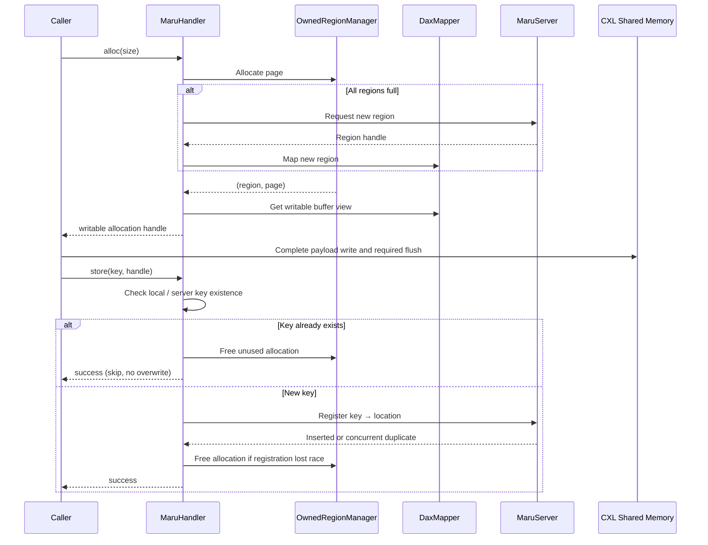
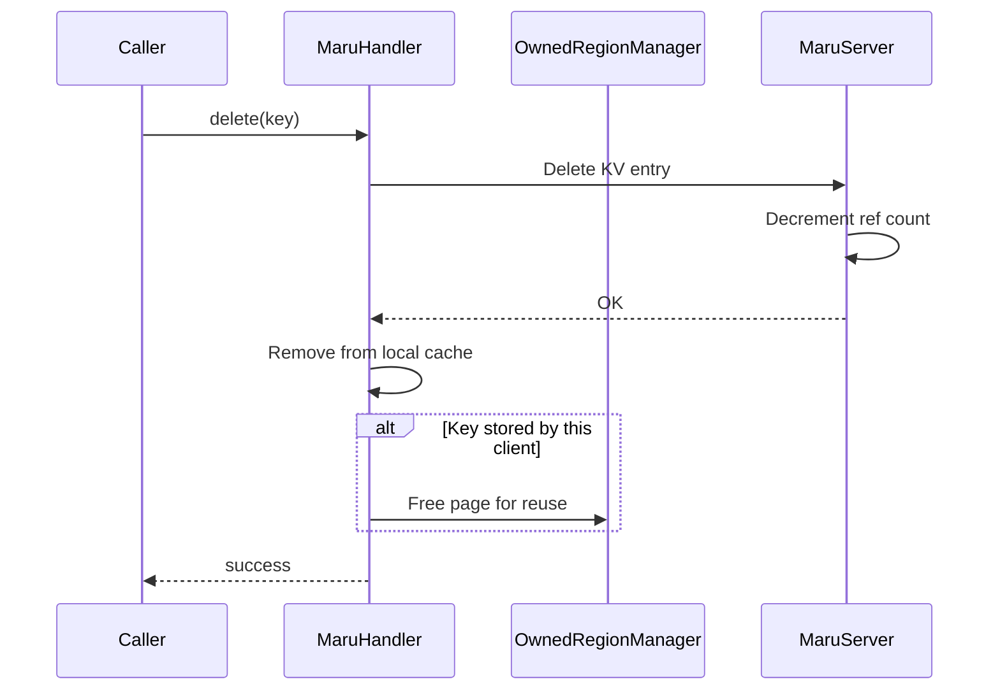

# MaruHandler Architecture

The `MaruHandler` is the client-side library that applications (e.g., LMCache/vLLM) use to interact with Maru. It serves two roles:

1. **KV cache client** — provides `store`/`retrieve`/`exists`/`delete` APIs.
2. **Memory manager** — owns CXL memory regions, manages paged allocation within them, and auto-expands when space runs out.

With the `cxl` backend, the Handler accesses memory-mapped CXL regions. With `remote_cxl`, it moves KV between worker-side CPU staging and memory-node CXL over RDMA. Neither path relays payload bytes through MaruServer or the Resource Manager. Sections 1–4 below describe `cxl`; section 5 describes the additional components and buffer lifetimes of `remote_cxl`.

## 1. Component Hierarchy



**MaruHandler** orchestrates the overall data flow. It is the sole owner of `RpcClient` and coordinates region expansion, deallocation, shared region mapping, and data read/write.

**RpcClient** handles all communication with the MaruServer over ZeroMQ. It serializes requests using a binary header plus MessagePack payload, and supports both synchronous and asynchronous modes. The handler is the sole owner of the RPC client — no other component communicates with the server directly.

**DaxMapper** manages the mmap/munmap lifecycle of CXL regions. It creates mapped region objects that provide buffer views for direct memory access. It performs bulk unmap of all regions (both owned and shared) on `close()`.

**OwnedRegionManager** tracks the set of regions owned by this client. Each region is paired 1:1 with a page allocator that manages free pages. The manager exposes add, allocate, and free operations, and returns all region IDs on `close()` so the handler can release them back to the MaruServer.

---

## 2. Memory Management

Each CXL region is divided into fixed-size pages. A page allocator tracks free pages using a free-list, providing O(1) allocation and deallocation.

```
Region (e.g. 256 MB)
│
├── Page 0   ← KV Entry A
├── Page 1   ← KV Entry B
├── Page 2   ← (free)
├── Page 3   ← KV Entry C
├── ...
└── Page N-1
```

### Multi-Region Expansion

A single handler can own multiple CXL regions. When the active region runs out of free pages, the OwnedRegionManager scans other owned regions. If all are full, the handler requests a new region from the MaruServer.



The allocation strategy follows a fast-path pattern: try the active region first, scan other regions if it is full, and expand via RPC only as a last resort.

---

## 3. Owned vs Shared Regions

Each handler owns one or more regions for writing, and may map other clients' regions on demand for cross-instance retrieval.



Owned regions are mapped during connection or region expansion, and managed by OwnedRegionManager with a page allocator for each. Shared regions are mapped by DaxMapper on demand during retrieve, when the requested key resides in another client's region. On `close()`, owned regions are returned to the MaruServer, while all mapped regions (both owned and shared) are bulk-unmapped by DaxMapper.

---

## 4. Data Flows

### 4.1 Store



The caller allocates and finishes the payload write before calling
`store(key, handle)`. If the key already exists, registration is skipped and
the unused page is freed. Callers must make equal keys mean equal immutable
content; Maru treats keys as opaque strings. Readers discover a completed
payload only if the caller completed its transfer and the platform's required
visibility operations before registration. Store does not finish a pending
GPU copy or flush non-coherent CPU cache lines on the caller's behalf.

### 4.2 Retrieve


If the region is owned by this client, it is already mapped and can be used directly. If the region belongs to another client, DaxMapper maps it on demand. The region mapping is cached for subsequent accesses.

### 4.3 Delete



---

(maru-handler-remote-cxl)=
## 5. Remote CXL Backend

With `storage_backend="remote_cxl"` the Handler keeps its KV in the CXL memory
of memory nodes and moves it over RDMA. It gets regions the way a cxl Handler
does, but through a storage session: one region when the session opens and one
more (`expand`) whenever all of them are full. The remote CXL agent on a region's
memory node maps the region and registers it with that node's NIC; the Handler
reaches the region with one-sided RDMA.

![Components of the remote_cxl backend. Worker nodes: MaruKVConnector calls MaruHandler, whose PoolRouter (with several pools) picks a request's pool and hands it to that pool's RemoteCxlStorageClient; all clients share one RdmaDataPath (RegionMapClient, StagingBuffer, NIXL). Metadata node: MaruServer with ReplicaDirectory (storage sessions), AllocationManager (resource manager requests) and RegionKeeper. Memory nodes of a shared CXL pool: the resource manager, and on every node a remote CXL agent whose RegionMapServer takes connections for RegionMapService, which holds the region at the resource manager (HOLD, checking its handle; UNHOLD after deregistering), maps it with DaxRegionMapper and registers it with NIXL](../image/remote_cxl_sw_structure.png)

| Component | Role |
|-----------|------|
| `RemoteCxlStorageClient` | The storage session: regions, pages, stores, loads, eviction |
| `RdmaDataPath` | The worker's staging buffer, its NIXL agent and its connections to the remote CXL agents |
| `RegionMapClient` | One connection to a remote CXL agent: proves the remote CXL agent key, then `map`, `unmap`, `release` |
| `StagingBuffer` | Worker host memory registered with the NIC; CUDA registration is best effort. KV moves GPU ↔ staging by copy, staging ↔ region by RDMA |
| `PoolRouter` | Several pools (one MaruServer each): routes a request to one pool by its first chunk key |

**Store.** The Handler takes a staging slot and a free page of an own region,
the Connector copies the KV into the slot, and the Handler WRITEs it to the
page. On vLLM's engine thread the alloc takes only the slot, and the store
gives the page when it starts, on the thread that sends it. It commits the
key only after the WRITE completed. A WRITE whose end is not confirmed keeps its page and slot out of use until NIXL releases the
transfer, and the page of a WRITE that ended in an error stays out of use
while the Handler owns the region (that WRITE may still be in the network,
and the memory node's NIC still accepts the region's key), so a late WRITE
never lands on reused memory.

**Retrieve.** The Handler takes a server lease on the keys (`acquire`), which
returns each key's location and, for another worker's region, a *read handle*.
It maps that region at its remote CXL agent on first use, READs the pages into
staging slots, and ends the lease (`release`). It uses the bytes only if the
lease was held to the end. A location longer than a staging slot, or past the
end of its region, loads as a miss without a READ. A `release` whose reply is
lost is sent again by the heartbeat thread, so the lease does not keep the
owner from evicting the key.

**Eviction.** When its regions are full and the Resource Manager has no room,
or another worker is waiting for its first region, the Handler asks MaruServer for its least recently used unleased keys
(`victims`) and removes them. A page is reused only after MaruServer
confirmed that no key refers to it.

**A memory node that stops answering.** A region whose remote CXL agent cannot
map it is set aside, and a background retry maps it again. If the retry
succeeds within 30 seconds (a remote CXL agent restart), the region is used
again with its keys; otherwise its keys are removed, so probes stop reporting
hits that would fail to read, as MaruServer does for a region it took over.
A remote CXL agent that left a request unanswered stays so until a later request
to it (a map, or the heartbeat's boot check every 10 seconds) is answered.
Until then stores take no pages in its regions, eviction picks no keys there
and no new region is asked for; with no other region the store is skipped,
since no WRITE could reach the freed pages. When the memory node answers again, the Handler maps its regions anew.
Before it loads a map reply into a NIXL peer (NIXL's record of a remote agent:
its metadata and its UCX connection) that it already knows, it checks that
the connection has not failed and otherwise drops the peer and connects anew.
UCX fails an unanswered connection on its own, even an idle one, and NIXL
1.2.0 keeps the closed connection in the peer, so loading into it would crash
the process:


Adding a region's metadata also waits for all existing transfers to that peer
to release their handles. NIXL 1.2.0 can discard the peer's whole metadata
when an update fails, making an ongoing transfer report an error before its
DMA ends. The pending-handle check and metadata update hold the same lock as
transfer creation; while waiting, the lock is released so transfers continue
to progress. Transfers to another known peer do not delay the update. A new
peer whose name is not known yet waits for all existing handles. If the wait
exceeds the RDMA timeout, the map fails safely without loading metadata.
The data path remembers a peer as soon as metadata is introduced, even if
the connection probe fails. A retry checks that peer and drops a failed
endpoint before loading metadata again; it marks the connection ready only
after the probe succeeds.

**A memory node that rebooted.** The owner reports the node's boot id when it
first maps a region. An acquire reply includes that recorded id in
`region_boots`, separately from the region handles. Before reading a leased
region, the reader compares the recorded boot with the boot in its map reply.
An unknown or different boot makes the batch a miss and releases its lease
and staging slots. This also covers the interval after the owner or keeper
has registered a region again but has not yet retired its old keys. A new
agent process on the same boot preserves cache reuse. A reader talking to a
server that does not provide the recorded boot treats those entries as misses.

**Giving regions back.** A region goes back to the Resource Manager only after
its remote CXL agent deregistered it from the NIC (`release`):

The agent replaces the released virtual-address range with an inaccessible
anonymous reservation and keeps it until its process exits. A timer is
insufficient: a worker paused just before posting a WRITE may resume after
any deadline, and the NIC can reuse a key if a new region uses the old
address. Keeping every released address unused prevents that alias. These
reservations use virtual address space and kernel mapping records without
retaining CXL capacity or populated data pages. If the process runs out of
address space or mapping records, a new map fails safely; capacity planning
must allow for region churn and a controlled agent restart. Service cleanup
does not remove the reservations early; the OS reclaims them at process exit,
after that process's NIC connections end.


- A region the Handler gives back while it runs (for example a new region
  whose memory node it cannot reach) is released first, then returned with
  `return_region`.
- A region whose memory node rebooted (its remote CXL agent reports a new boot
  id) goes back the same way at once, since bytes that sat in the node's CPU
  cache may be lost. MaruServer then stops finding its keys and ends the
  leases on them, so a reader holding one drops what it read; the next store
  gets a new region.
- When the Handler leaves (it closes, or its session expired), it waits for
  its WRITEs, closes the session drained and drops its holds at the remote CXL
  agents. MaruServer takes its regions over: it keeps those that hold keys,
  so other workers and the restarted worker keep reading them, and releases
  the others before it frees them.
- If MaruServer restarted, nobody takes the regions over, so the Handler
  releases them itself.

**Regions the Resource Manager reclaims on its own.** When maru-server dies
or loses its Resource Manager connection, the Resource Manager reclaims its
regions after a grace period without asking the remote CXL agent. The remote
CXL agent holds every region it registers (`HOLD`), so the Resource Manager
keeps a reclaimed region's range out of use while the agent still registers
it. Once a second the agent asks about all its mappings, releases the
reclaimed ones and unholds them; only then can the range go to a new region,
whichever memory node maps it or whether a cxl Handler on the memory node
uses it. A late WRITE through the old registration fails at the NIC:

![A shared pool: worker A kept region R's address and NIC key at agent X on memory node 1 when R's maru-server died; worker B gets region R2 on the same range through agent Y on memory node 2 and stores NEW! in page p; then A sends a late WRITE through R's old registration at X. (a) Without a hold, the Resource Manager hands R's range to R2 at once and the late WRITE overwrites page p, so B reads LATE. (b) With a hold, the range waits until X has released R and sent the unhold; the late WRITE fails at node 1's NIC and B reads NEW!](../image/remote_cxl_rm_hold.png)

The agent also checks, before it registers a region, every region it holds
on an overlapping range, and releases those the Resource Manager no longer
knows (for example after `maru-rm-ctl discard`); it refuses the map if it
cannot ask.

**Staging slots.** Loads and stores share the staging buffer. With
asynchronous transfers (the default on this backend), stores leave a share of
the slots free for loads. The loader thread reads 8 chunks at a time and
reads the next batch while the previous batch's GPU copies run; a batch's
slots go back once its copies have ended. A store takes only a slot on vLLM's
engine thread; the write-behind thread gives each chunk its page and WRITEs
it:


For remote CXL write-behind stores, a request skips full chunks that it has
successfully loaded from the pool. The loader records them only after every
READ and GPU copy completed; the resumed store filters them before gathering
GPU bytes or allocating staging slots. A failed or partially failed load
leaves its chunks eligible for recompute and storage. Partly loaded boundary
chunks remain eligible too. Chunked-prefill stores still collect the chunks
computed in earlier steps when the prompt completes.

This is a per-request admission decision, not a permanent record that a key
exists: the record ends at finish, preemption or abort. A key evicted after
the successful load may stay absent for the rest of that request, but its
already loaded GPU bytes remain valid. The next request probes the pool
again and can recompute and store a miss. Other storage backends retain their
existing store policy.

**CPU use.** The worker uses a small adapter over NIXL's public native API.
It enables the UCX progress thread with `pthrDelay=1000` microseconds: after
progressing and arming the workers, the thread waits for their event file
descriptors, with a 1 ms periodic fallback. This is an event wait, so a ready
event can wake it earlier; it does not add a fixed sleep to each transfer.
Transfer status queries still progress UCX on the posting thread. The memory
node's remote CXL agent retains progress OFF. The remote CXL agent
issues no transfers, and the bytes of an established connection need no CPU
on the memory node; its side has work when a worker connects. A map request
names the worker's NIXL agent, and the remote CXL agent drives UCX from the
map until that agent announces itself with an empty notification over the
connection, and once on every hello, map and once-a-second sweep. The worker
completes a new connection at the map with a small READ from the region, so
no later transfer waits for the connection setup. An idle remote CXL agent
does not busy-poll UCX.


The two rows are threads of the same worker. A ready event can wake the
native thread before its timeout; 1 ms is the configured fallback, not an
OS scheduling deadline. [Editable diagram](../image/remote_cxl_progress.mmd).

The adapter imports NIXL lazily and requires NIXL `>=1.2.0,<2`, its public
native APIs and a matching CUDA wheel. Python call contracts have been
checked against `1.2.0` and `1.5.0`; newer versions retain capability checks.
Missing public native exports, incompatible versions and mismatched wheel
versions raise `ImportError`. It only accepts Maru's DRAM tuple descriptors
and preserves their order. Full and partial metadata remain native bytes.
No Python NIXL agent is created and replaced, and no vendor private fields
or global monkeypatches are used.

Native transfer handles retain their native agent and have no destructor,
automatic cancellation or free. `NixlTransport` remains responsible for
their explicit release. Native query/post/release exceptions propagate as
they do through the installed Python wrapper, retaining unknown transfers
and their memory. An unexpected raw status other than SUCCESS or IN_PROG is
also an exception, rather than a synthetic terminal ERR that could free a
live handle. An event timeout does not prove completion or change the
existing metadata, read-lease, staging or RM-hold lifetime rules. The idle
CPU and end-to-end latency of this adapter require device validation.

> **See also:** [Architecture Overview](architecture_overview.md),
> [Memory Model](memory_model.md),
> [KV Cache Management](kv_cache_management.md),
> [Consistency and Safety](consistency_and_safety.md)
