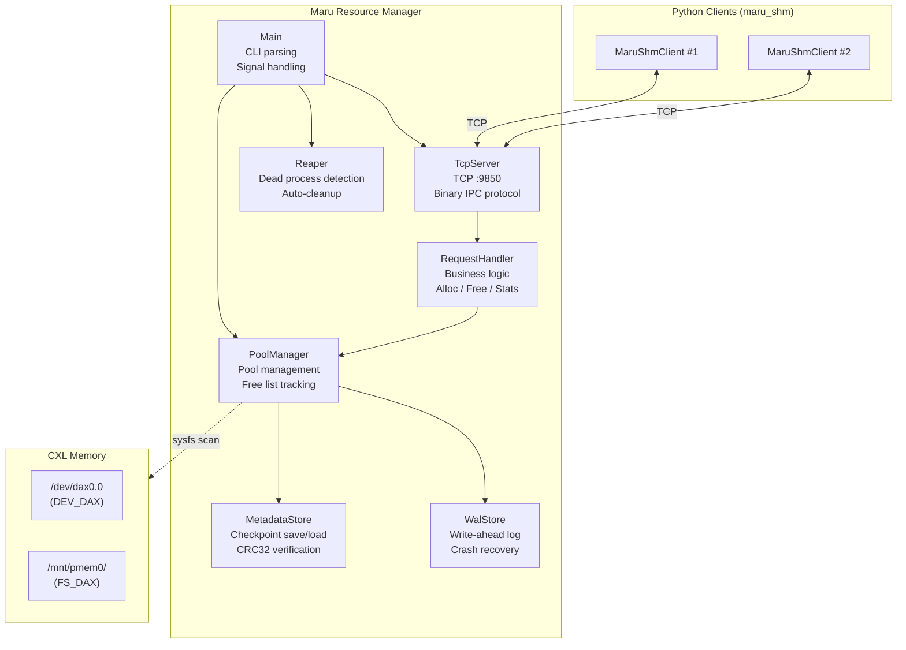

# MaruResourceManager Architecture

The `MaruResourceManager` is a server that manages physical CXL DAX device pools for the Maru system. It provides memory allocation, deallocation, and region handle issuance to clients via TCP RPC. It handles two device types — DEV_DAX (character devices) and FS_DAX (filesystem-backed DAX mounts) — and ensures durability through write-ahead logging and periodic checkpoints. A background reaper automatically reclaims leaked allocations from terminated client processes.

## 1. Component Architecture



`PoolManager` is the central component that owns all shared state — pool metadata, allocation maps, and free lists. It performs device discovery by scanning sysfs for DEV_DAX and FS_DAX devices, and supports hot-plug via `SIGHUP`-triggered rescans (`kill -HUP $(pidof maru-resource-manager)`).

`TcpServer` accepts TCP client connections and dispatches requests to `RequestHandler`. It handles transport concerns including client identity parsing from the `client_id` field in requests.

`RequestHandler` contains all business logic — allocation, deallocation, access info lookup, and stats queries. It depends only on `PoolManager` and has no transport code.

`Reaper` runs a background thread that periodically detects terminated client processes and reclaims their leaked allocations through `PoolManager`.

`MetadataStore` persists the global allocation map (the checkpoint) and one identity record per pool (device UUID and layout), with integrity verification. `WalStore` provides crash recovery by recording every allocation and free operation to a write-ahead log before modifying in-memory state.

---

## 2. IPC Protocol

> **Note:** This section describes the Resource Manager's binary IPC protocol (TCP, port 9850). The Metadata Server (`maru-server`) uses a separate RPC protocol over ZMQ (port 5555) — see the MaruServer documentation for details.

All messages use a fixed-size binary header (12 bytes) containing protocol magic, version (v2), message type, and payload length, followed by a type-specific payload. Communication is over TCP.

| Type | Direction | Description |
|------|-----------|-------------|
| `ALLOC_REQ` / `ALLOC_RESP` | client ↔ server | Allocate shared memory; response includes handle + device path |
| `FREE_REQ` / `FREE_RESP` | client ↔ server | Free allocation (requires valid auth token) |
| `GET_ACCESS_REQ` / `GET_ACCESS_RESP` | client ↔ server | Request device path + offset + length for an existing allocation |
| `HOLD_REQ` / `HOLD_RESP` | client ↔ server | `GET_ACCESS` that also records a hold: a remote CXL agent holds every region it registers with its NIC (§5) |
| `UNHOLD_REQ` / `UNHOLD_RESP` | client ↔ server | The holder deregistered the region (requires the handle) |
| `RESET_HOLDS_REQ` / `RESET_HOLDS_RESP` | client ↔ server | A restarted holder drops the holds of its earlier process |
| `STATS_REQ` / `STATS_RESP` | client ↔ server | Query per-pool statistics |
| `ERROR_RESP` | server → client | Error with status code and message |

Every allocation returns a **Handle** containing the region ID (globally unique), mmap offset, allocation length, and a cryptographic auth token. The Handle serves as both the allocation identifier and the authorization credential — clients must present it for free and access operations.

### Memory access via device path

Instead of passing file descriptors via `SCM_RIGHTS` (which only works over UDS), the server returns a **device path string** in `ALLOC_RESP` and `GET_ACCESS_RESP`. The client opens the path directly with `open()` and creates an `mmap()`.

| DAX type | Device path example | Offset | Length |
|----------|-------------------|--------|--------|
| DEV_DAX | `/dev/dax0.0` | Real byte offset within device | Aligned allocation size |
| FS_DAX | `/mnt/pmem0/maru_42.dat` | 0 (file per allocation) | File size |

### Client identity

Requests that require owner tracking (`ALLOC_REQ`, `FREE_REQ`) include a `client_id` field in the payload (`hostname:pid` format). The server extracts the PID for allocation ownership and Reaper tracking.

The `STATS_RESP` returns per-pool statistics. Each pool entry contains:

| Field | Type | Description |
|-------|------|-------------|
| `pool_id` | uint32 | Pool identifier |
| `dax_type` | enum | `DEV_DAX` (character device) or `FS_DAX` (filesystem DAX) |
| `total_size` | uint64 | Total pool capacity in bytes |
| `free_size` | uint64 | Currently available space in bytes |
| `align_bytes` | uint64 | Alignment requirement in bytes |

Stats can be queried via `MaruShmClient.stats()` in Python or the `maru_test_client stats` CLI tool.

---

## 3. Memory Management

Each discovered CXL device becomes a **pool** with a sorted free list of extents (offset + length pairs). The allocation algorithm uses **first-fit with alignment**: it scans the free list for the first extent that can accommodate the aligned request size, splits the extent into residual fragments if needed, and returns a Handle pointing to the allocated region.

For **DEV_DAX** pools, a single character device (`/dev/daxX.Y`) is shared by all allocations. The Handle's offset field contains the real byte offset within the device. For **FS_DAX** pools, each allocation creates a dedicated file (`<mountpoint>/maru_<regionId>.dat`) of the requested size, and the Handle's offset is always zero. The file is unlinked on free.

All allocation sizes are rounded up to the pool's alignment boundary. For DEV_DAX, the alignment is read from the sysfs `align` attribute (typically 2 MiB). For FS_DAX, it is determined from the block device's logical block size, with a 2 MiB minimum.

---

## 4. Persistence & Recovery

The **allocation ledger** is the only authority on which ranges are in use: the global checkpoint (`global.meta`) plus the write-ahead log (WAL) since it. Every allocation and free is appended to the WAL (and synced) before it is acknowledged. A **checkpoint** writes the whole ledger, including pools whose device is absent or refused, to `global.meta` and retires the WAL. Free lists are not persisted: a pool's free list is its device's data range minus its live allocations.

Each pool also has a record, `pool_N.meta` (version 7), holding the device's UUID and the layout it was served with (type, data range, alignment). It is written before the pool is first served and whenever the pool starts over; checkpoints do not write it. Records of version 6, written by earlier resource managers, hold a free list only and are migrated (see below).

**Startup.** The resource manager reads the excluded device list, `global.meta` and the WAL, and builds the ledger for every pool. It then judges each device on its own:

| The device | Outcome |
|---|---|
| Carries the recorded UUID, its layout matches the record and its identity tags, and its allocations fit | Served as recorded |
| Has no header and no history | New pool: a fresh UUID header and record |
| Lost its header, or its layout changed (e.g. re-provisioned to another size), and no allocation on it may still be in use | Starts over (reset): the pool is rebuilt from the device; the previous record is kept as `pool_N.meta.reset-<time>` |
| As above, but an allocation's owner may still be running (a remote owner, or a local process that is alive) | Refused: not served, nothing written; the rest of the resource manager keeps running |
| Holds another pool's UUID, an unknown header version, a record from a newer resource manager, or a UUID another device also holds | Refused |
| Formatted by ROOF, excluded, or not answering, or the pool records cannot be listed | Skipped (excluded devices are never opened) |

An owner counts as gone only when it is a local process whose PID no longer exists, or one recorded in an earlier boot (the `boot_id=` line of `rm.conf`). Remote owners are never assumed gone by recovery. Startup exits only when the ledger itself cannot be trusted or the state directory cannot be written: an unreadable `global.meta`, WAL or excluded device list; pool records without `global.meta` (unless the WAL reaches back to region 1); one region ID claimed by two different records (possible only in a WAL in which a resource manager before #91 reused region IDs; stop every client, move the WAL aside and restart); a missing secret with live allocations. Devices are rejudged at every rescan (every 10 s and on SIGHUP), so a refused device whose last local owner exits starts over automatically.

**Identity tags.** The reserved area after the 32-byte header holds, every 256 bytes up to 2 MiB, a tag with the device UUID and its own offset. A region whose interleave members were swapped, reordered or reset keeps its header but no longer has consistent tags, and is treated as a changed layout.

**Migration.** `global.meta` and the WAL keep their format, so the ledger carries over as it is. A version 6 record holds only a free list, which the ledger makes redundant, so it is treated like a missing record: a device with its header and allocations that fit is served and recorded as version 7; a device without its header starts over or is refused as in the table above. A version 6 device whose layout changed while its header survived is therefore served once at the upgrade; the identity tags written then catch later changes.

**Checkpoint.** A checkpoint writes `global.meta` (tmp, fsync, rename), syncs the directory and then removes the WAL. If a crash loses the removal, the WAL is applied again onto the checkpoint that already holds it, with the same result: this resource manager never reuses a region ID, an ALLOC already in `global.meta` is skipped, and a FREE of a region not in it does nothing. The exception is a WAL in which a resource manager before #91 reused a region ID; startup then exits as above. When `global.meta` is missing at startup, an empty one is created and the WAL is kept.

**Operator commands**: [`maru-rm-ctl`](../api_reference/maru_rm_ctl.md) shows why a device is not served and resolves it (`include` with `--reinit`, `--adopt` or `--restore-header`; `discard`; `release`).

**Downgrade** is forward-only: an earlier resource manager exits on a version 7 record, and cannot serve a pool with allocations without a version 6 free list. To go back, stop all clients, check that `maru-rm-ctl allocations` is empty, stop the resource manager, move `pool_*.meta` aside, and start the earlier version.

**Deployment assumptions** (shared with the reaper, §5): host names are unique in the cluster, and local clients and the resource manager share the host PID namespace. `rm.conf` belongs to the resource manager: do not manage it with configuration tools or restore it from a backup.

---

## 5. Reaper

The Reaper periodically checks the liveness of each allocation's owner process. If the process no longer exists, its allocations are reclaimed — extents are returned to the free list and the allocation is removed from the map.

To defend against **PID reuse**, the server caches each client's process start time at allocation time. If the OS reports the process as alive but the current start time differs from the cached value, the PID has been recycled by the kernel, and the allocations are reclaimed.

Allocations of a pool that is not served (absent, refused or excluded device) are reclaimed only when a local owner is gone; the grace period below does not apply to them, because a remote owner cut off by the network may still be running.

For **remote clients** (different hostname), the server monitors TCP connection state. When a remote client disconnects, a grace period begins (configurable via `--grace-period`, default 30 seconds). If the client reconnects within the grace period, the timer is cancelled and allocations are preserved. If not, its allocations are reclaimed.

Local vs. remote is determined by comparing the client's hostname (from `client_id`) against the server's hostname. TCP keepalive (idle 10s, interval 5s, count 3) detects dead connections in ~25 seconds, after which the grace period starts — so a crashed remote client's allocations are reclaimed after ~55 seconds total.

**Held regions.** A remote CXL agent registers the regions it maps with its node's NIC, and a late RDMA WRITE through such a registration would land in whatever region next gets the range. So the agent holds each region it registers (`HOLD`, named by its node and process instance) and unholds it once deregistered. A region freed while held, by its owner, the reaper, `maru-rm-ctl release` or recovery, becomes *draining*: it is freed for its owner and `GET_ACCESS` refuses it, but its range stays out of the free list until the last holder unholds it. A restarted agent drops the holds of its earlier process (`RESET_HOLDS`), whose registrations ended with it. Holds and draining marks are kept in `holds` in the state directory (rewritten atomically on every change), so a restart keeps the range out of use too. A pool with a held region is never reset by recovery. If a memory node is gone for good, `maru-rm-ctl drop-holds NODE --confirm` drops its holds. The RM trusts its network for `RESET_HOLDS`, as for `ALLOC`.

---

## 6. Security

Every allocation receives a **cryptographic auth token** derived from the Handle fields and a server-side secret. Free and access requests must present a valid token; invalid tokens are rejected.

The secret is generated on first start and persisted to the state directory. On restart, if allocations exist from a previous run, the secret is loaded; if it is missing, startup is aborted to prevent token verification failures.

**Owner verification** ensures that clients can only free their own allocations — the `client_id` (`hostname:pid`) is recorded at allocation time and must match the freeing client's identity. Note that `client_id` is self-reported by the client; it provides ownership tracking rather than authentication. The auth token is cryptographically bound to the `client_id`, so forging a valid token requires knowing both the Handle fields and the server-side secret.

**PID reuse safety:** A new process may receive the same PID as a terminated one, but it cannot access the old allocations — the Handle (including auth token) existed only in the old process's memory. The Reaper detects PID reuse by comparing cached process start times (local clients) or via TCP disconnect grace period (remote clients). See §5 for details.

**Device permissions:** Since clients open device paths directly (instead of receiving FDs from the server), client processes must have read/write access to the CXL device files. Configure via `chmod` or group-based permissions.

---

## 7. Server Configuration

The server is configured via CLI arguments. On startup, the resource manager writes host, port, and log level to `rm.conf` in the state directory (atomic tmp+rename) for reference. The same file holds the `boot_id=` line used by recovery (§4).

| Option | Default | Description |
|--------|---------|-------------|
| `--host`, `-H` | `127.0.0.1` | TCP bind address (use `0.0.0.0` for remote access — see security note below) |
| `--port`, `-p` | `9850` | TCP port |
| `--state-dir`, `-d` | `/var/lib/maru-resourced` | State directory for WAL and checkpoints |
| `--log-level`, `-l` | `info` | Log level: `debug`, `info`, `warn`, `error` |
| `--num-workers`, `-w` | `32` | Worker thread pool size |
| `--grace-period`, `-g` | `30` | Seconds to wait before reaping a disconnected remote client's allocations |
| `--max-clients`, `-m` | `256` | Maximum concurrent client connections |

### Daemon mode (production)

The recommended way to run the resource manager is as a systemd service:

```bash
sudo systemctl start maru-resource-manager
```

To customize options, use `sudo systemctl edit maru-resource-manager` and override `ExecStart`.

### Direct mode (development/debugging)

```bash
maru-resource-manager --host 127.0.0.1 --port 9850 \
                      --state-dir /var/lib/maru \
                      --log-level debug
```

> **Security note:** The default bind address is `127.0.0.1` (local-only). When binding to
> `0.0.0.0` for multi-node deployments, auth tokens and device paths are transmitted in
> plaintext. Use an encrypted tunnel (WireGuard, SSH tunnel, IPsec) to protect the traffic.

### RM address propagation

MaruServer and MaruHandler need to know the resource manager's address:

```bash
# MaruServer — pass RM address
maru-server --port 5555 --rm-address 192.168.1.100:9850

# MaruHandler — configure via MaruConfig
# maru_rm_address: "192.168.1.100:9850"
```

Default `127.0.0.1:9850` works for single-node setups without explicit configuration.
