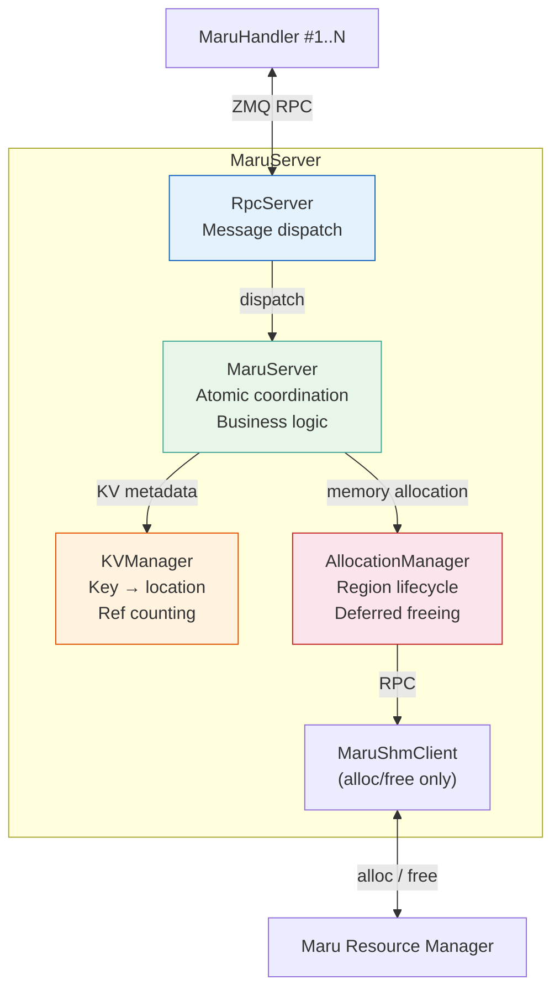
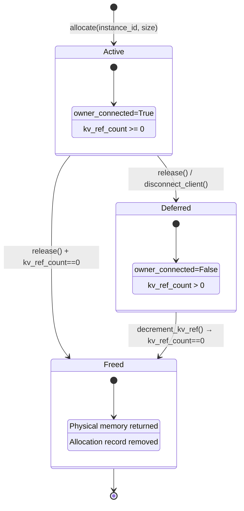
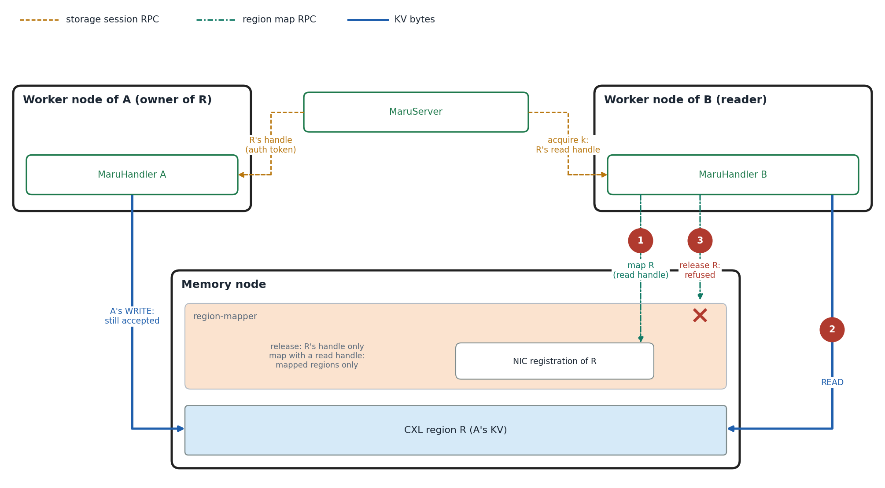

# MaruServer Architecture

The `MaruServer` is a **metadata-only server** that coordinates CXL memory allocation and KV metadata across clients. It never directly accesses KV data — all actual reads and writes happen through CXL shared memory by the clients themselves.

**Responsibilities:**
- CXL memory allocation and deallocation (via the resource manager)
- KV metadata management (key → region, offset, length)
- Brokering KV location information between clients

## 1. Component Structure

`RpcServer` accepts incoming ZeroMQ messages, dispatches to the appropriate `MaruServer` method, and returns the serialized response.

`MaruServer` is the central coordinator. It holds references to both `KVManager` and `AllocationManager`, and guarantees atomicity of cross-manager operations such as registering a KV entry and incrementing its region's reference count.

`KVManager` maintains a key-to-location mapping, where each entry records the region ID, offset, and length of a stored KV pair. Duplicate key registrations are handled idempotently.

`AllocationManager` tracks all CXL memory allocations with records that include the owner instance, a KV reference count, and a connection flag. It communicates with the Resource Manager to perform physical allocation and deallocation.

---

## 2. Allocation Management

Each allocation is tracked with an `AllocationInfo` that records the owning client, the number of KV entries referencing the region, and whether the owner is still connected.

The allocation lifecycle uses **deferred freeing**: a region is only physically freed when both the owner has disconnected and no KV entries reference it. This prevents premature deallocation while readers still depend on the data.

When a client calls `return_alloc` or disconnects, the allocation's `owner_connected` flag is set to false. If the KV reference count is already zero, the region is freed immediately. Otherwise, it enters the deferred state and is freed later when the last KV entry referencing it is deleted.

---

## 3. KV Registry

`KVManager` stores a mapping from string keys to location records containing the region ID, offset within the region, and data length.

When a new key is registered, an entry is created and the allocation's KV reference count is incremented. If the key already exists, the registration is treated as idempotent — no new entry is created.

When a key is deleted, the entry is removed and the allocation's KV reference count is decremented. This may trigger deferred freeing if the region's owner has already disconnected.

---

## 4. Cross-Manager Coordination

`MaruServer` ensures atomicity between `KVManager` and `AllocationManager` by executing paired operations as a single atomic unit.

For `register_kv`, the server registers the key and increments the region's KV reference count atomically. Without this, a concurrent `return_alloc` could free the region between registration and reference count increment, creating a dangling KV entry.

For `delete_kv`, the server deletes the key and decrements the reference count atomically. If this brings the count to zero and the owner has disconnected, the allocation is freed immediately.

For `lookup_kv`, the server reads the KV entry and retrieves the corresponding handle atomically, ensuring the allocation cannot be freed between the two reads.

---

## 5. RPC Interface

The server exposes the following message types:

| MessageType | Operation |
|-------------|-----------|
| `REQUEST_ALLOC` | Allocate a new CXL region for a client |
| `RETURN_ALLOC` | Release ownership of a region |
| `LIST_ALLOCATIONS` | List all active allocations |
| `REGISTER_KV` | Register a KV entry at a given location |
| `LOOKUP_KV` | Look up a KV entry's location and handle |
| `EXISTS_KV` | Check whether a key exists |
| `PIN_KV` | Atomically check existence and pin a KV entry |
| `UNPIN_KV` | Unpin a KV entry |
| `DELETE_KV` | Delete a KV entry |
| `BATCH_REGISTER_KV` | Batch register multiple KV entries |
| `BATCH_LOOKUP_KV` | Batch look up multiple keys |
| `BATCH_EXISTS_KV` | Batch check existence of multiple keys |
| `BATCH_PIN_KV` | Batch check existence and pin multiple entries |
| `BATCH_UNPIN_KV` | Batch unpin multiple entries |
| `GET_STATS` | Retrieve server statistics |
| `HEARTBEAT` | Connection health check |
| `HANDSHAKE` | Reserved — initial client-server handshake |
| `SHUTDOWN` | Reserved — graceful server shutdown |

Batch operations allow clients to reduce RPC round-trips when operating on multiple keys.

---

(maru-server-remote-cxl)=
## 6. Remote CXL Regions

For `remote_cxl` workers, MaruServer keeps storage sessions (`ReplicaDirectory`).
A session gets regions from the Resource Manager as a cxl Handler does
(`open`, then `expand`), and MaruServer indexes every session's keys, so any
session of the same namespace can lease and read them. A session opens only if
its schema and page size match those of the namespace's other sessions and of
the regions kept for workers that left, since it may read their keys. A session
may hold no region for a while (its only region went back) and asks for one
with `expand`. MaruServer hands the pool's remote CXL agent list to the workers in
the handshake.

**Regions of a worker that left.** When a session closes drained or expires,
MaruServer takes its regions over. A region that holds keys is *kept*: its
keys are still found, and the `RegionKeeper` thread keeps its mapping at the
remote CXL agent so readers keep reading. A region without keys goes back. The
keeper releases a region at its remote CXL agent before MaruServer frees it at
the Resource Manager, so a late RDMA WRITE fails at the NIC. A kept region goes
back when:

- the Resource Manager refuses a region request (the kept region read longest
  ago goes, one at a time). The room it makes goes to a worker that was refused
  its first region: for 30 seconds after such a refusal, a session that already
  holds a region is refused more and evicts its own keys instead;
- its memory node rebooted (the boot id differs from the one its owner
  reported), since bytes in the node's CPU cache may be lost;
- its remote CXL agent refuses its handle (someone released it);
- its remote CXL agent has not answered for 30 seconds, as a live owner removes
  the keys of a region it cannot reach. The keeper notices at its next check
  (every 10 seconds) once its request times out (10 seconds), so the keys stop
  being found somewhat later than 30 seconds after the remote CXL agent stopped
  answering. The region is released and freed once the remote CXL agent answers
  again.

When maru-server stops, the keeper releases the regions it took over at their
remote CXL agents and frees them before it exits, so a reader's open connection
does not keep one registered after the Resource Manager hands it out again.
The keeper talks to the remote CXL agents on its own thread, so a memory node
that does not answer delays no request. It proves the remote CXL agent key like a
worker (`--remote-cxl-agent-key-file`).

**Handles.** MaruServer gives a region's handle, with the Resource Manager's
auth token, only to the session that owns the region. Other sessions get a
read handle with `acquire`: the region's number, offset and length with a read
token derived from the auth token. A remote CXL agent maps a read handle only for
a region it has mapped, and only the region's handle releases a region, so a
reader cannot take a region away from its owner.

| Action | Operation |
|--------|-----------|
| `open` / `close` | Open a session (with its first region) / close it drained |
| `expand` | One more region for the session |
| `heartbeat` | Renew the session; reports usage and each region's boot id |
| `commit` / `probe` / `acquire` / `release` | Register keys / check them / lease them for a read / end the lease |
| `victims` / `remove` | Least recently used unleased keys of own regions / remove them |
| `return_region` | Give one region back after its remote CXL agent released it |

