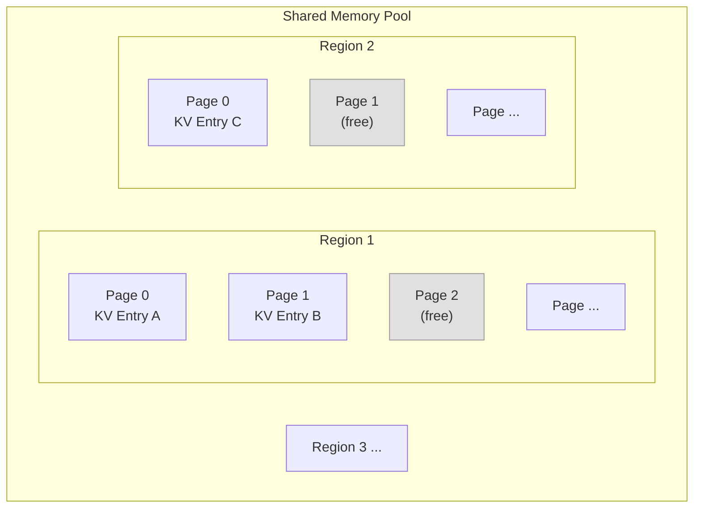
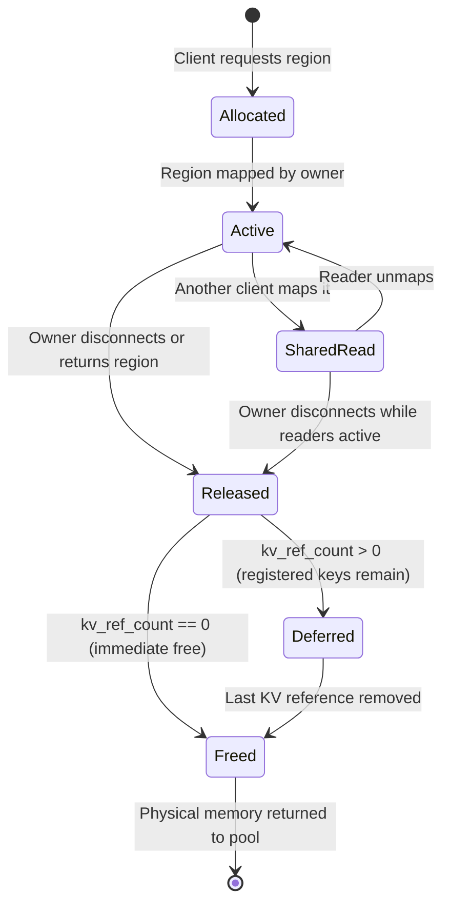
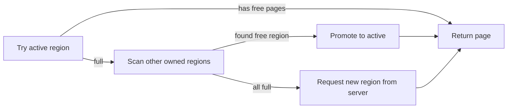
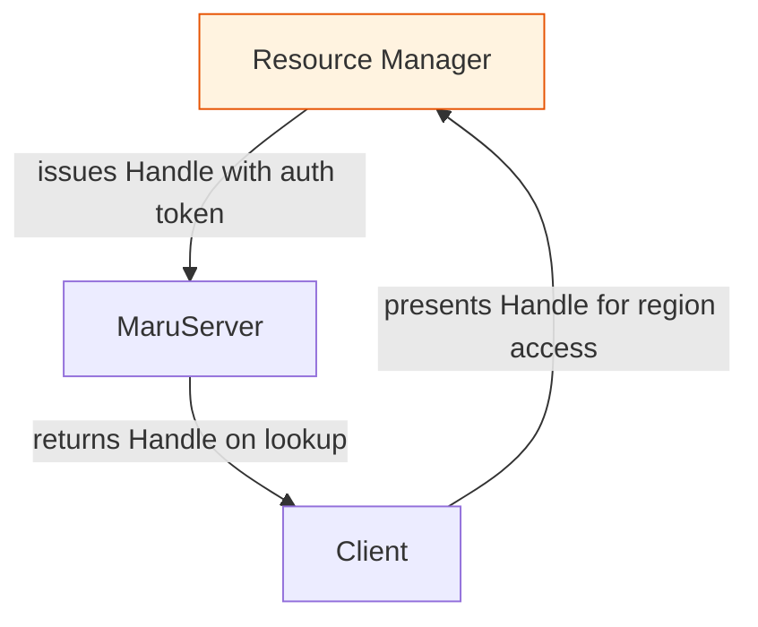

# Maru Memory Model

## Backend and buffer ownership

The directly mapped `cxl` backend and the node backend (selected by `maru_node`) differ in which process owns the pool and which workers can map it. The GPU's execution KV cache is separate from all storage pools below.

| Backend | Storage bytes | Worker-facing read result | Sharing scope |
|---|---|---|---|
| `cxl` | CXL mapped on the worker | `MemoryInfo` over the mapping | Workers that map the same pool and use the registry on MaruServer (`maru-server --backend cxl`) |
| node, `dram` | Node-owned DRAM | A pinned read result over the local mapping | Compatible workers on that node |
| node, `local_cxl` | Node-owned CXL regions | A pinned read result over the local mapping | Compatible workers that can map the pool |
| node, `remote` | Memory-node DRAM or CXL | Worker-owned staging filled by direct RDMA READ | Compatible workers using the same memory node and MaruServer (`maru-server --backend node`) |

Remote staging must outlive NIC access and every GPU copy. It is not a cache. See {doc}`node_storage_service` for source pins, write domains and orphan-worker protection. The numbered sections below describe `cxl`.

## 1. Memory Hierarchy

Maru organizes CXL shared memory into a three-level hierarchy:

```
Pool                   (entire CXL device capacity)
  └── Region           (fixed-size allocation unit)
       └── Page        (fixed-size slot within a region)
```



**Pool** — The total CXL device capacity managed by the Resource Manager. Discovered at startup via hardware enumeration. Multiple physical devices can form multiple independent pools.

**Region** — A contiguous allocation carved from a pool. Size is determined by the client's `pool_size` configuration. Regions are the unit of allocation, ownership, and shared access.

**Page** — A fixed-size slot within a region, sized by the `chunk_size_bytes` configuration. Pages are the unit of allocation within a region. A region of size `pool_size` contains `pool_size / chunk_size_bytes` pages. Any trailing bytes below one page are unused. Each page holds exactly one KV cache chunk, identified by a key and located by (region_id, page_index).

> See also: [MaruHandler — Memory Management](maru_handler.md#2-memory-management), [MaruResourceManager — Memory Management](maru_resource_manager.md#3-memory-management), [KV Cache Management](kv_cache_management.md)

---

## 2. Region Lifecycle

The diagram illustrates directly mapped `cxl` mapping and ownership states. MaruServer tracks owner connection and registered-key references, not every live mapped view or GPU copy. `SharedRead` below describes a client mapping, not a server read lease.



**Allocated** — Resource Manager carves a contiguous extent from the pool's free list and returns a handle to the server.

**Active** — The owning client has mapped the region and is actively storing KV entries.

**SharedRead** — One or more non-owning clients have mapped the region for cross-instance retrieval.

**Released** — The owner has disconnected or explicitly returned the region. The `owner_connected` flag is set to false.

**Deferred** — The owner has disconnected but registered keys still reference the region. This preserves those registered objects; a `MemoryInfo` view does not itself increment that count or pin a key. Callers must keep the key/region valid through outstanding reads and GPU copies.

**Freed** — On the `cxl` backend, the owner has disconnected and the KV reference count is zero, so the region can be returned to the Resource Manager.

### Node-store protections

| Protection | Resource protected | End condition |
|---|---|---|
| Catalog source pin | Stored page during a read | READ completes or unused work is safely discarded |
| Worker read-result ownership | Local mapping or remote staging used by GPU copies | Final copy completes |
| Write-domain registration | Memory-node pages reserved by one instance within one GPU-node run | That domain's registration revoked before uncertain pages are reused |
| RM hold | CXL range mapped or registered with a NIC | Mapping or registration safely removed |

A GPU-service run change preserves source pins for live old readers. Neither a deadline nor session expiry proves that RDMA or a GPU copy has ended. See {doc}`node_storage_service` for restart and quarantine rules.

---

## 3. Page Allocation

The `cxl` backend uses `PagedMemoryAllocator` and a free list. Node stores allocate from service-owned pools and give workers explicit credit.

### Multi-Region Allocation Strategy

When a client stores a new KV entry, it must allocate a page. The allocation follows a three-tier strategy:



1. **Fast path** — Try the currently active region's allocator. This succeeds when the active region has free pages.
2. **Scan** — If the active region is full, iterate through other owned regions. Promote the first region with free pages to active.
3. **Expand** — If all owned regions are exhausted, request a new region. This is the only path that involves server communication.

### Population Policy

Physical page population is determined per region based on ownership:

| Region Ownership | Policy | Rationale |
|------------------|--------|-----------|
| Owned | Eager — all pages populated at map time via `madvise(MADV_POPULATE_WRITE)` | Avoids page faults on the write path |
| Shared | Deferred — pages faulted on first read | Most shared regions are partially read; eager population wastes memory |

> See also: [MaruHandler — Memory Management](maru_handler.md#2-memory-management)

---

## 4. Access Control

Maru enforces access control at the region level through a capability-based model: **a client must present valid authorization to access a region it does not own**.



Every allocation receives a **capability-based handle** containing a cryptographic auth token. The token is computed from the handle's fields using a server-side secret. Clients must present a valid handle to:
- Map a region's shared memory for direct access
- Free an allocation

The Resource Manager associates allocations with a reported client identity. That ownership record is distinct from network authentication and from the OS permissions needed to open a DAX device.

### Trust Boundary

Applications must respect allocation ownership and immutable-payload rules. Region authorization, local DAX permissions and remote deployment-key authentication serve different purposes. They do not establish general tenant isolation. See the backend-specific access description in {doc}`architecture_overview`.

> See also: [MaruResourceManager — Security](maru_resource_manager.md#6-security)

---

## 5. GC and Cleanup

The following summarizes `cxl` allocation cleanup. Node-store cleanup follows the pin, staging and registration rules above.

| Concern | Strategy |
|---------|----------|
| **Normal shutdown** | Client calls `close()`: returns all owned regions via RPC, server decrements ref counts, immediate or deferred free |
| **Client crash** | MaruServer marks the worker's regions owner-disconnected; the RM reaps its allocation owner, usually MaruServer, using local liveness or remote disconnect/grace rules |
| **Stale metadata** | Server holds KV entries pointing to deferred regions until last ref is removed; then region is freed |
| **PID reuse defense** | Reaper caches process start time; detects recycled PIDs by comparing current vs cached start time |
| **Crash recovery** | Resource Manager replays write-ahead log on restart to reconstruct allocation state |

> See also: [MaruServer — Allocation Management](maru_server.md#2-allocation-management), [MaruResourceManager — Reaper](maru_resource_manager.md#5-reaper)
