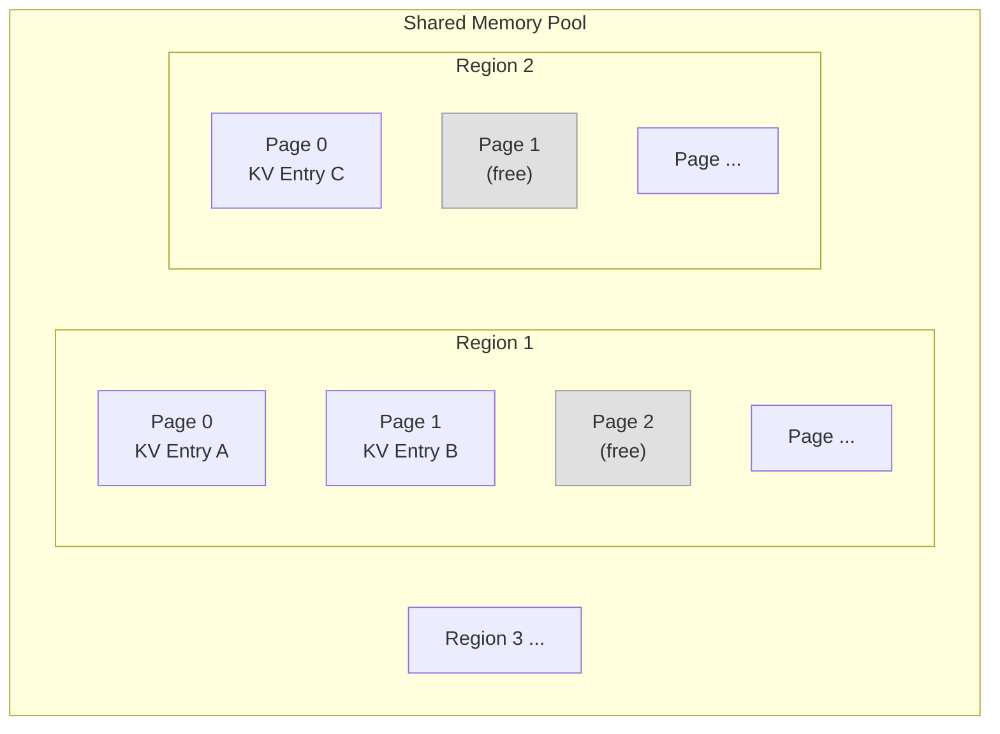
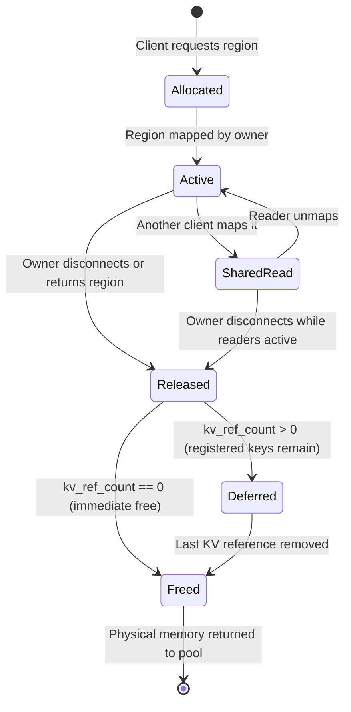
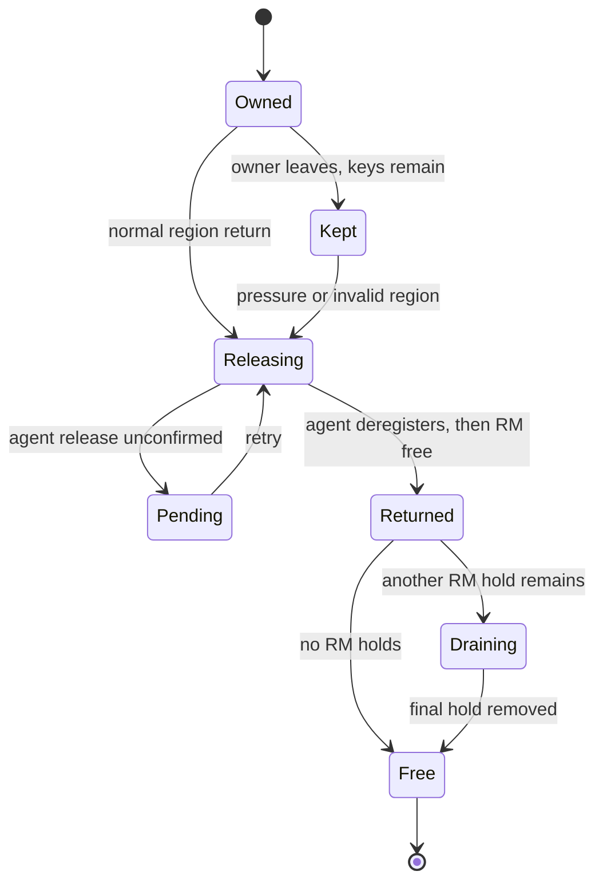
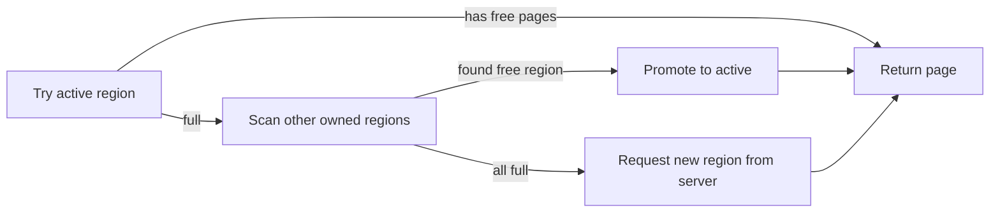
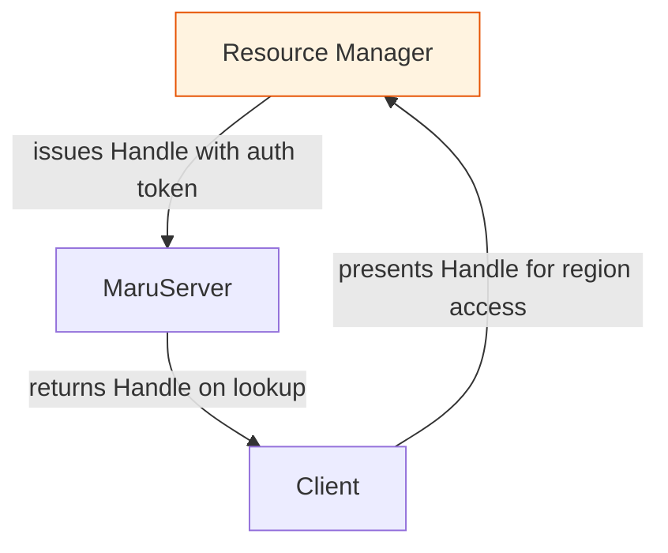

# Maru Memory Model

## Backend and buffer ownership

The storage backend determines which process maps or owns the bytes. The GPU's
execution KV cache is separate from all storage pools below.

| Backend | Storage bytes | Worker-facing read result | Sharing scope |
|---|---|---|---|
| `cxl` | CXL mapped on the worker | `MemoryInfo` over the mapping | Legacy CXL registry; workers can map the same pool |
| `remote_cxl` | CXL mapped and NIC-registered by the memory-node agent | A lease over worker CPU staging filled by RDMA | Compatible sessions in the same namespace and pool |
| `cpu` | Worker-local CPU DRAM | A read lease | Owning worker only |
| `mixed` | Worker-local CPU DRAM and typed CXL pools | A read lease over the selected local medium | Owning worker only in this version; separate from legacy CXL sharing |

Remote CXL staging is a worker-owned transfer buffer, shared by that worker's
pool clients. It must outlive the last NIC access and CPU/GPU copy. A worker
without CXL does not mmap the remote DAX region. See {doc}`maru_handler`.

The numbered sections below describe legacy `cxl` unless a `remote_cxl`
distinction is explicit. They do not describe the fixed private `cpu` and
`mixed` pools.

## 1. Memory Hierarchy

Maru organizes CXL shared memory into a three-level hierarchy:

```
Pool                   (entire CXL device capacity)
  └── Region           (fixed-size allocation unit)
       └── Page        (fixed-size slot within a region)
```



**Pool** — The total CXL device capacity managed by the Resource Manager. Discovered at startup via hardware enumeration. Multiple physical devices can form multiple independent pools.

**Region** — A contiguous allocation carved from a pool. Size is determined by the client's `pool_size` configuration. Regions are the unit of allocation, ownership, and shared access.

**Page** — A fixed-size slot within a region, sized by the `chunk_size_bytes` configuration. Pages are the unit of allocation within a region. A region of size `pool_size` contains `pool_size / chunk_size_bytes` pages. Any trailing bytes below one page are unused. Each page holds exactly one KV cache chunk, identified by a key and located by (region_id, page_index).

> See also: [MaruHandler — Memory Management](maru_handler.md#2-memory-management), [MaruResourceManager — Memory Management](maru_resource_manager.md#3-memory-management), [KV Cache Management](kv_cache_management.md)

---

## 2. Region Lifecycle

The diagram illustrates legacy `cxl` mapping and ownership states. MaruServer
tracks owner connection and registered-key references, not every live mapped
view or GPU copy. `SharedRead` below describes a client mapping, not a server
read lease.



**Allocated** — Resource Manager carves a contiguous extent from the pool's free list and returns a handle to the server.

**Active** — The owning client has mapped the region and is actively storing KV entries.

**SharedRead** — One or more non-owning clients have mapped the region for cross-instance retrieval.

**Released** — The owner has disconnected or explicitly returned the region. The `owner_connected` flag is set to false.

**Deferred** — The owner has disconnected but registered keys still reference the region. This preserves those registered objects; a `MemoryInfo` view does not itself increment that count or pin a key. Callers must keep the key/region valid through outstanding reads and GPU copies.

**Freed** — In legacy `cxl`, the owner has disconnected and the KV reference count is zero, so the region can be returned to the Resource Manager.

### Remote CXL regions and three different protections

`remote_cxl` does not use the legacy `owner_connected` / KV-ref-count state
machine. MaruServer can keep a region with keys after its owner leaves. Normal
return deregisters it at the agent first; the RM keeps a freed-but-held range
in *draining* until its final hold ends.

| Protection | Resource protected | When it ends |
|---|---|---|
| Server read lease (`acquire` / `release`) | Remote CXL object during RDMA | After the READ completes and the directory confirms the lease held |
| Local read lease (`release_retrieved`) | Worker staging slot | After the last CPU read or GPU copy |
| RM hold (`HOLD` / `UNHOLD`) | CXL range registered with a memory-node NIC | After deregistration; freeing the allocation alone does not end it |

The server lease may end before the GPU copy: the bytes are now in local
staging, whose own read lease still owns the slot. Uncertain native transfers
can retain staging after Handler close. See the recovery boundary in the
{doc}`vLLM guide <../integration/vllm>`.

Server leases are revocable when a region is invalidated or reclaimed by the
keeper. A completed READ is not enough: if the final directory check says the
lease was lost, discard the staged result and report a miss.



This is the normal Handler/keeper return path. RM reaping or an admin free can
end allocation ownership earlier; RM holds still keep the range out of reuse.
See {doc}`maru_resource_manager` for draining and {doc}`maru_server` for keeper
invalidation.

> See also: [MaruServer — Allocation Management](maru_server.md#2-allocation-management), [MaruResourceManager — Reaper](maru_resource_manager.md#5-reaper)

---

## 3. Page Allocation

Legacy `cxl` uses `PagedMemoryAllocator` and a free list. A `remote_cxl` client also allocates pages in its owned regions, with a separate worker staging budget and load reserve. The current `cpu` and `mixed` pools have fixed capacities.

### Multi-Region Allocation Strategy

When a client stores a new KV entry, it must allocate a page. The allocation follows a three-tier strategy:



1. **Fast path** — Try the currently active region's allocator. This succeeds when the active region has free pages.
2. **Scan** — If the active region is full, iterate through other owned regions. Promote the first region with free pages to active.
3. **Expand** — If all owned regions are exhausted, request a new region. This is the only path that involves server communication.

### Population Policy

Physical page population is determined per region based on ownership:

| Region Ownership | Policy | Rationale |
|------------------|--------|-----------|
| Owned | Eager — all pages populated at map time via `madvise(MADV_POPULATE_WRITE)` | Avoids page faults on the write path |
| Shared | Deferred — pages faulted on first read | Most shared regions are partially read; eager population wastes memory |

> See also: [MaruHandler — Memory Management](maru_handler.md#2-memory-management)

---

## 4. Access Control

Maru enforces access control at the region level through a capability-based model: **a client must present valid authorization to access a region it does not own**.



Every allocation receives a **capability-based handle** containing a cryptographic auth token. The token is computed from the handle's fields using a server-side secret. Clients must present a valid handle to:
- Map a region's shared memory for direct access
- Free an allocation

The Resource Manager associates allocations with a reported client identity.
That ownership record is distinct from network authentication and from the
OS permissions needed to open a DAX device.

### Trust Boundary

Applications must respect allocation ownership and immutable-payload rules.
Region handles, local DAX permissions and the remote agent's connection/read
handle checks serve different purposes; they do not by themselves establish
general multi-tenant isolation. See the backend-specific access description
in {doc}`architecture_overview`.

> See also: [MaruResourceManager — Security](maru_resource_manager.md#6-security)

---

## 5. GC and Cleanup

The following summarizes legacy CXL allocation cleanup. Storage-session and
RDMA cleanup follow the additional lease/hold rules above.

| Concern | Strategy |
|---------|----------|
| **Normal shutdown** | Client calls `close()`: returns all owned regions via RPC, server decrements ref counts, immediate or deferred free |
| **Client crash** | MaruServer marks the worker's regions owner-disconnected; the RM reaps its allocation owner, usually MaruServer, using local liveness or remote disconnect/grace rules |
| **Stale metadata** | Server holds KV entries pointing to deferred regions until last ref is removed; then region is freed |
| **PID reuse defense** | Reaper caches process start time; detects recycled PIDs by comparing current vs cached start time |
| **Crash recovery** | Resource Manager replays write-ahead log on restart to reconstruct allocation state |

> See also: [MaruServer — Allocation Management](maru_server.md#2-allocation-management), [MaruResourceManager — Reaper](maru_resource_manager.md#5-reaper)

