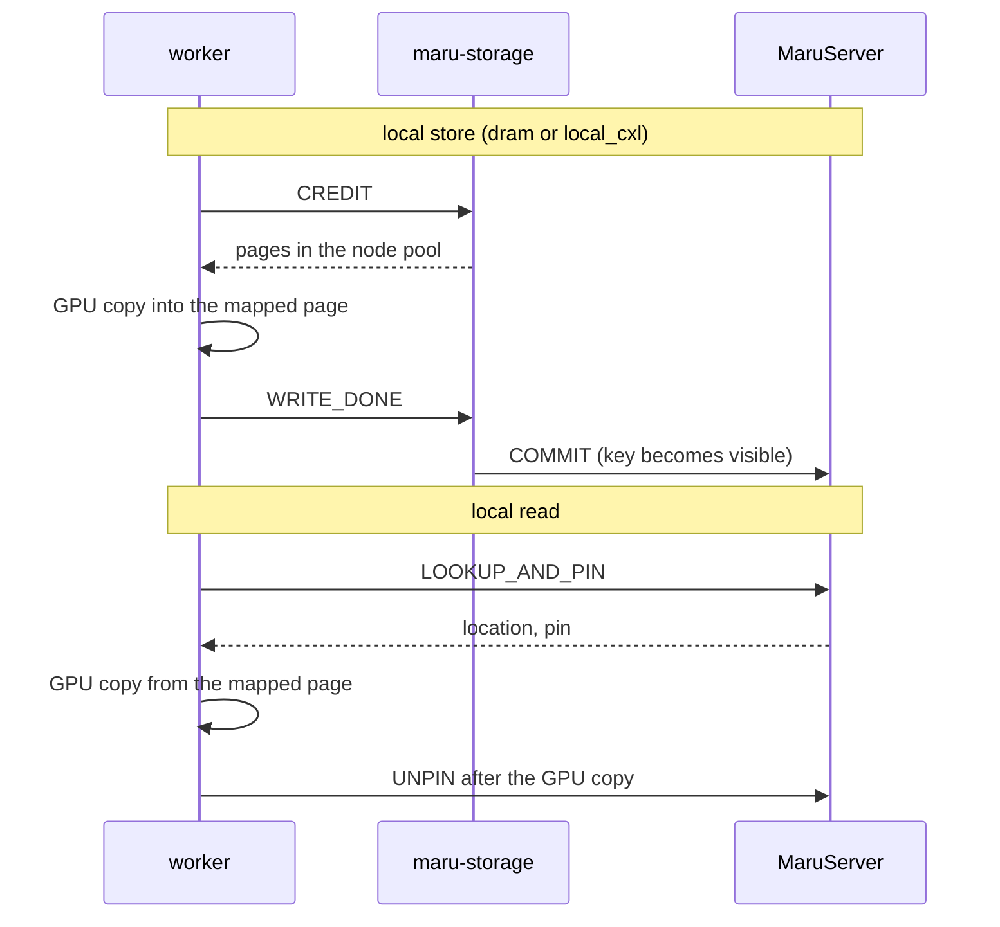
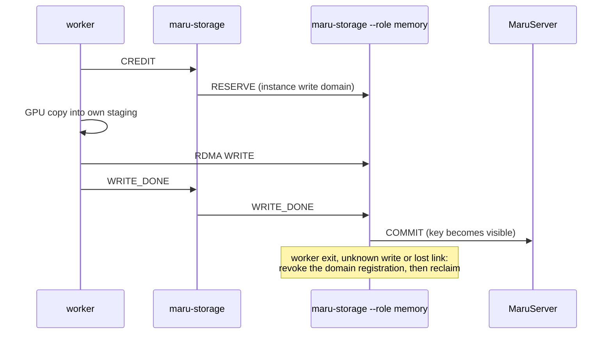
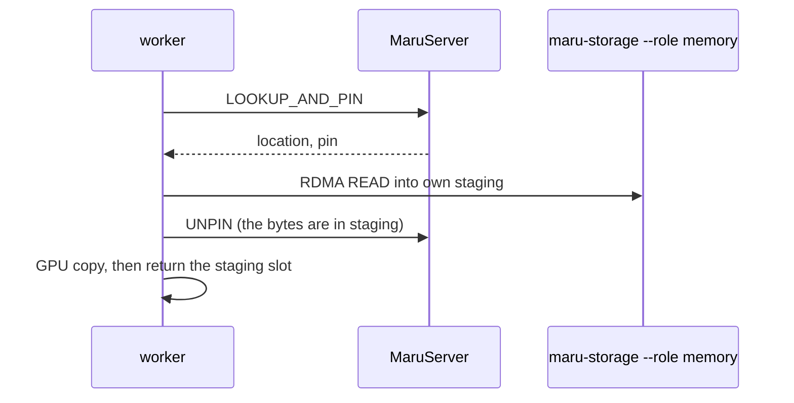

# Node StorageService

The node backend (selected by `maru_node`) runs MaruServer (`maru-server --backend node`). MaruServer keeps the Catalog of the node backend: published keys, their locations and pins. The GPU StorageService (`maru-storage --role gpu`) serves one `dram`, `local_cxl` or `remote` store. The memory StorageService (`maru-storage --role memory`) owns one `dram` or `local_cxl` pool. The directly mapped `cxl` backend runs MaruServer (`maru-server --backend cxl`) with a separate key registry.

## Processes and data paths

| Process | Responsibility |
|---|---|
| MaruServer | Catalog, node and worker sessions, publication, pins and retirement |
| `maru-storage --role gpu` | GPU-node pools, worker attachment, credit and memory-node control |
| `maru-storage --role memory` | Memory-node pools, RDMA registrations, publication and shared LRU eviction |
| vLLM worker | GPU copies and, with `remote`, direct RDMA READ and WRITE |
| Resource Manager | CXL region ownership and holds; needed for `local_cxl` |


The figure shows `remote`. For `dram` and `local_cxl`, workers map the node-owned pool and copy directly between that mapping and GPU memory. With `remote`, the GPU service carries control messages; KV bytes move through each worker's own staging. Workers and their GPU service must share a PID namespace so the service can verify process identity and exit.

## Stores and reads

Engines on the same GPU node can share local keys when their namespace and KV geometry match. To store a key, the worker obtains credit, fills its page and reports write completion. The service publishes the key through Catalog COMMIT after the payload write completes. A local read pins the Catalog location and uses the mapped page until its GPU copy completes.



For a remote store, the GPU service reserves memory-node pages and obtains the instance's write registration for that GPU-node run. The worker copies GPU bytes into its registered staging, issues RDMA WRITE to those pages, and reports completion. The memory node publishes the key with Catalog COMMIT. The committed key belongs to the memory node and can outlive the storing GPU worker or its GPU StorageService.



The GPU service reports its connected memory node’s ID and epoch to MaruServer on each heartbeat, starting before workers attach. For both PROBE and LOOKUP_AND_PIN, a remote HIT requires a committed copy in an active pool of that memory-node run and live sessions on both nodes. If a key has several copies, MaruServer selects a readable location from the Catalog.

For a remote read, the worker performs LOOKUP_AND_PIN and validates the pool registration and generation. It issues RDMA READ directly into its staging, then copies the bytes to the GPU. Reads already in progress for the same location can be joined within one worker. Different workers use separate staging and READs. Read bytes are never published or retained as cached copies.



Unavailable keys, stale locations and lack of a staging slot produce a MISS and recomputation. The read path does not wait for capacity or retry a failed read. Synchronous loads use the same direct reader on the engine thread. Deferred loads use the loader thread.

(node-capacity-lifetimes)=

## Capacity and lifetimes

| Store | Owner | Under capacity pressure |
|---|---|---|
| GPU `dram` | GPU node | Skip new stores; keep existing keys |
| GPU `local_cxl` | GPU node | Skip new stores; keep existing keys |
| GPU `remote` | Memory node | Shared memory-node LRU |
| Memory-node `dram` or `local_cxl` | Memory node | Shared memory-node LRU |

The memory node evicts eligible keys in LRU order across all writers. Pins and MaruServer's preserve policy protect keys. The high and low watermarks govern eviction. The memory node can also evict below the high watermark to make space for the transfer reserve and one credit page.

A timed-out remote read immediately misses. A running worker continues tracking its transfer. A worker stopped by a CUDA error returns no resources.

| Resource | Release or reuse condition |
|---|---|
| Worker WRITE source slot | After D2H finishes, the worker releases the slot once it knows the WRITE was never posted or the transfer handle has finished, including a finished failure. An unfinished handle keeps its slot even after `UNKNOWN`. |
| Memory-node write credit | A completed write passes to its COMMIT ticket. Unused credit can be safely cancelled. `UNKNOWN` retires the write domain. Its unconfirmed pages stay quarantined until registration revocation succeeds or a memory-node restart is verified. |
| Catalog pin on the remote READ source | The worker unpins if no READ was posted or once it confirms a successful READ, including a late success after a MISS. A posted READ whose success remains unconfirmed keeps the pin. |
| Worker READ destination slot | A posted READ must succeed, all waiters must have taken or discarded their results, and all GPU consumers must finish. A late success permits release. If success remains unconfirmed, the slot stays held until process exit. |
| Orphan source pin after a GPU-service run change | The old worker releases it or its exit is verified. |
| CXL region hold | Its mapping or NIC registration is safely removed. |

Each vLLM instance has a separate write domain within a GPU-node run. Ranks of that instance share the domain on that node. Each domain has its own write agent and registration. All workers share a separate read registration.

A worker exit, stopped worker, uncertain write, lost control connection or `reserve_ttl_s` without a control request triggers revocation. FENCE_DOMAIN revokes only the affected domain. Pages awaiting COMMIT stay with their tickets. A successful WRITE_DONE response follows the Catalog COMMIT result.

Time alone is not a fence. At `peer_quarantine_max` the memory node stops granting credit to that GPU node. The limit counts quarantined pages across all its runs. Failed service teardown retains mappings and prevents another run in that process.

A memory node accepts up to 64 worker NIXL agents per GPU node, with at most 1 MiB of metadata each, and up to 64 outstanding write registrations per GPU node, including registrations whose revocation failed.

When the GPU StorageService starts a new run, each worker closes admission to old READ locations before issuing new READs. After a persistent transfer failure or a CUDA error that stops a worker, restart the affected vLLM instance and verify that its old workers have exited.

A remote worker attaches once per GPU service run. If its connection ends during that run, the service fences its write domains and refuses further attachment by that worker. Remote loads and stores stop until the worker process restarts or the service starts a new run. A clean close unregisters and unmaps staging before DETACH, which releases its staging admission. An uncertain teardown keeps that admission until process exit. DRAM and `local_cxl` workers can reattach to the same run and keep their credit.

## Restarts and memory generations

A MaruServer restart loses the Catalog. Services and workers need new sessions, and engines recompute misses. A DRAM pool ends with its service run. A `local_cxl` store can adopt regions and registered keys from an earlier run when the MaruServer epoch, boot ID and memory generation still match and earlier holds permit access. This is cache reuse, not persistent storage.

A memory-node extension can report `memory_generation()`. A changed generation, or an unknown generation beyond the grace period, revokes registrations and ends the run, invalidating old locations. An unknown generation at startup prevents service. HELLO advertises the extension's supported actions, and unsupported actions are rejected. See {doc}`read_hints` for the extension contract.

## Configuration

`maru-storage --role gpu --config gpu.json --check` and `maru-storage --role memory --config memory.json --check` validate JSON and print resolved defaults without starting pools, RDMA or a NIXL agent. Start each service with the same command without `--check`. Select the service role with `--role` (default `gpu`). JSON has no `role` field. Unknown and duplicate keys are rejected.

Common keys:

| Key | Default | Rule |
|---|---|---|
| `node_id` | Required | Unique stable node name; starts with a letter or digit, followed by letters, digits, `.`, `_` or `-` |
| `server` | Required | One MaruServer URL per deployment. `--check` verifies only that the string is nonempty. |
| `page_size` | Required | Positive byte size; must hold the largest stored object |
| `state_dir` | `/run/maru` | Writable service state and ownership-lock directory |
| `tiers` | Required | Exactly one store |
| `budgets` | Derived | Credit, pending-write and reserve limits |

GPU-only keys are `socket` (default `/run/maru/node.sock`), `socket_group` (default service group; a named group must exist) and `local_pin` (only `false` is supported). The socket mode is `0660`. Memory-only keys are `remote_server` and `region_extension`.

| Store key | Default | Rule |
|---|---|---|
| `dram.size` | Required | At least one page; capacity uses whole pages |
| `dram.hugepage` | `true` | Huge pages must be available; `false` uses ordinary pages |
| `local_cxl.size` | Required to serve | Target capacity, at least `region_size`. Usable capacity depends on the whole regions the Resource Manager grants. |
| `local_cxl.region_size` | `1GiB` | A multiple of `page_size`, at least one page |
| `local_cxl.rm` | `127.0.0.1:9850` | Resource Manager address |
| `local_cxl.visibility` | `coherent` | `coherent` or `flush` |
| `high_watermark`, `low_watermark` | `0.9`, `0.8` | Memory nodes only; `0 < low < high <= 1` |

`remote` is GPU-only and accepts these keys in its tier object:

| Key | Default | Rule |
|---|---|---|
| `url` | Required | One memory endpoint per GPU StorageService, `host:port`, optionally prefixed with `tcp://`; port 1–65535 |
| `key_file` | Required | Shared deployment key readable by the service |
| `rdma_device` | Empty | UCX chooses the NIC unless a device is specified |
| `timeout_s` | `30` | Positive transfer/control timeout in seconds |
| `staging_size` | `max(1GiB, 64 * page_size)` | Per worker; at least two whole pages and a multiple of `page_size` |
| `staging_max_bytes` | `staging_size` | Node-wide admission cap; at least `staging_size` |
| `quarantine_max` | Half of `staging_size` | Between one page and `staging_size` |
| `write_hints` | `false` | Send supported advisory write actions during reservation |
| `write_wait_ms` | `50` | Integer 0–10000; 0 disables preparation waits |

Set `staging_max_bytes` for the number of simultaneous workers, including TP and DP ranks. The service rejects attachment when another worker's staging would exceed this cap. Remote staging has no `hugepage` option.

`remote_server` accepts `listen` and `key_file` (both required), `rdma_device` (empty by default), `reserve_ttl_s` (positive, default `60`; how long a GPU node run may send no control request before its open write domains are fenced), `peer_quarantine_max` (positive bytes, default twice the **memory node's** derived `credit_max_bytes`) and `quarantine_max` (positive bytes, default `max(page_size, registered capacity / 8)`). Configure it on a memory node to serve remote workers.

`region_extension` requires a memory-node `local_cxl` store. Its keys are `name` (required), `config` (empty string), `generation_poll_s` (`0.1`), `generation_grace_s` (`2.0`) and `hint_requests_max` (`4096`). Both intervals and the integer request limit must be positive.

### Budgets

| Budget | Sized local store | GPU `remote` store |
|---|---|---|
| `credit_total_max_bytes` (shared by writers) | 25% of store size | `max(16 pages, 512MiB)` |
| `credit_max_bytes` (per worker) | Node total rounded down to whole pages, at least one page | Same |
| `credit_refill_high` | Smaller of the worker cap and `max(16 pages, 512MiB)`, rounded down to whole pages | Same |
| `credit_refill_low` | 25% of high | 50% of high |
| `commit_pending_max_bytes` | Node total | Node total |

With 32 MiB pages, one remote writer can keep 16 pages at hand. This covers a 4,096-token document when each 256-token chunk occupies one page. When unused credit drops below eight pages, the background refill requests the gap to 16 in one batched RESERVE, subject to available credit and the protocol batch limit. A worker can also request credit before a step's forward pass. The default engine-thread credit wait is zero. A store skips a chunk if the refill has yet to arrive and the worker has used its last credit.

The memory node grants pages from its own shared credit budget and free pool space above the transfer reserve. Granted pages occupy pool capacity even while idle in a worker's credit cache. For simultaneous writers, size the GPU node's total for their combined demand and the memory node's credit budget for the GPU nodes it serves. Larger grants can leave more unconfirmed pages in quarantine after a failed fence. The memory node checks its per-peer and global quarantine thresholds before granting new reservations.

`transfer_reserve_bytes` defaults to 5% of each local store's size and accepts a byte size or a map keyed by `dram` or `local_cxl`. Credit excludes these bytes. Memory nodes copy no KV data themselves; they retain this setting and evict as needed to make one credit page available beyond the reserve. Memory nodes reject the worker-only `credit_max_bytes`, `credit_refill_low` and `credit_refill_high` keys.

Validation requires `credit_refill_low <= credit_refill_high <= credit_max_bytes <= credit_total_max_bytes`, at least one page of worker credit, and, for a sized local store, total credit plus pending writes plus transfer reserve no greater than capacity. Sizes accept integer bytes or binary suffixes such as `M`, `MiB`, `G` and `GiB`.

### GPU DRAM

```json
{
  "node_id": "gpu-1",
  "server": "tcp://127.0.0.1:5556",
  "page_size": "32MiB",
  "tiers": [{"store": "dram", "size": "16GiB", "hugepage": false}]
}
```

### GPU local CXL

```json
{
  "node_id": "gpu-1",
  "server": "tcp://127.0.0.1:5556",
  "page_size": "32MiB",
  "tiers": [{"store": "local_cxl", "size": "16GiB", "region_size": "1GiB", "rm": "127.0.0.1:9850", "visibility": "coherent"}]
}
```

### GPU remote and memory node

GPU configuration for four writers, each with 2 GiB of staging and up to 512 MiB of credit:

```json
{
  "node_id": "gpu-1",
  "server": "tcp://192.0.2.1:5556",
  "page_size": "32MiB",
  "budgets": {"credit_total_max_bytes": "2GiB", "credit_max_bytes": "512MiB"},
  "tiers": [{"store": "remote", "url": "192.0.2.10:9871", "key_file": "/etc/maru/maru.key", "staging_size": "2GiB", "staging_max_bytes": "8GiB"}]
}
```

Memory-node configuration:

```json
{
  "node_id": "memory-1",
  "server": "tcp://192.0.2.1:5556",
  "page_size": "32MiB",
  "tiers": [{"store": "local_cxl", "size": "16GiB", "region_size": "1GiB", "rm": "127.0.0.1:9850"}],
  "remote_server": {"listen": "192.0.2.10:9871", "key_file": "/etc/maru/maru.key"}
}
```

Memory-node DRAM configuration:

```json
{
  "node_id": "memory-1",
  "state_dir": "/run/maru-memory-1",
  "server": "tcp://192.0.2.1:5556",
  "page_size": "32MiB",
  "tiers": [{"store": "dram", "size": "16GiB", "hugepage": true}],
  "remote_server": {
    "listen": "192.0.2.10:9871",
    "key_file": "/etc/maru/maru.key",
    "reserve_ttl_s": 60,
    "peer_quarantine_max": "1GiB"
  }
}
```

Use matching page sizes for the stores and workers. Run the same software release on MaruServer, services and workers. The memory-node endpoint checks the wire version and required capabilities. Use a shared key on GPU services and memory nodes; MaruServer does not need that key. Remote processes default to `UCX_TLS=rc,dc,cuda_copy` and `UCX_RCACHE_ENABLE=n`; explicit settings must preserve checked RC/DC transports and disable registration caching. See {doc}`../getting_started/installation` and {ref}`deployment key setup <quickstart-deployment-key>`.
