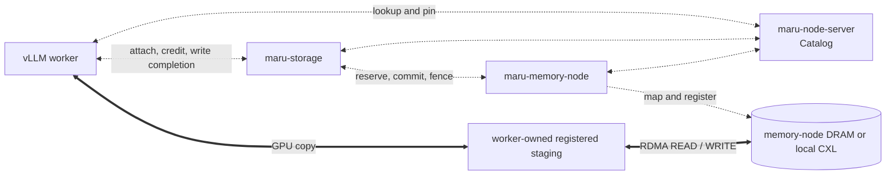

# Node StorageService

`maru_node` connects vLLM to a node-owned store. Each GPU node serves exactly one of `dram`, `local_cxl` or `remote`; a memory node owns one `dram` or `local_cxl` store. The Catalog in `maru-node-server` is the authority for published keys and their locations. The directly mapped `cxl` backend uses `maru-server` and a separate registry.

## Processes and data paths

| Process | Responsibility |
|---|---|
| `maru-node-server` | Catalog, node and worker sessions, publication, pins and retirement |
| `maru-storage` | GPU-node pools, worker attachment, credit and memory-node control |
| `maru-memory-node` | Memory-node pools, RDMA registrations, publication and shared LRU eviction |
| vLLM worker | GPU copies and, with `remote`, direct RDMA READ and WRITE |
| Resource Manager | CXL region ownership and holds; needed for `local_cxl` |



The diagram shows `remote`. For `dram` and `local_cxl`, workers map the node-owned pool and copy directly between that mapping and GPU memory. With `remote`, the GPU service carries control messages; KV bytes move through each worker's own staging. Workers and their GPU service must share a PID namespace so the service can verify process identity and exit.

## Stores and reads

For a local store, the worker obtains credit, fills its page, and reports write completion. The service publishes the key through Catalog COMMIT after the payload write completes. A local read pins the Catalog location and uses the mapped page until its GPU copy completes.

For a remote store, the GPU service reserves memory-node pages and obtains the instance's write registration for that GPU-node run. The worker copies GPU bytes into its registered staging, issues RDMA WRITE to those pages, and reports completion. The memory node publishes the key with Catalog COMMIT. A staging write or an RDMA completion alone does not publish a key.

For a remote read, the worker performs LOOKUP_AND_PIN and validates the pool registration and generation. It issues RDMA READ directly into its staging, then copies the bytes to the GPU. The source pin protects the memory-node page during the READ; staging stays owned until the GPU copy finishes. Reads already in progress for the same location can be joined within one worker. Different workers use separate staging and READs. Read bytes are never published or retained as cached copies.

Unavailable keys, stale locations and lack of a staging slot produce a MISS and recomputation. The read path does not wait for capacity or retry a failed read. Synchronous loads use the same direct reader on the engine thread. Deferred loads use the loader thread.

## Capacity and lifetimes

| Store | Owner | When full |
|---|---|---|
| GPU `dram` | GPU node | Skip new stores; keep existing keys |
| GPU `local_cxl` | GPU node | Skip new stores; keep existing keys |
| GPU `remote` | Memory node | Memory node evicts its least recently used unpinned keys |
| Memory-node `dram` or `local_cxl` | Memory node | Shared LRU, using the high and low watermarks |

Memory-node eviction covers all writers using that memory node, rather than a per-engine partition. Each GPU service connects to one memory-node endpoint. There is one Catalog per deployment; a list of Catalogs or memory endpoints is not accepted.

| Protection | Ends only when |
|---|---|
| Write credit | Its write is committed, safely cancelled or fenced |
| Catalog source pin | The READ completes or the unused result is discarded safely |
| Worker staging slot | NIC access and all GPU copies using it have ended |
| Orphan source pin after a GPU-service run change | The old worker releases it or its exit is verified |
| CXL region hold | Its mapping or NIC registration is safely removed |

The memory node maintains a separate write domain for each vLLM instance within a GPU-node run. Only ranks of that instance attached to the same GPU-node run share the domain; another GPU node or run has a separate domain. A worker exit, stopped worker, uncertain write, lost control connection or expired credit triggers revocation of that domain's write registration before unconfirmed pages are reclaimed. Fencing affects only the specified domain. Workers share the memory node's read registration, which is independent of write-domain revocation.

Time alone is not a fence. If revocation fails, unconfirmed pages remain quarantined; at the configured limit that GPU node receives no new credit. A confirmed revocation or a verified memory-node restart can recover those pages. An uncertain or failed native transfer keeps its worker staging out of reuse until the vLLM processes exit. Failed service teardown retains mappings and prevents another run in that process.

A GPU-service run change closes the worker's read admission gate before new READs can use old locations. Source pins held by live old workers survive that run change. A CUDA error that leaves a copy unconfirmed stops the worker, which returns no resources; restart the complete vLLM instance and verify that its old worker processes have exited.

## Restarts and memory generations

Catalog metadata is volatile. A `maru-node-server` restart invalidates all keys; services and workers establish new sessions and recompute misses. A DRAM pool ends with its service run. A `local_cxl` store can adopt regions and registered keys from an earlier run when the Catalog, boot and memory generation still match and earlier holds permit access. This is cache reuse, not persistent storage.

A memory-node extension can report `memory_generation()`. A changed generation, or an unknown generation beyond the grace period, revokes registrations and ends the run, invalidating old locations. An unknown generation at startup prevents service. See {doc}`read_hints` for the extension contract and {doc}`memory_node` for recovery.

## Configuration

`maru-storage --config gpu.json --check` and `maru-memory-node --config memory.json --check` validate JSON and print resolved defaults without starting pools or RDMA. Start each service with the same command without `--check`. The command selects its role; JSON has no `role` field. Unknown and duplicate keys are rejected.

Common keys:

| Key | Default | Rule |
|---|---|---|
| `node_id` | Required | Unique stable node name; starts with a letter or digit, followed by letters, digits, `.`, `_` or `-` |
| `server` | Required | One `maru-node-server` URL |
| `page_size` | Required | Positive byte size; must hold the largest stored object |
| `state_dir` | `/run/maru` | Writable service state and ownership-lock directory |
| `tiers` | Required | Exactly one store |
| `budgets` | Derived | Credit, pending-write and reserve limits |

GPU-only keys are `socket` (default `/run/maru/node.sock`), `socket_group` (default service group; a named group must exist) and `local_pin` (only `false` is supported). The socket mode is `0660`. Memory-only keys are `remote_server` and `region_extension`.

| Store key | Default | Rule |
|---|---|---|
| `dram.size` | Required | At least one page; capacity uses whole pages |
| `dram.hugepage` | `true` | Huge pages must be available; `false` uses ordinary pages |
| `local_cxl.size` | Required to serve | At least `region_size` |
| `local_cxl.region_size` | `1GiB` | A multiple of `page_size`, at least one page |
| `local_cxl.rm` | `127.0.0.1:9850` | Resource Manager address |
| `local_cxl.visibility` | `coherent` | `coherent` or `flush` |
| `high_watermark`, `low_watermark` | `0.9`, `0.8` | Memory nodes only; `0 < low < high <= 1` |

`remote` is GPU-only and accepts these keys in its tier object:

| Key | Default | Rule |
|---|---|---|
| `url` | Required | One `host:port`, optionally prefixed with `tcp://`; port 1–65535 |
| `key_file` | Required | Shared deployment key readable by the service |
| `rdma_device` | Empty | UCX chooses the NIC unless a device is specified |
| `timeout_s` | `30` | Positive transfer/control timeout in seconds |
| `staging_size` | `max(1GiB, 64 * page_size)` | Per worker; at least two whole pages and a multiple of `page_size` |
| `staging_max_bytes` | `staging_size` | Node-wide admission cap; at least `staging_size` |
| `quarantine_max` | Half of `staging_size` | Between one page and `staging_size` |
| `write_hints` | `false` | Send supported advisory write actions during reservation |
| `write_wait_ms` | `50` | Integer 0–10000; 0 disables preparation waits |

Set `staging_max_bytes` for the number of simultaneous workers, including TP and DP ranks. The service rejects attachment when another worker's staging would exceed this cap. Remote staging has no `hugepage` option.

`remote_server` accepts `listen` and `key_file` (both required), `rdma_device` (empty by default), `reserve_ttl_s` (positive, default `60`), `peer_quarantine_max` (positive bytes, default twice the derived `credit_max_bytes`) and `quarantine_max` (positive bytes, default `max(page_size, registered capacity / 8)`). Configure it on a memory node to serve remote workers.

`region_extension` requires a memory-node `local_cxl` store. Its keys are `name` (required), `config` (empty string), `generation_poll_s` (`0.1`), `generation_grace_s` (`2.0`) and `hint_requests_max` (`4096`). Both intervals and the integer request limit must be positive.

### Budgets

For a sized local store, `credit_total_max_bytes` defaults to 25% of its size. For `remote`, it defaults to two pages. `credit_max_bytes` defaults to that total rounded down to whole pages, with a one-page minimum. `credit_refill_high` defaults to the smaller of that worker cap and `max(16 pages, 512MiB)`, rounded down to whole pages. `credit_refill_low` defaults to 25% of the refill high value. `commit_pending_max_bytes` defaults to the total credit limit.

`transfer_reserve_bytes` defaults to 5% of each local store's size and accepts a byte size or a map keyed by `dram` or `local_cxl`. It is not the remote reader's staging reserve. Memory nodes reject the worker-only `credit_max_bytes`, `credit_refill_low` and `credit_refill_high` keys.

Validation requires `credit_refill_low <= credit_refill_high <= credit_max_bytes <= credit_total_max_bytes`, at least one page of worker credit, and, for a sized local store, total credit plus pending writes plus transfer reserve no greater than capacity. Sizes accept integer bytes or binary suffixes such as `M`, `MiB`, `G` and `GiB`.

### GPU DRAM

```json
{
  "node_id": "gpu-1",
  "server": "tcp://127.0.0.1:5556",
  "page_size": "32MiB",
  "tiers": [{"store": "dram", "size": "16GiB", "hugepage": false}]
}
```

### GPU local CXL

```json
{
  "node_id": "gpu-1",
  "server": "tcp://127.0.0.1:5556",
  "page_size": "32MiB",
  "tiers": [{"store": "local_cxl", "size": "16GiB", "region_size": "1GiB", "rm": "127.0.0.1:9850", "visibility": "coherent"}]
}
```

### GPU remote and memory-node local CXL

GPU configuration, allowing four workers with 2 GiB of staging each:

```json
{
  "node_id": "gpu-1",
  "server": "tcp://192.0.2.1:5556",
  "page_size": "32MiB",
  "tiers": [{"store": "remote", "url": "192.0.2.10:9871", "key_file": "/etc/maru/maru.key", "staging_size": "2GiB", "staging_max_bytes": "8GiB"}]
}
```

Memory-node configuration:

```json
{
  "node_id": "memory-1",
  "server": "tcp://192.0.2.1:5556",
  "page_size": "32MiB",
  "tiers": [{"store": "local_cxl", "size": "16GiB", "region_size": "1GiB", "rm": "127.0.0.1:9850"}],
  "remote_server": {"listen": "192.0.2.10:9871", "key_file": "/etc/maru/maru.key"}
}
```

Use matching page sizes and the same software release for the Catalog, services and workers. Use a shared key on GPU services and memory nodes; the Catalog does not need that key. Remote processes default to `UCX_TLS=rc,dc,cuda_copy` and `UCX_RCACHE_ENABLE=n`; explicit settings must preserve checked RC/DC transports and disable registration caching. See {doc}`../getting_started/installation` and {doc}`../getting_started/migrating_to_maru_node`.
