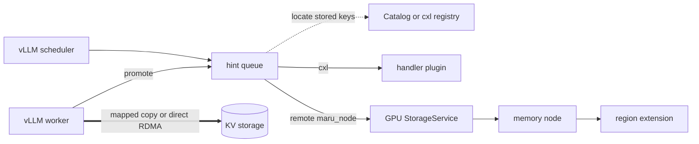

# Prefetch Hints (Read and Write)

Hints tell an installed extension which ranges a request may read or write. They are advice: keys, payload contents, ownership and the transfer path stay the same. A hint does not pin an object or prove that a later read will hit.

## Delivery



On `cxl`, `MaruHandler` calls plugins implementing `on_memory_hint` and advertising the corresponding `hint_actions`. On remote `maru_node`, the scheduler locates keys through the Catalog and sends ranges to its GPU service. The GPU service forwards supported actions to the memory node, which checks pool identity, registration, generation and page bounds before calling the extension. Workers announce the start of hinted loads through the same service path.

| Action | Meaning | Payload |
|---|---|---|
| `read_hint` | Request may read these ranges in order | Request ID and ranges |
| `read_promote` | Worker starts that request's load | Request ID |
| `read_hint_end` | Load ended or request finished | Request ID |
| `write_hint` | Reserved pages are about to be written | Ranges |
| `write_wait` | Bounded preparation before replying to reservation | Ranges and wait limit |

The extension receives `{"handle": {"region_id", "offset", "length", ...}, "offset", "length"}` ranges. Inner offsets are relative to the handle. Scheduler and worker messages can arrive on separate connections, so extensions must tolerate a promote arriving before its hint.

## Configuration and failure handling

`maru_read_hints=true` enables scheduler hints with deferred loading. `maru_read_hint_on_arrival=true` requests an earlier advisory hint through a vLLM hook; an incompatible hook logs a warning and keeps lookup-time hints. Hints are queued outside the load path. A full hint queue drops advisory work; stale or rejected hints do not change the load result.

Memory nodes advertise accepted actions. A `local_cxl` memory node loads its extension from the `maru.region_extensions` entry-point group:

```json
{
  "name": "my_extension",
  "config": "",
  "generation_poll_s": 0.1,
  "generation_grace_s": 2.0,
  "hint_requests_max": 4096
}
```

Place this object under the memory-node configuration's `region_extension`. The opaque `config` string is passed to the factory with the run epoch. Both intervals and the integer request limit must be positive. The factory must implement `validate_access`, `mapped`, `hint`, `retire` and `close`. Optional hooks are `memory_generation` and `connection_closed`; `hint_actions` advertises supported actions.

GPU `remote.write_hints` defaults to `false`. With it enabled, reservation sends a supported `write_hint` or `write_wait` before the worker's WRITE. `write_wait_ms` defaults to `50` and accepts integers from `0` to `10000`; `0` disables preparation waits. Reservation proceeds after the bounded wait even if preparation is incomplete. Read hints do not enable write hints implicitly.

Hint callback errors are logged and do not fail KV transfers. Mapping and generation checks protect access and can refuse service. Hooks must be thread-safe; ordinary hints, generation and retirement answer promptly from local state. Only `write_wait` may wait for preparation, up to its timeout. A hint never authorizes reuse of an in-use page.

## Region lifecycle and memory resets

`validate_access` runs before mapping a CXL region. `mapped` runs after NIC registration, with `fresh=true` for a new allocation and `false` for an adopted region. `retire` follows registration revocation and precedes release to the Resource Manager; a refusal retains the region. `connection_closed` clears connection-specific hint state, and `close` ends the extension's run.

The memory node combines its boot identity with the extension's `memory_generation()`. Generation checks run periodically and on control and mapping operations. A changed generation revokes old registrations and starts a fresh run without adopting the old contents. If generation stays unknown beyond `generation_grace_s`, access is refused and old locations are invalidated. Startup with an unknown generation fails. Time passing does not authorize page reuse without revocation.

(read-hint-scope)=

## Scope

Read hints and promote are available to `cxl` handler plugins and remote memory-node extensions. Node-local `dram` and `local_cxl` have no read-hint receiver. Write hints and memory-generation handling belong to memory-node extensions; installing a handler plugin does not add them to `cxl`.

Scheduler hints identify every stored object needed by a prefix: TP slices, layerwise objects on `cxl`, and each required KV group. Hints stop at missing objects and cannot establish read availability. See {doc}`../api_reference/plugins` for handler plugins and {doc}`node_storage_service` for configuration and lifetimes.
