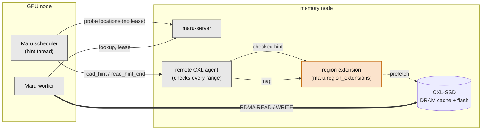
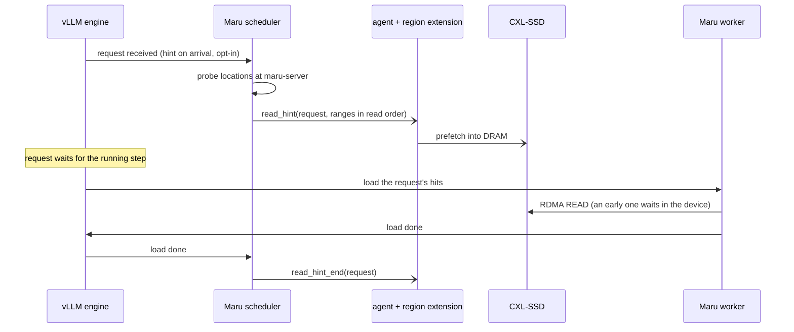

# Read Hints

Some CXL memory answers every address but not always at the same speed. A
CXL-SSD, for example, keeps a DRAM cache in front of its flash: an RDMA READ of
a page already in DRAM runs at DRAM speed, one of a page still on flash waits
inside the device until the page is brought in. The device writes data back to
flash on its own. Such a device is correct without any help from Maru, but it
is fast only when it knows early which pages are coming.

Maru knows that early. A request waits for the running engine step before the
scheduler picks it, and for the scheduler to admit its load before the worker
starts it. A **read hint** carries the pages a request will read to the memory
side during that wait, so the device can prefetch them. Maru's KV data path
(lookup, lease, RDMA READ and WRITE) is the same with or without hints.

## Who owns what

Grey boxes are Maru; the orange box is a separately installed package. Thick
arrows carry KV bytes, thin arrows carry control messages.

- **Maru** decides which keys hit, which pages hold them and which bytes move.
  It finds where a request's hits are, sends the hint to the remote CXL agent
  of their regions and never waits for an answer.
- **The remote CXL agent** maps and registers regions. It hands a hint to its
  region extension only after checking that every range lies in a region it
  maps and some connection holds, under that region's own capability. The
  sender needs to hold no region itself: the scheduler holds none.
- **The region extension** (entry point group `maru.region_extensions`,
  selected with `--region-extension`) owns whatever it does to the device. It
  hears each region as it is mapped, may refuse to map a region and may keep
  a region from going back while a device command on it still runs.
  The agent advertises in its hello which hint actions the extension takes;
  Maru sends hints only to agents that advertise them.
- **Latency.** The agent asks the extension whether a region may go back while
  every other request waits, and hands it each hint on request threads. The
  extension answers these from its own
  state within microseconds: it queues a hint for its own thread and never
  waits on the device or another process there.

## One request

- **Where hints come from.** With `maru_read_hints` and `maru_async_load`, the
  vLLM scheduler connector hints a request the first time it finds a load for
  it, or, with `maru_read_hint_on_arrival`, as soon as vLLM's engine receives
  it. Each load is hinted once and its hint is ended once, as soon as vLLM
  reports the load done, so the memory side stops keeping the hinted bytes
  while the request decodes; a request that finishes first ends it then. A
  process that names no request to its storage (LMCache's `maru://` backend,
  for example) can set `read_hints` on its worker instead: each load is then
  hinted as its READs start.
- **Hint on arrival hooks into vLLM.** vLLM offers no interface for this, so
  Maru wraps an internal method of vLLM's engine. It does so only if the
  method has the shape Maru expects; otherwise hints on arrival are off with
  a warning, and the scheduler still hints when it first finds the load. A
  vLLM upgrade can change that method, so check this warning after one.
- **No waiting.** The caller only queues the hint. One thread per backend looks
  the keys up and sends the messages in the order hints were given. While 1024
  hints wait, further hints are dropped with a warning; ends are never dropped.
  A process keeps at most 4096 hinted requests open and ends the oldest past
  that; the agent refuses a connection's hints past its own limit (4096 by
  default), and the extension bounds what it keeps as well.
- **Advice only.** A hint that is late, lost or wrong costs only the time it
  would have saved: the load still leases and reads every key. A hint on
  arrival may name more chunks than the load reads, since vLLM's own prefix
  cache is consulted later. A process that dies sends no end, so the extension
  also expires what it prepared; the agent also tells it when any connection
  closes, so it can end what that connection's hints started.

The message formats and the extension's hooks, locks and failure outcomes are
documented in `maru_handler/storage/remote_cxl/hints.py`,
`maru_remote/region_map.py` and `maru_remote_cxl_agent/extension.py`.

## Scope

Read hints are sent on the `remote_cxl` backend. A CXL-SSD attached to the GPU
node's own host has the same need; there no agent sits between Maru and the
device, and hints would reach the device software through a handler plugin.
