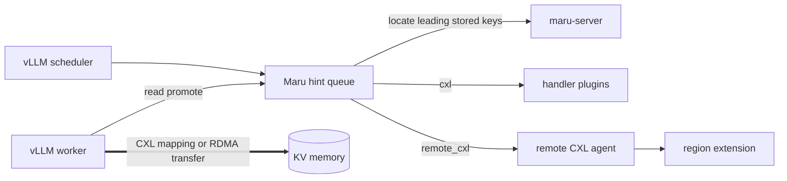
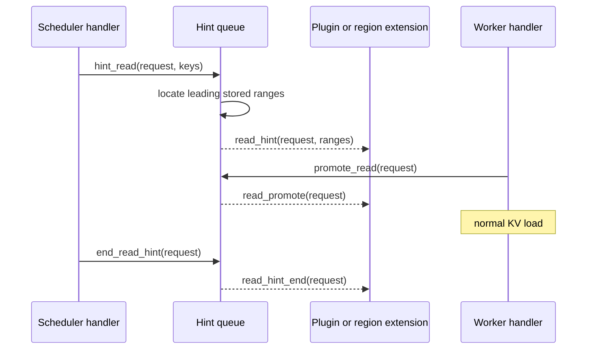

# Prefetch Hints (Read and Write)

Maru can notify an independently installed plugin of the memory ranges a
request will read or write. These messages are advisory: enabling them does
not change the KV keys, allocation ownership, lookup results or transfer
path. Maru defines the message interface; the plugin owns its preparation
policy and any work it performs outside Maru.

## Who owns what

*Figure 1. Hint delivery and KV transfers. Thin arrows carry control
messages; the thick arrow carries KV bytes. Handler plugins and region
extensions are separate packages selected by the operator.*

- The scheduler identifies a request's leading stored chunks.
- The worker announces when the hinted load starts.
- On `cxl`, `MaruHandler` delivers messages to handler plugins that
  implement `on_memory_hint` and advertise the corresponding
  `hint_actions`.
- On `remote_cxl`, the remote CXL agent validates each range against its
  mapped regions and capabilities before calling its region extension.
  The extension is selected with `--region-extension`.
- Plugins own their implementation and dependencies. Maru does not require
  a particular plugin, product or service.

## One request

*Figure 2. Request lifecycle. Scheduler and worker handlers can use separate
connections; a receiver must correlate messages by request ID and tolerate
a promote arriving before its hint.*

| Action | Meaning | Payload |
|---|---|---|
| `read_hint` | The request may soon read these ranges, in order | Request ID and ranges |
| `read_promote` | The worker is starting that request's load | Request ID |
| `read_hint_end` | The load ended, or the request finished first | Request ID |
| `write_hint` | A store is about to write its allocated ranges; remote only | Ranges |
| `write_wait` | Bounded preparation wait before a remote write | Ranges and wait limit |

A range is `{"handle": {"region_id", "offset", "length"}, "offset", "length"}`.
Its inner offset and length identify bytes within the handle. The handle's
offset identifies the mapping offset, not a device-specific address.
See {doc}`../api_reference/plugins` for the local hook contract.

## Scheduling and failure handling

With `maru_read_hints` and `maru_async_load`, the scheduler hints at its
first lookup of a request. `maru_read_hint_on_arrival` can send the hint
earlier, through an optional wrapper around a vLLM internal method. If that
method is incompatible, Maru warns and retains hints at lookup time.

The caller queues a message without waiting for plugin work. One hint
thread locates keys and delivers messages. The queue accepts up to 1024
waiting hints; additional hints are dropped with a warning, while end
messages are retained. A process tracks at most 4096 open hinted requests
and ends the oldest when that limit is exceeded.

A hint does not hold a read lease or establish that a later lookup will
succeed. Receivers must tolerate stale ranges, missing end messages and
messages arriving in a different order across connections. Plugin callbacks
should return promptly and expire request state independently. Callback
exceptions are logged and isolated from other plugins and KV transfers.

On `cxl`, enabling hints without an accepting plugin logs a warning and
sends no hints. Closing the handler drains its hint thread before closing
plugins. On `remote_cxl`, agents advertise accepted actions and only those
actions are sent. `write_wait` is bounded by `write_wait_ms` (default 50 ms,
0 disables waiting), plus the reply timeout if the agent does not answer;
the write proceeds after the wait.

## Memory resets

The remote agent can combine an extension-provided memory generation with
the node's boot identity. A generation change invalidates old registrations
and mappings, so owners and readers apply their existing reboot handling.
When a generation becomes unknown beyond the configured grace period,
the agent invalidates mappings and refuses new maps until it knows the
generation again.

The polling interval is `--memory-generation-poll-s` (default 0.1 seconds)
and the grace period is `--memory-generation-grace-s` (default 2 seconds).
Generation checks also run on hello, map and sweep operations. The extension
must report changes consistently; this interface is not proof that an
external device or service detects every loss.

(read-hint-scope)=
## Scope

Read hints, read promotes and read-hint ends are available on `remote_cxl`
and `cxl`. Write hints and memory-generation handling remain
`remote_cxl` only. Installing a handler plugin does not add either feature
to `cxl`.

In vLLM, scheduler hints name chunk keys without tensor-parallel slice or
KV-group suffixes. They currently apply at TP = 1 with one KV cache group;
when keys do not match, no hint is sent and the normal load still runs.

Message transport is implemented in `maru_handler/hints.py`. Remote range
validation and extension contracts are in `maru_remote/region_map.py` and
`maru_remote_cxl_agent/extension.py`.
