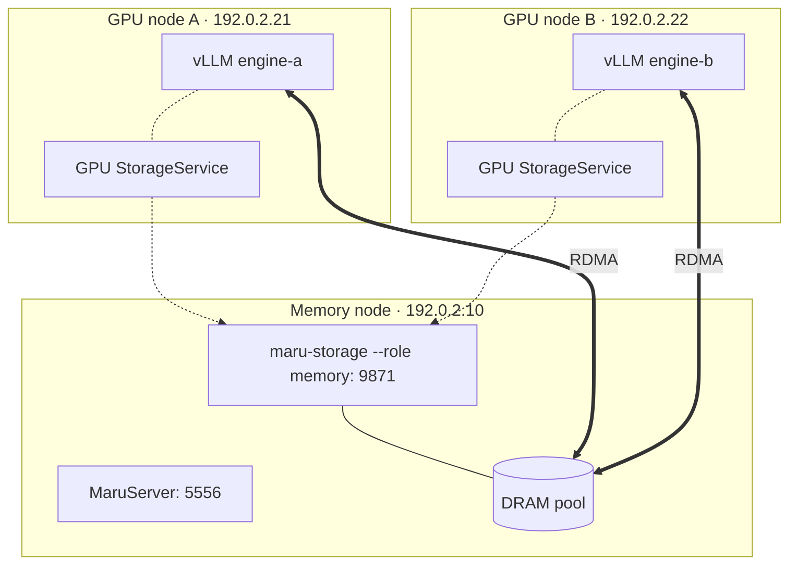

(quickstart-node-remote)=

# Memory Node over RDMA

Engines on two GPU nodes share a memory node's pool over RDMA. The pool is DRAM or CXL on the memory node, and the GPU nodes need no CXL. This example uses DRAM. Workers move KV bytes between their own registered staging and the pool with one-sided RDMA. The services exchange only control messages.



Dashed lines show control connections. Thick lines carry KV bytes. Engines and services also reach MaruServer.

## Prerequisites

Each GPU node needs an NVIDIA GPU and an RDMA NIC. The memory node also needs an RDMA NIC. Follow the {ref}`Node Store requirements <node-store-requirements>` in Installation for vLLM, NIXL and the memlock limits. Use the same Maru release on all nodes and activate its environment in each terminal.

Create `/run/maru` on all three nodes for the StorageService node locks. Each GPU StorageService also creates its worker socket there.

```bash
sudo install -d -o "$USER" -g "$(id -gn)" /run/maru
```

Replace the addresses with your own. GPU nodes must reach the memory node on TCP ports `5556` and `9871` and over RDMA. The client node must reach port `8000` on both GPU nodes.

## 1. Start the services

(quickstart-deployment-key)=

### Create the deployment key

The GPU and memory StorageServices authenticate with a shared key. Generate it once:

```bash
umask 077
openssl rand -hex 32 > maru.key
```

Copy `maru.key` to the other nodes, and install it on all three:

```bash
sudo install -D -m 600 -o "$USER" maru.key /etc/maru/maru.key
```

MaruServer and vLLM do not use the key.

### Start the memory node

On the memory node, start MaruServer in its own terminal:

```bash
maru-server --backend node --host 192.0.2.10 --port 5556
```

Write `memory.json`:

```json
{
  "node_id": "memory-1",
  "server": "tcp://192.0.2.10:5556",
  "page_size": "32MiB",
  "tiers": [{"store": "dram", "size": "16GiB", "hugepage": false}],
  "remote_server": {"listen": "192.0.2.10:9871", "key_file": "/etc/maru/maru.key"}
}
```

Check the configuration, then start the memory StorageService in another terminal.

```bash
maru-storage --role memory --config memory.json --check
maru-storage --role memory --config memory.json
```

A memory node can serve local CXL instead: start the Resource Manager there and use a `local_cxl` tier.

### Start the GPU nodes

On GPU node A, write `gpu.json`. On GPU node B, use `"node_id": "gpu-b"`:

```json
{
  "node_id": "gpu-a",
  "server": "tcp://192.0.2.10:5556",
  "page_size": "32MiB",
  "tiers": [{"store": "remote", "url": "192.0.2.10:9871", "key_file": "/etc/maru/maru.key"}]
}
```

Check the configuration, then start the GPU StorageService on each GPU node.

```bash
maru-storage --role gpu --config gpu.json --check
maru-storage --role gpu --config gpu.json
```

If a node has several RDMA NICs, set `rdma_device` in the `remote` tier and in `remote_server`. Each worker gets its own staging (`staging_size`, 2 GiB with this page size), and the default `staging_max_bytes` admits one worker per GPU node. For TP or DP, set `staging_max_bytes` to `staging_size` times the number of workers on the node. Workers and their GPU StorageService must share a PID namespace.

## 2. Check without a GPU

Use the {ref}`producer.py and consumer.py scripts <quickstart-node-clients>` from the Quick Start. On **GPU node A**, run the producer against A's GPU StorageService socket. It writes 1 MiB to the memory node over RDMA.

```bash
CUDA_VISIBLE_DEVICES="" python3 producer.py /run/maru/node.sock
```

After the producer exits, run the consumer on **GPU node B**. The socket path is the same on both nodes. On B it connects to B's GPU StorageService, and the consumer reads the stored bytes from the memory node over RDMA.

```bash
CUDA_VISIBLE_DEVICES="" python3 consumer.py /run/maru/node.sock
```

The consumer should print `Success: read 1 MiB from the producer`. With GPUs hidden, UCX can report a CUDA initialization error while the host-memory transfer succeeds.

## 3. Start two vLLM engines

Start one engine on each GPU node. On GPU node A:

```bash
vllm serve Qwen/Qwen3-0.6B --revision c1899de289a04d12100db370d81485cdf75e47ca --port 8000 --kv-transfer-config '{
  "kv_connector": "MaruKVConnector",
  "kv_connector_module_path": "maru_vllm",
  "kv_role": "kv_both",
  "kv_load_failure_policy": "recompute",
  "kv_connector_extra_config": {
    "maru_node": "/run/maru/node.sock",
    "maru_engine_id": "engine-a",
    "maru_cache_namespace": "Qwen/Qwen3-0.6B@c1899de289a04d12100db370d81485cdf75e47ca",
    "maru_async_load": true
  }
}'
```

On GPU node B, start the second engine with its own engine ID.

```bash
vllm serve Qwen/Qwen3-0.6B --revision c1899de289a04d12100db370d81485cdf75e47ca --port 8000 --kv-transfer-config '{
  "kv_connector": "MaruKVConnector",
  "kv_connector_module_path": "maru_vllm",
  "kv_role": "kv_both",
  "kv_load_failure_policy": "recompute",
  "kv_connector_extra_config": {
    "maru_node": "/run/maru/node.sock",
    "maru_engine_id": "engine-b",
    "maru_cache_namespace": "Qwen/Qwen3-0.6B@c1899de289a04d12100db370d81485cdf75e47ca",
    "maru_async_load": true
  }
}'
```

## 4. Verify sharing

Use `send.py` from {ref}`the Quick Start <quickstart-node-verify>`. Check both engines from the client node.

```bash
engine_a=http://192.0.2.21:8000
engine_b=http://192.0.2.22:8000
curl -fsS "$engine_a/health" && curl -fsS "$engine_b/health"
```

Once both health checks succeed, send the same prompt to each engine. Keep engine B idle between samples so the counter changes belong to this request.

```bash
metrics() {
    curl -fsS "$engine_b/metrics" | grep -E '^vllm:(external_prefix_cache_hits_total|prompt_tokens_by_source_total[{][^}]*source="external_kv_transfer")'
}
python3 send.py "$engine_a"
metrics
python3 send.py "$engine_b"
metrics
```

A rise in `vllm:external_prefix_cache_hits_total` counts tokens matched by the lookup. Check that `vllm:prompt_tokens_by_source_total{source="external_kv_transfer"}` also increases and that the worker reports a completed load. See {ref}`the Quick Start sharing check <quickstart-node-verify>` for load failures.

## 5. Stop

Stop the engines, then the GPU StorageService on each GPU node, then the memory StorageService and finally MaruServer.

## Next steps

- {doc}`../../design_doc/node_storage_service` — Configuration keys, budgets, eviction and recovery
- {doc}`../../integration/vllm` — Connector settings, tensor parallelism and hybrid models
