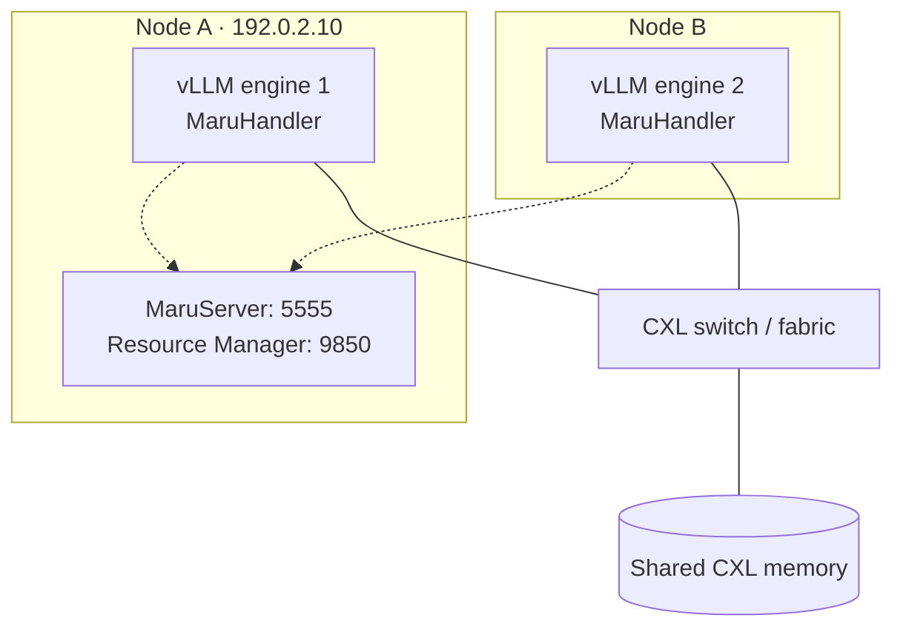

# Shared CXL

With the `cxl` backend, vLLM engines on nodes attached to the same CXL memory map one shared pool directly through their local DAX devices. Start the services, check sharing with two Python processes, then run two vLLM engines that share KV.

| Setup | Required environment | Where the engines run |
|-------|----------------------|-----------------------|
| {ref}`Single node <quickstart-single-host>` | One x86 node with a CXL DEV_DAX device and two NVIDIA GPUs | Both on the same node |
| {ref}`Multiple nodes <quickstart-multi-host>` | Two x86 nodes connected to shared CXL memory through a CXL switch/fabric, each with an NVIDIA GPU | Engine 1 on Node A, engine 2 on Node B |

Complete {doc}`bios_setup`. On each GPU node, install vLLM 0.16 or later for deferred loading before installing Maru. See the {ref}`vLLM prerequisites <vllm-prerequisites>` and {doc}`installation`. Activate the Maru environment in each terminal. Install one Resource Manager on the node that owns the shared CXL pool. Both clients reach that Resource Manager on port `9850` and MaruServer (`maru-server --backend cxl`) on port `5555`.

## 1. Start the services

Choose one setup below. Keep the services running for the Python check and the vLLM engines.

(single-host)=
(quickstart-single-host)=

### Single node

Start the Resource Manager as a systemd service:

```bash
sudo systemctl start maru-resource-manager
```

Alternatively, with the service stopped, run it in a dedicated terminal:

```bash
sudo maru-resource-manager --host 127.0.0.1 --port 9850
```

Wait for `ready — listening on 127.0.0.1:9850` in the Resource Manager log. For the systemd service, use `journalctl -u maru-resource-manager`. Run the following command on the node running the Resource Manager. Confirm that the intended device shows `state=active` and has space for both engines' `maru_pool_size` allocations (4 GiB each here).

```bash
sudo maru-rm-ctl status
```

Start MaruServer in another terminal.

```bash
maru-server --backend cxl
```

Continue to {ref}`the GPU-free check <quickstart-clients>`.

(multi-host)=
(quickstart-multi-host)=

### Multiple nodes

This example runs both services and engine 1 on **Node A**, with engine 2 on **Node B**:



Dashed lines are TCP connections to the services on Node A. Solid lines show each node's direct access to the shared memory through its local DEV_DAX device and the CXL fabric.

Both nodes must have read/write access to the **same physical CXL memory at matching device offsets**. Install Maru with `./install.sh` on Node A and `./install.sh --no-rm` on Node B.

Replace `192.0.2.10` with Node A's reachable IP. Node B must be able to reach Node A on TCP ports `5555` and `9850`.

Run one Resource Manager for the shared pool on **Node A**. Only one process can lock its state directory. Stop the systemd service before starting the foreground Resource Manager in a dedicated terminal.

```bash
sudo systemctl stop maru-resource-manager
sudo maru-resource-manager --host 192.0.2.10 --port 9850
```

To run it as the systemd service instead, see the {ref}`multi-node configuration <installation-multi-node-config>`.

Wait for `ready — listening on 192.0.2.10:9850`. Run the following command on the node running the Resource Manager. Confirm that the intended device shows `state=active` and has space for both engines' `maru_pool_size` allocations (4 GiB each here).

```bash
sudo maru-rm-ctl status
```

Start MaruServer in another terminal on **Node A**.

```bash
maru-server --backend cxl --host 192.0.2.10 --port 5555 \
    --rm-address 192.0.2.10:9850 \
    --dax-path /dev/dax0.0
```

Replace `/dev/dax0.0` with the shared device's path on Node A. Local device names may differ on Node B; Maru resolves them by UUID. The advertised `--rm-address` must be reachable from Node B, so use Node A's IP here.

Continue to {ref}`the GPU-free check <quickstart-clients>`.

(quickstart-clients)=

## 2. Check without a GPU

A Python producer and consumer can check the shared pool through `MaruHandler` without a GPU or inference engine. Run this optional check while the services from step 1 are running. Set the MaruServer address in both client terminals. Use `tcp://127.0.0.1:5555` on a single node or `tcp://192.0.2.10:5555` on both nodes in the two-node setup.

```bash
export MARU_SERVER_URL=tcp://127.0.0.1:5555
```

With two nodes, run the producer on Node A and the consumer on Node B.

### Producer: write and store

Run this first and keep it running until the consumer finishes:

```python
import os

from maru import MaruConfig, MaruHandler
from maru_shm._cxl_flush import HAVE_CLFLUSH, flush_range

assert HAVE_CLFLUSH, "This CPU example requires x86 cache-flush support"

config = MaruConfig(
    server_url=os.environ["MARU_SERVER_URL"],
    instance_id="producer",
    pool_size=100 * 1024 * 1024,
)

with MaruHandler(config) as handler:
    data = b"A" * (1024 * 1024)
    handle = handler.alloc(size=len(data))
    handle.buf[:] = data
    flush_range(handle.buf)  # Make the CPU write visible before publishing.
    handler.store(key="quickstart-demo", handle=handle)

    print("Stored 1 MiB. Run the consumer.")
    input("Press Enter after the consumer finishes...")
```

### Consumer: retrieve and verify

Run this in the other client terminal:

```python
import os

from maru import MaruConfig, MaruHandler
from maru_shm._cxl_flush import HAVE_CLFLUSH, flush_range

assert HAVE_CLFLUSH, "This CPU example requires x86 cache-flush support"

config = MaruConfig(
    server_url=os.environ["MARU_SERVER_URL"],
    instance_id="consumer",
    pool_size=100 * 1024 * 1024,
)

with MaruHandler(config) as handler:
    result = handler.retrieve(key="quickstart-demo")
    assert result is not None, "Run the producer first"
    flush_range(result.view)  # Discard local cached copies before reading.
    assert bytes(result.view) == b"A" * (1024 * 1024)
    print("Success: read the producer's data from shared CXL memory")
```

The consumer should print `Success: read the producer's data from shared CXL memory`. The `flush_range` calls make CPU writes and reads visible across nodes and are used in both setups. They require Maru's x86 cache-flush extension; if the import fails, see {ref}`verifying the installation <installation-verify>`. See {doc}`../design_doc/consistency_and_safety` for the write-back and invalidation pattern.

Press Enter in the producer terminal after the consumer exits, then continue to {ref}`the vLLM engines <quickstart-cxl-engines>`.

(quickstart-cxl-engines)=

## 3. Start two engines

Start two engines in separate terminals. Each engine maps `maru_pool_size` of the shared pool for the KV it stores. On a single node, run both engines alongside the services:

```bash
CUDA_VISIBLE_DEVICES=0 vllm serve Qwen/Qwen3-0.6B --port 8000 --kv-transfer-config '{
  "kv_connector": "MaruKVConnector",
  "kv_connector_module_path": "maru_vllm",
  "kv_role": "kv_both",
  "kv_connector_extra_config": {
    "maru_server_url": "tcp://127.0.0.1:5555",
    "maru_pool_size": "4G"
  }
}'
```

```bash
CUDA_VISIBLE_DEVICES=1 vllm serve Qwen/Qwen3-0.6B --port 8001 --kv-transfer-config '{
  "kv_connector": "MaruKVConnector",
  "kv_connector_module_path": "maru_vllm",
  "kv_role": "kv_both",
  "kv_connector_extra_config": {
    "maru_server_url": "tcp://127.0.0.1:5555",
    "maru_pool_size": "4G"
  }
}'
```

With two nodes, run engine 1 on Node A and engine 2 on Node B. On nodes with one GPU each, set `CUDA_VISIBLE_DEVICES=0` on both. Point both engines at `"maru_server_url": "tcp://192.0.2.10:5555"` and keep port `8001` for engine 2.

(quickstart-cxl-verify)=

## 4. Verify sharing

Save this client as `send.py`. It sends the same prompt to each engine.

```python
import json
import sys
import urllib.request

prompt = " ".join(
    f"Line {i}: Maru shares KV cache between engines." for i in range(200)
)
body = {
    "model": "Qwen/Qwen3-0.6B",
    "prompt": prompt,
    "max_tokens": 16,
    "temperature": 0,
}
request = urllib.request.Request(
    f"{sys.argv[1]}/v1/completions",
    data=json.dumps(body).encode(),
    headers={"Content-Type": "application/json"},
)
with urllib.request.urlopen(request) as response:
    print(json.load(response)["choices"][0]["text"])
```

From the client node, check that both engines are ready. For the two-node setup, replace each loopback address with the IP address of the node running that engine.

```bash
engine_a=http://127.0.0.1:8000
engine_b=http://127.0.0.1:8001
curl -fsS "$engine_a/health" && curl -fsS "$engine_b/health"
```

Once both health checks succeed, send the same prompt to each engine. Keep engine B idle between samples so the counter changes belong to this request.

```bash
metrics() {
    curl -fsS "$engine_b/metrics" | grep -E '^vllm:(external_prefix_cache_hits_total|prompt_tokens_by_source_total[{][^}]*source="external_kv_transfer")'
}
python3 send.py "$engine_a"
metrics
python3 send.py "$engine_b"
metrics
```

A rise in `vllm:external_prefix_cache_hits_total` counts tokens matched by the lookup. Check that `vllm:prompt_tokens_by_source_total{source="external_kv_transfer"}` also increases and that the worker reports a completed load. If the hit counter stays at zero, check the Resource Manager pool's state and free capacity first.

## 5. Stop

Press Ctrl+C in the engine terminals, then stop MaruServer, then the Resource Manager if you started it for this example. Use Ctrl+C for foreground processes, or `sudo systemctl stop maru-resource-manager` for the systemd service.

## Next steps

- {doc}`examples/vllm/index` — More vLLM serving examples
- {doc}`examples/dynamo/index` — Run Dynamo with Maru-backed vLLM workers
- {doc}`examples/lmcache/index` — Use Maru as a shared KV cache backend for LMCache
- {doc}`../design_doc/architecture_overview` — System architecture and component interactions
- {doc}`../api_reference/api` — Python API
- {doc}`../api_reference/config` — Configuration options
