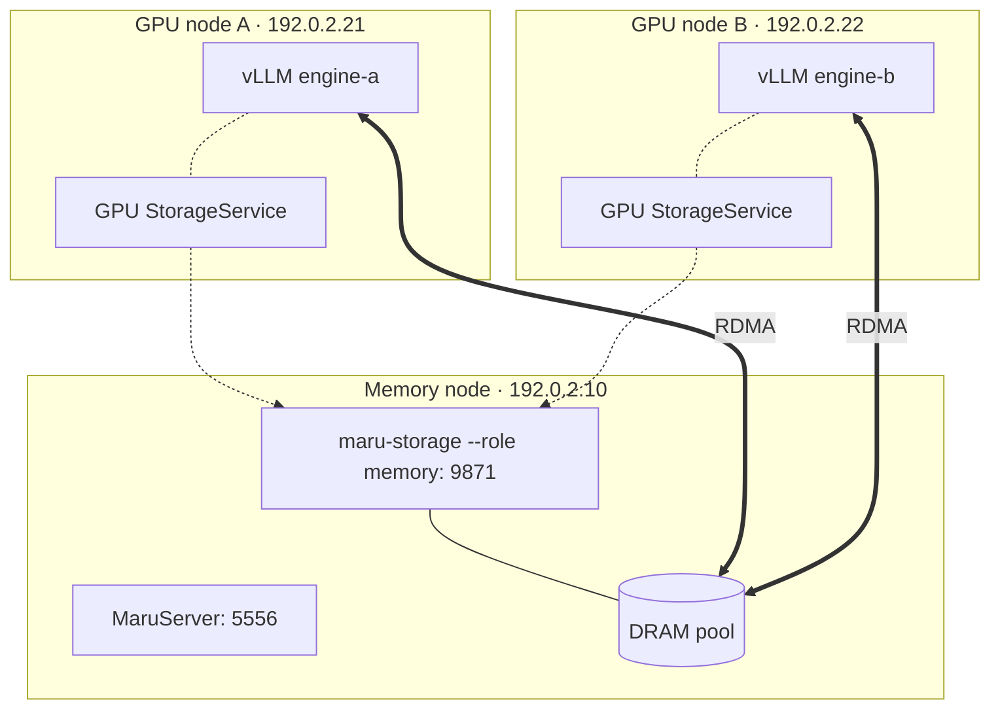

# Node Store

The node backend (selected by `maru_node`) uses one MaruServer (`maru-server --backend node`) to track keys. Each worker connects to its GPU StorageService (`maru-storage --role gpu`) over a Unix socket. Engines on one GPU node can share its local store. Engines on different GPU nodes can share a pool owned by a memory StorageService (`maru-storage --role memory`).

| Setup | Store | Hardware for vLLM | Engines that share KV |
|---|---|---|---|
| {ref}`One GPU node <quickstart-node-local>` | `dram`, or `local_cxl` | NVIDIA GPU; CXL DEV_DAX and the Resource Manager only for `local_cxl` | Engines on that node |
| {ref}`GPU nodes with a memory node <quickstart-node-remote>` | GPU `remote`; memory-node `dram` or `local_cxl` | NVIDIA GPU and RDMA NIC on each GPU node; RDMA NIC on the memory node | Engines on all GPU nodes that use the memory node |

On each GPU node, install vLLM 0.16 or later for deferred loading before installing Maru. See the {ref}`vLLM prerequisites <vllm-prerequisites>` and {doc}`installation`. For remote storage, install the {ref}`NIXL stack <nixl-stack>` on each GPU node and install Maru and NIXL on the memory node. Use the same Maru release on all nodes and activate its environment in each terminal. Install the Resource Manager only on a node that owns CXL regions. The examples use `Qwen/Qwen3-0.6B`. For another {doc}`supported model <../integration/supported_models>`, its largest stored KV object must fit in `page_size`.

Both service roles keep their node lock in `/run/maru` by default. The GPU StorageService also creates its worker socket there. Create the directory on every node running a service.

```bash
sudo install -d -o "$USER" -g "$(id -gn)" /run/maru
```

(quickstart-node-local)=

## One GPU node

Two engines on one GPU node share the node's DRAM store.

### 1. Start the services

Start MaruServer in its own terminal:

```bash
maru-server --backend node --host 127.0.0.1 --port 5556
```

Write the GPU node's configuration to `gpu.json`:

```json
{
  "node_id": "gpu-1",
  "server": "tcp://127.0.0.1:5556",
  "page_size": "32MiB",
  "tiers": [{"store": "dram", "size": "16GiB", "hugepage": false}]
}
```

Check the configuration, then start the GPU service in another terminal. The GPU role is the default for `maru-storage`:

```bash
maru-storage --role gpu --config gpu.json --check
maru-storage --role gpu --config gpu.json
```

To use local CXL instead of DRAM, complete {doc}`bios_setup`, start the Resource Manager (`sudo systemctl start maru-resource-manager`) and use `{"store": "local_cxl", "size": "16GiB"}` as the tier.

(quickstart-node-clients)=

### 2. Check without a GPU

Run two Python processes on this node. Each connects to the GPU StorageService socket with its own engine ID. Both use the same cache namespace.

Save the producer as `producer.py`. It stores 1 MiB under one key.

```python
import sys

from maru import MaruConfig, MaruHandler

config = MaruConfig(
    maru_node=sys.argv[1],
    engine_id="producer",
    cache_namespace="quickstart",
    pin_pools=False,
)
with MaruHandler(config) as handler:
    data = b"A" * (1024 * 1024)
    handle = handler.alloc(len(data))
    handle.buf[:] = data
    if not handler.store("quickstart-demo", handle):
        raise RuntimeError("Could not store quickstart-demo")
```

Save the consumer as `consumer.py`. It reads the same key and releases the read when it leaves the `with result` block.

```python
import sys

from maru import MaruConfig, MaruHandler

config = MaruConfig(
    maru_node=sys.argv[1],
    engine_id="consumer",
    cache_namespace="quickstart",
    pin_pools=False,
)
with MaruHandler(config) as handler:
    result = handler.retrieve("quickstart-demo")
    if result is None:
        raise RuntimeError("Run the producer first")
    with result:
        if result.view != b"A" * (1024 * 1024):
            raise ValueError("The stored bytes differ")
        print("Success: read 1 MiB from the producer")
```

Run the producer first. Once it exits, the GPU StorageService still owns the stored data, so the consumer can read it.

```bash
CUDA_VISIBLE_DEVICES="" python3 producer.py /run/maru/node.sock
CUDA_VISIBLE_DEVICES="" python3 consumer.py /run/maru/node.sock
```

The consumer should print `Success: read 1 MiB from the producer`.

### 3. Start two vLLM engines

Start two engines in separate terminals. They connect to the default socket `/run/maru/node.sock`. Give each engine a distinct `maru_engine_id`. Pin the same immutable revision in both engine commands and include it in their shared namespace so a cache key identifies the same weights on both engines.

```bash
CUDA_VISIBLE_DEVICES=0 vllm serve Qwen/Qwen3-0.6B --revision c1899de289a04d12100db370d81485cdf75e47ca --port 8000 --kv-transfer-config '{
  "kv_connector": "MaruKVConnector",
  "kv_connector_module_path": "maru_vllm",
  "kv_role": "kv_both",
  "kv_load_failure_policy": "recompute",
  "kv_connector_extra_config": {
    "maru_node": "/run/maru/node.sock",
    "maru_engine_id": "engine-1",
    "maru_cache_namespace": "Qwen/Qwen3-0.6B@c1899de289a04d12100db370d81485cdf75e47ca",
    "maru_async_load": true
  }
}'
```

```bash
CUDA_VISIBLE_DEVICES=1 vllm serve Qwen/Qwen3-0.6B --revision c1899de289a04d12100db370d81485cdf75e47ca --port 8001 --kv-transfer-config '{
  "kv_connector": "MaruKVConnector",
  "kv_connector_module_path": "maru_vllm",
  "kv_role": "kv_both",
  "kv_load_failure_policy": "recompute",
  "kv_connector_extra_config": {
    "maru_node": "/run/maru/node.sock",
    "maru_engine_id": "engine-2",
    "maru_cache_namespace": "Qwen/Qwen3-0.6B@c1899de289a04d12100db370d81485cdf75e47ca",
    "maru_async_load": true
  }
}'
```

With one GPU, start both engines on GPU 0 and add `--gpu-memory-utilization 0.4` to each.

(quickstart-node-verify)=

### 4. Verify sharing

Save this client as `send.py`. It sends the same prompt to each engine.

```python
import json
import sys
import urllib.request

prompt = " ".join(
    f"Line {i}: Maru shares KV cache between engines." for i in range(200)
)
body = {
    "model": "Qwen/Qwen3-0.6B",
    "prompt": prompt,
    "max_tokens": 16,
    "temperature": 0,
}
request = urllib.request.Request(
    f"{sys.argv[1]}/v1/completions",
    data=json.dumps(body).encode(),
    headers={"Content-Type": "application/json"},
)
with urllib.request.urlopen(request) as response:
    print(json.load(response)["choices"][0]["text"])
```

From a client terminal, check that both engines are ready.

```bash
engine_a=http://127.0.0.1:8000
engine_b=http://127.0.0.1:8001
curl -fsS "$engine_a/health" && curl -fsS "$engine_b/health"
```

Once both health checks succeed, send the same prompt to each engine. Keep engine B idle between samples so the counter changes belong to this request.

```bash
metrics() {
    curl -fsS "$engine_b/metrics" | grep -E '^vllm:(external_prefix_cache_hits_total|prompt_tokens_by_source_total[{][^}]*source="external_kv_transfer")'
}
python3 send.py "$engine_a"
metrics
python3 send.py "$engine_b"
metrics
```

A rise in `vllm:external_prefix_cache_hits_total` counts tokens matched by the lookup. Check that `vllm:prompt_tokens_by_source_total{source="external_kv_transfer"}` also increases and that the worker reports a completed load. With `kv_load_failure_policy` set to `recompute`, a cache miss or recoverable load failure triggers recomputation. Check the worker log for the reason. A CUDA error that leaves a copy unconfirmed stops the worker.

### 5. Stop

Press Ctrl+C in the engine terminals, then in the GPU service terminal and finally in the MaruServer terminal.

(quickstart-node-remote)=

## GPU nodes with a memory node

Two engines on GPU nodes without CXL share the DRAM pool of a memory node. Workers move KV bytes between their own registered staging and the pool with one-sided RDMA; the services exchange only control messages.



Dashed lines are control connections; thick lines carry KV bytes. Engines and services also reach MaruServer. Replace the addresses with your own. GPU nodes must reach the memory node on TCP ports `5556` and `9871` and over RDMA. The client node must reach port `8000` on both GPU nodes.

### 1. Start the services

(quickstart-deployment-key)=

#### Create the deployment key

The GPU and memory StorageServices authenticate with a shared key. Generate it once:

```bash
umask 077
openssl rand -hex 32 > maru.key
```

Copy `maru.key` to the other nodes, and install it on all three:

```bash
sudo install -D -m 600 -o "$USER" maru.key /etc/maru/maru.key
```

MaruServer and vLLM do not use the key.

#### Start the memory node

On the memory node, start MaruServer in its own terminal:

```bash
maru-server --backend node --host 192.0.2.10 --port 5556
```

Write `memory.json`:

```json
{
  "node_id": "memory-1",
  "server": "tcp://192.0.2.10:5556",
  "page_size": "32MiB",
  "tiers": [{"store": "dram", "size": "16GiB", "hugepage": false}],
  "remote_server": {"listen": "192.0.2.10:9871", "key_file": "/etc/maru/maru.key"}
}
```

Check the configuration, then start the memory StorageService in another terminal.

```bash
maru-storage --role memory --config memory.json --check
maru-storage --role memory --config memory.json
```

A memory node can serve local CXL instead: start the Resource Manager there and use a `local_cxl` tier.

#### Start the GPU nodes

On GPU node A, write `gpu.json`. On GPU node B, use `"node_id": "gpu-b"`:

```json
{
  "node_id": "gpu-a",
  "server": "tcp://192.0.2.10:5556",
  "page_size": "32MiB",
  "tiers": [{"store": "remote", "url": "192.0.2.10:9871", "key_file": "/etc/maru/maru.key"}]
}
```

Check the configuration, then start the GPU StorageService on each GPU node.

```bash
maru-storage --role gpu --config gpu.json --check
maru-storage --role gpu --config gpu.json
```

If a node has several RDMA NICs, set `rdma_device` in the `remote` tier and in `remote_server`. Each worker gets its own staging (`staging_size`, 2 GiB with this page size), and the default `staging_max_bytes` admits one worker per GPU node. For TP or DP, set `staging_max_bytes` to `staging_size` times the number of workers on the node. Workers and their GPU StorageService must share a PID namespace.

### 2. Check without a GPU

Use the {ref}`producer.py and consumer.py scripts <quickstart-node-clients>` from the one-node setup. On **GPU node A**, run the producer against A's GPU StorageService socket. It writes 1 MiB to the memory node over RDMA.

```bash
CUDA_VISIBLE_DEVICES="" python3 producer.py /run/maru/node.sock
```

After the producer exits, run the consumer on **GPU node B**. The socket path is the same on both nodes. On B it connects to B's GPU StorageService, and the consumer reads the stored bytes from the memory node over RDMA.

```bash
CUDA_VISIBLE_DEVICES="" python3 consumer.py /run/maru/node.sock
```

The consumer should print `Success: read 1 MiB from the producer`. With GPUs hidden, UCX can report a CUDA initialization error while the host-memory transfer succeeds.

### 3. Start two vLLM engines

Start one engine on each GPU node. On GPU node A:

```bash
vllm serve Qwen/Qwen3-0.6B --revision c1899de289a04d12100db370d81485cdf75e47ca --port 8000 --kv-transfer-config '{
  "kv_connector": "MaruKVConnector",
  "kv_connector_module_path": "maru_vllm",
  "kv_role": "kv_both",
  "kv_load_failure_policy": "recompute",
  "kv_connector_extra_config": {
    "maru_node": "/run/maru/node.sock",
    "maru_engine_id": "engine-a",
    "maru_cache_namespace": "Qwen/Qwen3-0.6B@c1899de289a04d12100db370d81485cdf75e47ca",
    "maru_async_load": true
  }
}'
```

On GPU node B, start the second engine with its own engine ID.

```bash
vllm serve Qwen/Qwen3-0.6B --revision c1899de289a04d12100db370d81485cdf75e47ca --port 8000 --kv-transfer-config '{
  "kv_connector": "MaruKVConnector",
  "kv_connector_module_path": "maru_vllm",
  "kv_role": "kv_both",
  "kv_load_failure_policy": "recompute",
  "kv_connector_extra_config": {
    "maru_node": "/run/maru/node.sock",
    "maru_engine_id": "engine-b",
    "maru_cache_namespace": "Qwen/Qwen3-0.6B@c1899de289a04d12100db370d81485cdf75e47ca",
    "maru_async_load": true
  }
}'
```

### 4. Verify sharing

Use `send.py` from {ref}`the one-node example <quickstart-node-verify>`. Check both engines from the client node.

```bash
engine_a=http://192.0.2.21:8000
engine_b=http://192.0.2.22:8000
curl -fsS "$engine_a/health" && curl -fsS "$engine_b/health"
```

Once both health checks succeed, send the same prompt to each engine. Keep engine B idle between samples so the counter changes belong to this request.

```bash
metrics() {
    curl -fsS "$engine_b/metrics" | grep -E '^vllm:(external_prefix_cache_hits_total|prompt_tokens_by_source_total[{][^}]*source="external_kv_transfer")'
}
python3 send.py "$engine_a"
metrics
python3 send.py "$engine_b"
metrics
```

A rise in `vllm:external_prefix_cache_hits_total` counts tokens matched by the lookup. Check that `vllm:prompt_tokens_by_source_total{source="external_kv_transfer"}` also increases and that the worker reports a completed load. See {ref}`the one-node check <quickstart-node-verify>` for load failures.

### 5. Stop

Stop the engines, then the GPU StorageService on each GPU node, then the memory StorageService and finally MaruServer.

## Next steps

- {doc}`../design_doc/node_storage_service` — Configuration keys, budgets, eviction and recovery
- {doc}`../integration/vllm` — Connector settings, tensor parallelism and hybrid models
