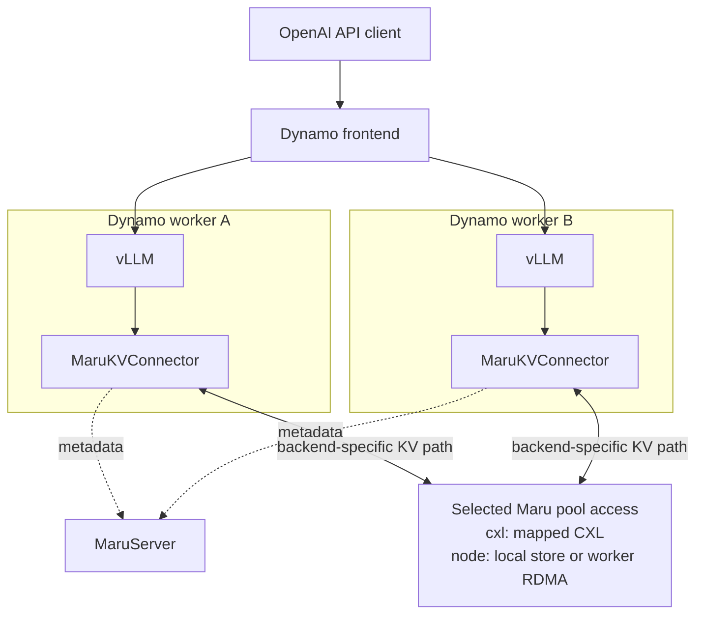

# NVIDIA Dynamo

Dynamo connects to Maru through its **vLLM backend**. Configure each `dynamo.vllm` worker with the same `MaruKVConnector` and `--kv-transfer-config` used for standalone vLLM. Dynamo routes requests to the workers, and the connector handles KV cache sharing through Maru.

The vLLM connector supports directly mapped `cxl` or the node backend (selected by `maru_node`). Node stores provide local DRAM, local CXL or worker direct RDMA to a memory node. Compatible workers share keys within the selected registry and namespace. Run MaruServer for the selected backend (`maru-server --backend cxl` or `maru-server --backend node`).

The provided Dynamo example uses `cxl`. A standalone vLLM backend result does not validate the same combination under Dynamo: an RDMA deployment also needs the node-service/NIXL setup and compatibility with the chosen Dynamo/vLLM versions.

See {doc}`vllm` for connector settings and the {doc}`Dynamo example <../getting_started/examples/dynamo/index>` for setup and execution instructions.
