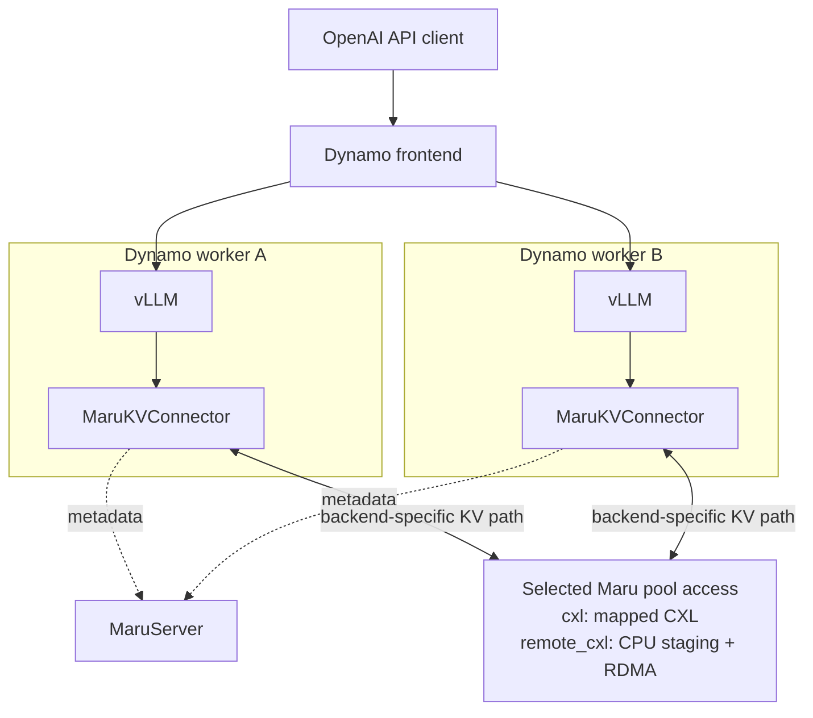

# NVIDIA Dynamo

Dynamo connects to Maru through its **vLLM backend**. Configure each
`dynamo.vllm` worker with the same `MaruKVConnector` and `--kv-transfer-config`
used for standalone vLLM. Dynamo routes requests to the workers, and the
connector handles KV cache sharing through Maru.

The pool's access path depends on the selected backend: `cxl` maps CXL on the worker, while `remote_cxl` transfers KV through worker CPU staging and RDMA. The diagram groups that payload path in one box; workers reuse KV within the same pool and backend.

The provided Dynamo example uses `cxl`. A standalone vLLM backend result does
not validate the same combination under Dynamo: an RDMA deployment also needs
the agent/NIXL setup and validation with the chosen Dynamo/vLLM versions.

See {doc}`vllm` for connector settings and the
{doc}`Dynamo example <../getting_started/examples/dynamo/index>` for setup and
execution instructions.
