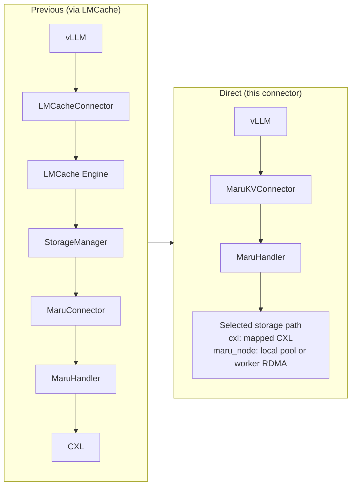
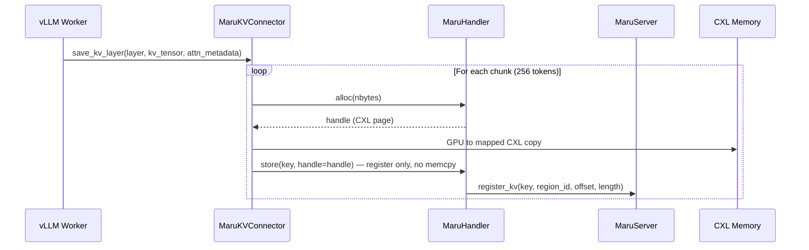
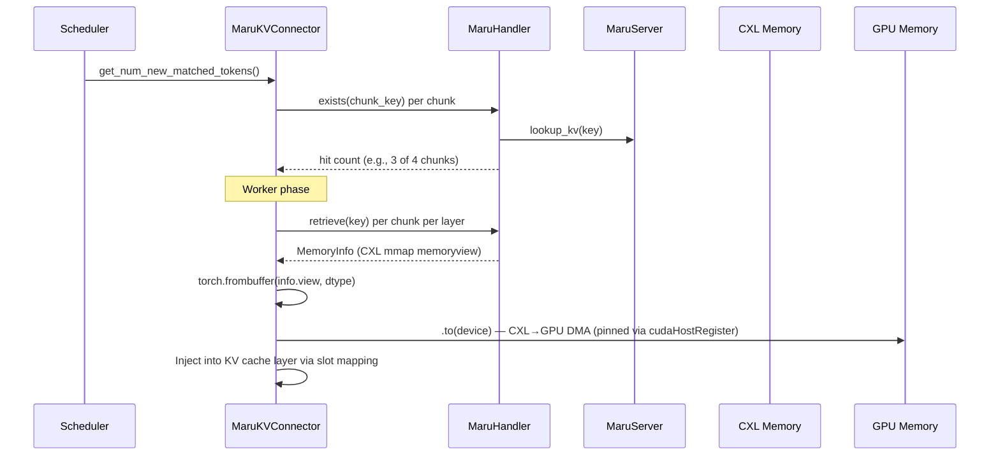

# vLLM

## Prerequisites

**vLLM v0.14+** — required for `KVConnectorBase_V1` support.

This is an interface minimum. Check the selected store's model and transfer restrictions below. Node remote stores also need a compatible NIXL/UCX runtime; see {ref}`nixl-stack`.

**Deferred loading requires vLLM v0.16.0+** (`maru_async_load`, also named `maru_enable_deferred_loading` in older configurations). Older versions do not retain GPU blocks when a request is cancelled while waiting for a KV load. Maru rejects deferred loading during initialization on those versions; upgrade vLLM or disable that option. Synchronous loading remains available on v0.14+.

**vLLM v0.29+** resolves one KV cache layout per model in the engine core (`VLLM_KV_CACHE_LAYOUT` selects it; `NHD` and `HND` are aliases for `LBNHC` and `LBHNC`) and hands every layer the logical page `[blocks, KV heads, tokens, K|V]`, whatever the physical order. Maru reads the resolved layout from the engine and splits each head's row into its K and V halves, so for dense attention a chunk object holds the same K/V-major bytes as a rank-5 cache of vLLM v0.25 and earlier. Chunk transfers place these pages with a `maru_kv_ops` kernel that reads the page's strides, so every physical order takes the kernel path. Pages whose content does not split into two heads (MLA, uneven K/V widths, inline quantization scales) use per-layer copies.

**Storing a hybrid model as several KV cache groups requires vLLM v0.30.0+.** A model whose layers keep different kinds of KV cache, such as sliding-window or Mamba-type layers next to full attention, has several KV cache groups; see {ref}`vllm-hybrid-models`. On older versions the connector does not declare hybrid support: vLLM then runs sliding-window models as one KV cache group and refuses Mamba hybrids at startup.

```bash
uv pip install vllm
```

See [vLLM installation docs](https://docs.vllm.ai/en/latest/getting_started/installation.html) for GPU-specific options.

## Model support

{doc}`supported_models` lists the KV cache structures and models the connector stores and the structures it refuses at startup. Node remote stores use chunkwise objects and reject layerwise format and overlap.

## Integration Architecture

MaruKVConnector is a native vLLM KV connector that enables direct KV cache sharing between vLLM instances — **without any middleware**. With the default `cxl` backend, the KV moves through CXL shared memory.



The direct connector supports the following integration and data paths:

- **Fewer dependencies** — only vLLM + Maru (node remote stores also need NIXL)
- **Mapped CXL transfers** (`cxl` backend) — GPU ↔ mapped CXL copies. CUDA registration, cache layout and the available placement kernels determine the copy or fallback path; GPU bytes still move.
- **Node stores** (`maru_node`) — GPU ↔ mapped node DRAM or local CXL, or GPU ↔ worker-owned staging ↔ direct RDMA ↔ memory-node DRAM/CXL. Services control ownership and publication.
- **Raw KV payloads** — no `MemoryObj` conversion in this connector; metadata RPC still serializes control information

### Component Roles

MaruKVConnector implements vLLM's `KVConnectorBase_V1` interface with a dual-role design:

| Role | Component | Responsibility |
|------|-----------|----------------|
| **SCHEDULER** | `MaruSchedulerConnector` | Checks chunk-by-chunk which prefix is cached; builds metadata for worker |
| **WORKER** | `MaruWorkerConnector` | Performs actual GPU ↔ CXL data transfers per chunk per layer |

The scheduler uses a metadata-only Handler; the worker's Handler owns the payload path for the selected backend.

## Data Path

The following store/load sequences illustrate the default `cxl` backend. See the node setup below and {doc}`../design_doc/node_storage_service` for local node stores and remote worker staging.

### Store Path (GPU → CXL)

When a vLLM instance completes prefill, the connector stores KV cache in chunks:



The save path uses `handler.alloc()` to get a pre-mapped CXL buffer, then copies GPU tensor data directly into it via `torch.Tensor.copy_()`. The subsequent `store(handle=)` call only registers the key in the metadata server — no additional data copy occurs.

### Load Path (CXL → GPU)

When a second instance receives a request with a matching prefix:



The CXL mmap region is pinned via `cudaHostRegister` by MaruHandler's DaxMapper, so `.to(device)` triggers a direct DMA transfer from CXL to GPU memory without any intermediate CPU copy.

If CUDA registration fails for a region, the packed connector checks each slab's actual pin status before passing a host pointer to the placement kernel. Inline loads copy an unpinned slab to the GPU and run the placement kernel on that copy, as deferred loads already do for every slab. Stores gather into one reusable GPU slab and copy it to CXL before publishing the keys. Pinned slabs keep the direct kernel path, including in batches that also contain unpinned slabs. This preserves caching when pinning fails, at reduced transfer performance.

### Chunk-Based Storage

Tokens are divided into fixed-size chunks (default 256 tokens) for storage:

```
Prompt: [tok0..tok255 | tok256..tok511 | tok512..tok767 | tok768..tok900]
         chunk 0        chunk 1          chunk 2          (incomplete, not stored)
```

Each chunk key = `kv_{hash(tok0..end)}_L{layer}` — a rolling prefix hash that encodes the full context up to that chunk, enabling partial prefix reuse.

### Partial Prefix Reuse

```
Instance A:
  Request: "The quick brown fox jumps over the lazy dog. Once upon a time..."
  → Stores chunk 0, 1, 2

Instance B:
  Request: "The quick brown fox jumps over the lazy dog. In a galaxy far away..."
  → chunk 0, 1 hit (common prefix), chunk 2 miss
  → Loads chunk 0, 1 from CXL, computes the rest
```

### GPU prefix caching and external stores

A vLLM prefix-cache hit does not mean that the same KV exists in Maru. In a multi-turn conversation, a previous turn's generated tokens may be present only in the GPU cache. For caches retaining the full prefix, the first store of the next turn starts at the end of the prefix found in Maru, copying those missing chunks together with the new prompt suffix. A later lookup can then reuse them after vLLM evicts the conversation.

Synchronous stores include the missing cached prefix on the admission step; later prefill steps store only their new chunks. Asynchronous stores retain the original start until the prompt finishes. Full Maru hits still avoid storing already present chunks, including a held-back compute block.

The repair applies when every stored group retains all prefix blocks: full-attention groups (including promoted groups with a `sliding_window` field) and non-windowed MLA groups. Bounded-replay and other skipped groups do not store KV and do not restrict the repair. Replaying a window before a confirmed Maru hit preserves the hit's store boundary.

Mamba and stored sliding-window groups keep their existing store rules because historical states or blocks may already be gone; missing history in those groups can still require recomputation.

### Requests Maru does not cache

Maru keys a chunk by its token ids alone. A request whose KV also depends on something else neither loads from nor stores to Maru, on any backend: requests with images or other multimodal inputs, a LoRA adapter, a `cache_salt`, or prompt embeddings. vLLM computes them as usual, and vLLM's own prefix cache, when enabled (the default), still applies to them because it hashes these inputs.

## Setup

**Start Maru server:**

```bash
maru-server
# Listens on tcp://127.0.0.1:5555 by default
```

**Launch vLLM with MaruKVConnector (dynamic loading):**

```bash
vllm serve <model> \
    --kv-transfer-config '{
        "kv_connector": "MaruKVConnector",
        "kv_connector_module_path": "maru_vllm",
        "kv_role": "kv_both",
        "kv_connector_extra_config": {
            "maru_server_url": "tcp://localhost:5555",
            "maru_pool_size": "4G"
        }
    }'
```

The `kv_connector_module_path` tells vLLM to dynamically import `MaruKVConnector` from the `maru_vllm` package. No vLLM source code changes are required.

**Second instance (same node):**

```bash
vllm serve <model> \
    --port 8001 \
    --kv-transfer-config '{
        "kv_connector": "MaruKVConnector",
        "kv_connector_module_path": "maru_vllm",
        "kv_role": "kv_both",
        "kv_connector_extra_config": {
            "maru_server_url": "tcp://localhost:5555",
            "maru_pool_size": "4G"
        }
    }'
```

## Configuration

### Node StorageService (maru_node)

Set `maru_node` to the GPU service's socket path. Each node serves one store: GPU nodes choose `dram`, `local_cxl` or `remote`; memory nodes choose `dram` or `local_cxl`. The Catalog runs separately from `maru-server`.

Start one Catalog:

```bash
maru-node-server --host 127.0.0.1 --port 5556
```

A GPU DRAM configuration (`gpu.json`) needs no CXL or Resource Manager:

```json
{
  "node_id": "gpu-1",
  "server": "tcp://127.0.0.1:5556",
  "page_size": "32MiB",
  "tiers": [{"store": "dram", "size": "16GiB", "hugepage": false}]
}
```

```bash
maru-storage --config gpu.json --check
maru-storage --config gpu.json
```

Launch vLLM in a separate process:

```bash
vllm serve <model> --kv-transfer-config '{
  "kv_connector": "MaruKVConnector",
  "kv_connector_module_path": "maru_vllm",
  "kv_role": "kv_both",
  "kv_load_failure_policy": "recompute",
  "kv_connector_extra_config": {
    "maru_node": "/run/maru/node.sock",
    "maru_engine_id": "engine-1",
    "maru_cache_namespace": "model-immutable-revision",
    "maru_async_load": true
  }
}'
```

Choose a page size that holds the largest chunk or group object. Store capacity, page size, Catalog address and RDMA/write-hint settings belong to service JSON. The connector rejects its capacity, page-size, server-address and write-hint equivalents. `maru_engine_id` and `maru_cache_namespace` are required. The namespace must identify the exact immutable weights revision; the connector binds it to model and KV geometry. All ranks share the engine name and attach with separate TP and DP indices.

For remote storage, start `maru-memory-node --config memory.json` on the memory host and configure GPU `remote.url` and `key_file`. Workers READ and WRITE directly through their own registered staging. `staging_size` defaults to `max(1GiB, 64 * page_size)` per worker; `staging_max_bytes` defaults to that amount for the node. Increase the total for multiple workers. Remote nodes reject layerwise format and overlapped loads. Workers and the GPU service must share a PID namespace.

Both node transfer defaults are `false`. Async scheduling automatically enables deferred loads; an explicit `maru_async_load=false` then requires `--no-async-scheduling`. TP>1 and multiple KV groups always require deferred loads. Store credit waits default to zero (`maru_credit_wait_ms`), and lookup timeout defaults to 100 ms (`maru_lookup_timeout_ms`). `maru_load_read_depth` defaults to 2 and must be at least 1.

A full GPU-local store skips writes. Memory nodes evict unpinned keys through one shared LRU. Remote publication occurs only after memory-node COMMIT; read copies are not cached. Missing or stale data is recomputed. An in-progress READ can be joined only within its worker. Write registrations are per instance within a GPU-node run; the affected domain's registration is revoked before its uncertain pages are reused.

See {doc}`../design_doc/node_storage_service` for complete JSON examples, defaults and validation, {doc}`../design_doc/memory_node` for memory-node recovery, and {doc}`../getting_started/migrating_to_maru_node` for process, setting and support tables.

### Connector settings

The deployment keys below describe `cxl`. Use the node configuration above for `maru_node`; its transfer knobs follow the store restrictions.

Settings in `kv_connector_extra_config`:

| Parameter | Type | Default | Description |
|-----------|------|---------|-------------|
| `maru_server_url` | str | `tcp://localhost:5555` | `cxl` MaruServer address; node stores set `server` in service JSON |
| `maru_pool_size` | str/int | `1G` | `cxl` allocation size; node stores set `size` in service JSON |
| `maru_chunk_size` | str/int | `4M` | Maru page size (CXL allocation unit) |
| `maru_instance_id` | str | auto | Unique instance ID (default: auto-generated UUID) |
| `maru_eager_map` | bool | `true` | Pre-map other instances' CXL regions on connect |
| `maru_kv_chunk_tokens` | int | `256` | KV cache chunk granularity (in tokens) |

Asynchronous transfer settings, all opt-in:

| Parameter | Type | Default | Description |
|-----------|------|---------|-------------|
| `maru_async_load` | bool | `false` (`true` for async scheduling on node stores, multiple KV groups and TP>1) | Load cache hits on a background thread between steps instead of inside the forward pass |
| `maru_async_store` | bool | `false` | Complete the store after the forward pass instead of on the last attention layer |
| `maru_overlap_load_with_compute` | bool | `false` | Overlap an async load's per-layer transfers with attention compute (either storage format) |
| `maru_overlap_release_after_layers` | int | `1` | Layers that must be copied before an overlapped load is reported complete and vLLM may schedule the request; requires `maru_overlap_load_with_compute` |

Storage format — how a request's KV is grouped into CXL objects:

| Parameter | Type | Default | Description |
|-----------|------|---------|-------------|
| `maru_use_layerwise` | bool | `false` | `false` = chunkwise: one object per chunk holding every layer. `true` = layerwise: one object per (chunk, layer) |

Diagnostics and fallback guards — leave these at their defaults in normal operation:

| Parameter | Type | Default | Description |
|-----------|------|---------|-------------|
| `maru_load_copy_ahead` | int | `2` | Chunk slabs a fallback load copies to the GPU ahead of its per-layer injects, on a side stream; `0` copies each slab in line. Each thread and stream that loads keeps this many slabs of GPU memory for the life of the worker, each `2 × layers × chunk tokens × KV hidden size × dtype size` (32 MiB for Llama 3.1 8B at 256-token chunks). They are allocated on the first load, after vLLM has sized its KV cache, so `gpu_memory_utilization` does not account for them |
| `maru_load_admission_window` | int | `0` | Cap on asynchronous loads in flight; `0` submits all |
| `maru_log_timing` | bool | `false` | Emit per-request CPU timing and request timeline logs to stderr |

#### Renamed parameters

These three knobs were renamed to name the axis a deployer chooses. The former names are still accepted and log a deprecation warning:

| Former name | Current name |
|-------------|--------------|
| `maru_enable_deferred_loading` | `maru_async_load` |
| `maru_enable_write_behind` | `maru_async_store` |
| `maru_enable_layerwise_overlap` | `maru_overlap_load_with_compute` |

`maru_enable_async_loading` and `maru_enable_fused_load` were removed. They gated a load path that the packed storage layout never entered, and no measurement ever exercised it.

### Asynchronous load and store

By default both the cache-hit load and the populate store run to completion inside the model worker's forward pass. The two settings below move that work off the critical path; they are independent and can be enabled separately.

`maru_async_load` parks a cache-hit request while a background thread performs the Maru lookup and the CXL→GPU transfer, then reports completion through a CUDA event. The forward pass no longer waits on the retrieve RPC. This is the mechanism vLLM itself calls an asynchronous load: the request waits in `WAITING_FOR_REMOTE_KVS`.

A parked request initially holds blocks for its loaded prefix. It needs room for the rest of its prompt and any speculative lookahead before it can run. On vLLM < 0.23, Maru budgets this full requirement for parked requests and earlier waiters, capped at the model's maximum length. A request that does not fit stays in `WAITING` and keeps its place until vLLM gives it blocks. The first request in line is admitted on its own; vLLM sizes the cache to fit one maximum-length request.

On vLLM 0.23+ without speculative lookahead, Maru uses vLLM's reservation for in-flight prefills without adding its own block budget. This allows loads to overlap when their initial allocations fit, even if their complete prompts would not all fit at once. With speculative lookahead (for example, draft-model or EAGLE decoding), Maru retains its budget: the upstream reservation counts prompt tails but can leave too little room for the oldest request's lookahead. Methods without lookahead slots, such as ngram, use the ordinary version rule. vLLM 0.31+ reserves the draft slots of every speculative method itself, so a load Maru admits can still wait for vLLM's own reservation.

This budget counts GPU blocks; `maru_load_admission_window` below counts loads in flight.

`maru_async_store` lets the store finish after the forward pass returns, so the first token of the current step is not delayed by the GPU→CXL copy and the metadata registration.

`maru_load_admission_window` bounds how many asynchronous loads may be in flight at once. The default `0` submits every load immediately. Set a positive value only if you need request-level backpressure.

### Storage granularity and overlap

`maru_use_layerwise` selects how a request's KV is grouped into CXL objects. The two layouts differ throughout the store and load paths:

| | chunkwise (`false`, default) | layerwise (`true`) |
|---|---|---|
| One CXL object holds | every layer of one chunk | one (chunk, layer) pair |
| Key | `<chunk_key>` | `<chunk_key>_L<layer_idx>` |
| Keys per request | chunks | chunks x layers |
| CXL page size | per-layer size x layers | per-layer size |
| Completion marker | the chunk key itself, registered once every layer is written | a separate `_DONE` key |
| Store | one gathered D2H per chunk | one write per layer |
| Load | whole slab per chunk, contiguous pages coalesced | one retrieve per (layer, chunk) |

The key count is the practical difference: layerwise resolves one key per (chunk, layer) instead of one per chunk, so both the key count and the retrieve metadata RPC volume grow by the model's layer count. Chunkwise is the default for that reason; layerwise remains available for deployments that need per-layer object granularity.

Both layouts store MLA models. A chunkwise MLA object holds one latent plane per layer where other models hold a K and a V plane, and moves through the per-layer copies rather than the gather kernel.

`maru_overlap_load_with_compute` works with either storage layout and requires `maru_async_load`; it pipelines a request's per-layer transfers against attention compute. Under the chunkwise layout each layer is sliced out of the chunkwise slabs; under the layerwise layout each layer's own chunk objects are gathered directly. Every (chunk, layer) key is still resolved before the request is released, so the layerwise layout pays its full metadata RPC volume up front — only the transfers overlap compute. The connector logs a warning and disables the knob when `maru_async_load` is off.


The loader thread queues the per-layer copies while the request is still parked. The load is reported complete — which is what lets vLLM schedule the request — once `maru_overlap_release_after_layers` of them have landed, one layer by default, so the request's prefill compute runs while the remaining layers arrive rather than after them. A cache-hit request computes only the tokens left over past its cached chunks, so one layer of compute is shorter than one layer of transfer: the compute fits inside the transfer and the transfer time is what sets time to first token. All parked-request transfers share one stream. That keeps each at full CXL bandwidth — splitting them across streams makes each transfer take as many times longer as there are loading requests, raising that floor — and it means a later request's first layer only lands once the earlier one has finished, so requests take their turn without any extra admission mechanism.

The knob therefore applies at any concurrency. On a 16k prompt it lowered cache-hit TTFT by 24%, 25% and 17% at 2, 4 and 8 concurrent requests, and raised throughput throughout; per-token generation time rose 4-5% at 4 and 8 concurrent requests, which is the cost of every request starting earlier.

#### Choosing the release point

`maru_overlap_release_after_layers` sets how many layers must be copied before the load is reported complete. The layers still in flight at that point are waited for inside the request's own forward pass, and those waits are taken on the model stream, which carries the whole batched step — so reporting early charges one request's remaining load time to every request scheduled alongside it.

Waiting for more layers first keeps that cost out of the batch: while the request is unscheduled it is the only thing waiting on its own load. It does not delay the request's own first token either, which needs the last layer no matter when the request was scheduled — the hold is free while it stays inside the delay the scheduler takes to re-admit the request anyway, and only past that does the count begin costing time to first token.

Which way to err depends on whether a layer's copy or a layer's compute takes longer:

- **Compute slower than the copy** — the forward pass never catches up, there is nothing left to wait on, and the default of `1` is already right.
- **Copy slower than compute** — the forward pass catches up almost at once and blocks on layers still in flight. Raising the count trades those blocks away.

Longer prompts and more concurrent loads both push a deployment toward the second case. The value is an absolute layer count, not a fraction of model depth, so one tuned on a 32-layer model does not carry to an 80-layer one, and a value at or above a model's KV-layer count reports the load only after the last layer — the overlap turned off in all but name. Sweep it per deployment.

```bash
vllm serve <model> \
    --kv-transfer-config '{
        "kv_connector": "MaruKVConnector",
        "kv_connector_module_path": "maru_vllm",
        "kv_role": "kv_both",
        "kv_connector_extra_config": {
            "maru_server_url": "tcp://localhost:5555",
            "maru_pool_size": "4G",
            "maru_async_load": true,
            "maru_overlap_load_with_compute": true,
            "maru_overlap_release_after_layers": 7
        }
    }'
```

The count is read only by the overlap path, so `maru_overlap_load_with_compute` must be on for it to mean anything — along with the overlap's own prerequisite, `maru_async_load` enabled. Either storage format can use the overlap, so `maru_use_layerwise` does not constrain this count. Raising the count on its own changes nothing; the connector logs a warning saying so, and a separate warning if the overlap was requested but its prerequisite is unmet.

### maru_kv_chunk_tokens

Controls how many tokens per chunk when storing KV cache:

- **Smaller** (64, 128): Finer prefix reuse granularity, more maru keys
- **Larger** (512, 1024): Fewer keys, but coarser reuse granularity
- **Default 256**: Good balance for most use cases
- **Auto-aligned**: Automatically adjusted to a multiple of vLLM `block_size`

### maru_pool_size

For `cxl`, memory an instance gets at a time: its first allocation and each expansion when full. Node stores instead use service `size`; remote capacity belongs to the memory node. The estimate below sizes one `cxl` allocation. Under TP it applies to each rank that stores, and `num_kv_heads` is one rank's share: the model's KV heads divided by the TP size, and at least 1 (see {ref}`vllm-tensor-parallelism`):

```
pool_size ≈ num_layers × kv_head_dim × num_kv_heads × 2(K+V) × max_cached_tokens × dtype_bytes
```

Example (Llama 7B, fp16):
```
32 layers × 128 head_dim × 32 heads × 2(K+V) × 4096 tokens × 2 bytes ≈ 2GB
```

(vllm-tensor-parallelism)=

## Tensor parallelism

The `cxl` and node paths support tensor parallelism for the KV cache structures listed in {ref}`Supported Models <vllm-model-support>`. vLLM starts one connector per TP worker, and each worker stores and loads only the KV it holds. Every rank hashes a prompt to the same chunk keys, so a key must also name the slice: if all ranks registered their heads under one key, the server would keep the first and every other rank would load heads that are not its own.

Chunk keys therefore name a slice by what it holds:

| A worker holds | Chunk key | Example |
|---|---|---|
| Every KV head: TP=1, or an MLA latent that each rank holds in full | `kv_<hash>` | Unchanged from earlier releases |
| KV heads `[a, b)` | `kv_<hash>_h<a>-<b>` | Llama-3.1-8B (8 KV heads) at TP=2: `_h0-4` on rank 0, `_h4-8` on rank 1 |
| Rank `r`'s part of a slice named by rank: each Mamba-type state, and the attention KV of sliding-window and full layers when TP exceeds the KV heads (below) | `kv_<hash>_tp<TP>_r<r>`, then `_c<chunk_tokens>_g<group_id>` with several KV cache groups | Qwen3.5-0.8B at TP=2: `_tp2_r0_c544_g0` on rank 0 |

The layerwise format appends its `_L<layer>` and `_DONE` suffixes after the slice. A model with several KV cache groups (see {ref}`vllm-hybrid-models`) appends `_c<chunk_tokens>_g<group_id>`, followed for an MLA group by `_b<block_size>`, since its objects keep vLLM's block layout (see {ref}`vllm-deepseek-v41`). It names the KV heads of each attention group, full or sliding window, as above: Qwen3.5-0.8B at TP=2 stores `kv_<hash>_h0-1_c544_g3` on rank 0.

Ranks that hold identical KV share one slice name: the MLA latent, and the heads vLLM replicates when there are more TP ranks than KV heads (4 KV heads at TP=8 put each head on two ranks). The lowest of those ranks stores the slice and the others only load it. A Mamba-type state is named by rank instead: vLLM divides every state evenly over the ranks, and a rank's Gated DeltaNet conv state gathers its share of the q, k and v channels, which no head range describes. No two ranks hold the same part, so every rank stores its own, including a rank that only loads replicated heads. A model with several attention groups, such as gpt-oss, names its attention KV by rank as well at a tensor parallel size above its KV heads: vLLM then replicates each group's heads by that group's own count, which the connector cannot tell from the model's. Every rank then stores its own copy of its heads. So does a model whose sliding-window and full-attention layers vLLM keeps in one group, as it does with its hybrid KV cache manager off (`--disable-hybrid-kv-cache-manager`, or vLLM before 0.30): one rank's object holds both kinds of layer, and two ranks that share a full-attention head can hold different sliding-window heads.

Because keys name heads rather than ranks, engines of different TP sizes share exactly the slices that hold the same heads. With 8 KV heads, TP=8 and TP=16 engines share every slice, while TP=2 and TP=4 engines share none. A slice is never read as a different set of heads. Mamba-type states differ for every TP size, so a model with such a group hits only on chunks that an engine of the same TP size stored. On the node path, the namespace includes TP size, so engines of different TP sizes do not share keys.

The scheduler reports a chunk as cached only when every slice that the hit needs is stored, so no rank is asked to load a slice the lookup did not find. It has no rank of its own, but it knows the TP size and the model's KV heads, so it lists every slice itself and checks all of them in one `batch_exists`.

The ranks do not talk to each other. vLLM sends every worker the same metadata and treats a load or store as finished only once every worker reports it. A load that fails on any rank is handled for the whole request by `kv_load_failure_policy`: under vLLM's default `"fail"` the request fails; under `"recompute"` vLLM recomputes it from the first block any worker reports as failed, or from its first token for a model with several KV cache groups (see {ref}`vllm-load-failures`).

Above TP=1 every load is parked (`maru_async_load=true`, which needs vLLM 0.16+). The connector turns it on unless it is set, and refuses `maru_async_load=false`. A parked load finishes on every rank, and vLLM merges every rank's result, before the request computes. An inline load runs in the step that computes its request, and a rank whose load fails is the only one that knows: the all-reduce in every layer would spread its unfilled KV to every rank, and the other ranks would store what they computed from it ([#135](https://github.com/xcena-dev/maru/issues/135)). For the same reason, a layerwise-overlap load (`maru_overlap_load_with_compute`) whose per-layer copies the loader thread cannot queue fails while the request is parked, instead of having the forward issue them as it does at TP=1.

Each worker process connects its own MaruHandler:

- `maru_pool_size` applies to each TP rank that stores. Without replicated KV heads a rank stores 1/TP of every chunk, so ranks with `P / TP` each hold as many tokens as a single TP=1 worker with `P`. A rank that only loads replicated heads or an MLA latent stores none of them, only its own part of each Mamba-type state. A rank that stores nothing at all, such as every rank but rank 0 of an MLA model, takes one page when it connects instead of `maru_pool_size`.
- A configured `maru_instance_id` becomes `<id>-tp<rank>`, so that the server sees each rank as its own owner. With data parallelism, replica `d` > 0 adds its index, as `<id>-dp<d>-tp<rank>` (`<id>-dp<d>` at TP=1). Leaving the id unset already gives every process its own UUID.
- On the node path, ranks share `maru_engine_id` and attach with their TP rank and DP index. Remote workers each have dedicated staging. Only ranks of the same vLLM instance attached to the same GPU-node run share a memory-node write domain; another GPU node or run has a separate domain.

Under TP the scheduler's process loads no model, and a model can change its config where a worker loads it, as vLLM's Transformers backend does with the dtype. On the node path the scheduler looks keys up in the cache namespace that the workers report through vLLM's KV connector handshake. vLLM's `MultiConnector` passes the first handshake that any sub-connector returns to all of them, and `NixlConnector` refuses any but its own: above TP=1, list `MaruKVConnector` after `NixlConnector`. The scheduler then keeps the namespace it computes itself, and a model that changes its config where the workers load it misses every lookup.

Pipeline parallelism and decode or prefill context parallelism are refused at startup: a pipeline stage would have to address its layers locally in the slab and the placement kernel, which index them globally.

(vllm-hybrid-models)=

## Hybrid models

vLLM puts layers that keep different kinds of KV cache into separate KV cache groups, for example sliding-window and full-attention layers, or Gated DeltaNet (Mamba-type) and full-attention layers. On vLLM 0.30+ the connector stores each group's part of a chunk as its own CXL object, keyed `<chunk_key>_c<chunk_tokens>_g<group_id>`, and reports a hit only for chunks that every group can resume from. A model with one group is stored as before.

The key names the chunk length because a chunk key hashes the prompt only up to the chunk's end. With a Mamba-type group a chunk is one vLLM block, and vLLM sizes that block from the per-rank state and attention page, so engines with different TP sizes (or KV cache dtypes) can use different chunks: Qwen3.5-0.8B has 544-token chunks at TP=2 and 272-token chunks at TP=4. Their objects for the same prompt prefix then get different keys, and neither engine loads the other's.

{doc}`supported_models` lists the hybrid models the connector stores and the ones it refuses at startup. Tensor parallelism is supported (see {ref}`vllm-tensor-parallelism`). Hybrid models are supported on this connector only, not on the LMCache path.

### Required settings

The connector refuses to start a model with several groups unless:

- Use `cxl` (the default) or `maru_node`. Remote nodes require chunkwise storage and reject overlap.
- `maru_use_layerwise` is `false` (the default), unless every group the connector stores is an MLA group, as DeepSeek-V4.1's are (see {ref}`vllm-deepseek-v41`).
- Speculative decoding is off.
- Mamba-type groups use vLLM's `align` Mamba cache mode. vLLM picks it when prefix caching is on, which is the default. Keep prefix caching on: with `--no-enable-prefix-caching`, vLLM sets the mode to `none` even if `--mamba-cache-mode align` is given, and the connector refuses the model. Do not pass `--mamba-cache-mode all`.
- The model does not have both Mamba-type groups and MLA groups, as GLM-5.3-Flash does.
- Every group uses vLLM's one `block_size`, except MLA groups, which may use other block sizes, as DeepSeek-V4.1's do; `maru_kv_chunk_tokens` is then rounded to a multiple of every group's block size. vLLM normally sets the groups up this way.
- Every attention group has the same KV heads per rank and head size. vLLM gives groups whose heads differ different block sizes, and the connector stores every group in one shape.
- On `cxl`, `maru_chunk_size`, if set, holds the largest (chunk, group) object. On node stores, service `page_size` must hold it.
- Loads are parked (`maru_async_load=true`). The connector turns it on for a model with several groups unless it is set, and refuses `maru_async_load=false`: vLLM cannot take a failed inline load of such a model correctly; see {ref}`vllm-load-failures`.

```bash
vllm serve Qwen/Qwen3.5-0.8B \
    --kv-transfer-config '{
        "kv_connector": "MaruKVConnector",
        "kv_connector_module_path": "maru_vllm",
        "kv_role": "kv_both",
        "kv_load_failure_policy": "recompute",
        "kv_connector_extra_config": {
            "maru_server_url": "tcp://localhost:5555",
            "maru_pool_size": "4G",
            "maru_async_load": true
        }
    }'
```

### What differs from a model with one group

- **Chunk size.** A Mamba-type group keeps its state only at block ends, so with such a group a chunk is one vLLM block (544 tokens for Qwen3.5-0.8B) and `maru_kv_chunk_tokens` is overridden with a warning. Without one, `maru_kv_chunk_tokens` works as before.
- **Hits** end at a chunk boundary: a 1,024-token gpt-oss prompt hits 768 tokens, where one group would hit 1,008. A Mamba-type group can resume only from a chunk where an earlier request's prefill step ended, because vLLM keeps the state only at step ends. For example, with `--max-num-batched-tokens 2048` a 2,300-token Qwen3.5-0.8B request running alone is prefilled in steps that end at 1,632, 2,176 and 2,300 tokens; only the first two are chunk ends. A later request that shares its first 1,700 tokens hits 1,632 tokens; one that shares its first 1,500 tokens hits nothing.
- **With a Mamba-type group, a repeated prompt can hit nothing.** A hit stops short of the prompt's last token. A prompt whose length is a multiple of the chunk and that was prefilled in one step keeps its only state at its last chunk, which the hit cannot include, so sending it again hits nothing. Benchmarks whose prompt length is a multiple of the chunk show this as stores without hits.
- **Stores** run right after the forward. Sliding-window and Mamba-type objects are always stored before the step ends, because vLLM frees those blocks while the request runs. `maru_async_store` defers only full-attention objects that use the `maru_kv_ops` kernel; objects of a group whose pages take per-layer copies (content that does not split into two heads, such as inline quantization scales) are stored before the step ends.
- **Loads.** `maru_overlap_load_with_compute` is turned off with a warning for any model with several groups: Mamba-type state must be complete before the forward, and per-layer overlap of the attention groups alone is not implemented.
- **CXL space.** All groups share one pool and one page size, that of the largest (chunk, group) object. A chunk takes one page per attention group, plus one page per Mamba-type group at chunks where a prefill step ended. For gpt-oss-20b that is two 12-layer pages instead of one 24-layer page, so `maru_pool_size` estimates stay about the same. For Qwen3.5-0.8B a step-end chunk takes four pages, because its three Gated DeltaNet groups hold three times the chunk's attention KV; other chunks take one.

(vllm-deepseek-v41)=

### DeepSeek-V4.1-Flash

Use vLLM 0.33.0. On SM120 GPUs such as the RTX PRO 6000, vLLM 0.33.0 cannot start the model without [vllm-project/vllm#65356](https://github.com/vllm-project/vllm/pull/65356).

vLLM splits the model's KV cache into several groups, how many depending on the GPU, and the connector handles them as follows:

- **The MLA group** holds the compressed KV and the indexer keys of four layers: eight KV caches of different sizes. Maru copies it block by block, keeping the layout vLLM gives each block rather than laying out each token's KV in its own format, so the stored objects follow the GPU's KV layout. Engines share them only when their layouts match: the object key names the block size, which differs between SM100 (128 tokens) and SM90 or SM120 (64), and a load of an object of another size, such as one stored with another KV cache dtype, fails and vLLM recomputes the request.
- **The sliding-window groups.** With SWA bounded replay (`--swa-bounded-replay`, the default on CUDA with vLLM's V2 model runner), vLLM keeps them out of its prefix cache and, after a hit, recomputes the hit's last 128 tokens to rebuild them; Maru does not store them. With bounded replay off (`--no-swa-bounded-replay`, the V1 model runner, or ROCm), vLLM prefix-caches them, and Maru stores for each chunk the window blocks that a hit at the chunk's end needs.
- **The KV compressor's circular buffer** is not stored, since vLLM does not prefix-cache it.

Both formats work on `cxl` and node-local stores; remote stores use chunkwise format. The model calls no per-layer connector method, so the layerwise format also stores after the forward and loads before it, without overlapping transfers with compute. With bounded replay on, a 256-token chunk takes one 467,712-byte page on SM120 in the chunkwise format, and about 2.9 times that in the layerwise format, which gives each KV cache and the `_DONE` marker a page of their own. With bounded replay off, each chunk also keeps the sliding windows' last blocks, several times the bytes of the MLA group's. Speculative decoding, which runs the DSpark draft layers in the model's checkpoint, is unsupported, as for any model with several groups.

```bash
vllm serve deepseek-ai/DeepSeek-V4.1-Flash-1017 \
    --tensor-parallel-size 4 --enable-expert-parallel --language-model-only \
    --kv-transfer-config '{
        "kv_connector": "MaruKVConnector",
        "kv_connector_module_path": "maru_vllm",
        "kv_role": "kv_both",
        "kv_load_failure_policy": "recompute",
        "kv_connector_extra_config": {
            "maru_server_url": "tcp://localhost:5555",
            "maru_pool_size": "32G"
        }
    }'
```

(vllm-load-failures)=

### Load failures

vLLM's `kv_load_failure_policy` decides what happens to a request whose KV load fails:

- `fail` (vLLM's default) ends the request with an error.
- `recompute` computes the request again; with several groups vLLM restarts it from the first token.

With several groups every load is parked, and Maru reports a failed parked load by its request. An inline load could be reported only by its blocks: vLLM 0.31 and later stop the engine on a block-level failure of a model with several groups, whatever the policy, since block ids are unique only within a group ([#126](https://github.com/xcena-dev/maru/issues/126)), and under `recompute` vLLM 0.30's V2 model runner resumes the recomputed request from the wrong position and can return wrong output ([vllm-project/vllm#49250](https://github.com/vllm-project/vllm/issues/49250)). The connector therefore turns `maru_async_load` on for such a model and refuses `maru_async_load=false`.

After a failure is reported, the scheduler checks keys with MaruServer again instead of trusting earlier lookups. When vLLM asks again about a request whose load failed, the request is computed without Maru, with every backend.

A CUDA error from a GPU copy of a load or a store, or from recording, waiting on or querying a stream or event queued after it (with `maru_log_timing`, the timing events too), stops the worker: such a copy may still be running, and vLLM would reuse the blocks it writes or reads. The connector call that met the error raises, or else the next one vLLM makes, and vLLM fails the engine. The load is not reported as failed. An error that is not a CUDA error, such as running out of GPU memory, a rejected cache layout or a miss, does not stop the worker. Depending on the path, a load is reported and recomputed or falls back to another way of loading, a store skips the chunk, or the error propagates out of the hook.

A load that fails after copies were queued is reported only after those copies end. Copies already ordered on the forward's stream can be reported immediately because recomputation follows them on that stream. Read results, source pins and staging remain owned until their consumers finish.

Once stopped by a CUDA error, a worker issues no new read, copy, store or hint, including during shutdown. It returns no resources that a copy may still use, even if a later wait succeeds. Store pages, read views or staging, GPU buffers and affected request blocks remain held until process exit. A synchronous store with unconfirmed copies publishes no objects and raises. Restart the complete vLLM instance and verify its old workers have exited.

Remote RDMA failure produces a MISS or skipped store. Unknown or failed transfers keep staging out of reuse; memory nodes revoke the instance's write registration within its GPU-node run before reclaiming that domain's uncertain writes. A timeout alone is not a fence. Persistent errors require the same full-instance restart. See {doc}`../design_doc/node_storage_service`.

(vllm-hybrid-one-group)=

### Running a hybrid model as one group

A model whose extra groups are sliding-window or chunked-local attention can run as one KV cache group with `--disable-hybrid-kv-cache-manager`; the connector's refusal messages suggest it. vLLM then keeps those layers' KV for every token, as for full attention, and Maru stores the model as it stores any one-group model. Mamba-type groups cannot be merged this way.

- If some layers use a sliding window and others do not, as in gpt-oss, FlashInfer (vLLM 0.30's choice for gpt-oss on Blackwell) refuses the single group. Add `--attention-backend TRITON_ATTN`.
- On vLLM 0.30 a one-group model stores misses layer by layer during the forward; several-group storage runs after the forward.

## Comparison with LMCache Path

| Aspect | Via LMCache | Direct (this connector) |
|--------|-------------|------------------------|
| Dependencies | vLLM + LMCache + maru | vLLM + maru |
| Middleware | LMCache Engine, StorageManager, RemoteBackend | None |
| Serialization | LMCache MemoryObj conversion | torch tensor ↔ bytes direct |
| Prefix matching | LMCache CacheEngineKey hashing | vLLM token prefix hashing |
| Configuration | LMCACHE_CONFIG_FILE YAML | kv_connector_extra_config JSON |
| Storage paths | `cxl` | `cxl`, `maru_node` (`dram`, `local_cxl`, `remote`) |
| Save path (`cxl` backend) | GPU → CPU → bytes → alloc + memcpy → CXL | GPU → CXL (single DMA via alloc) |
| Load path (`cxl` backend) | CXL → clone → CPU → GPU | CXL → GPU (single DMA, pinned) |

## Troubleshooting

### MaruServer Connection Failure

```
ERROR: Failed to connect to MaruServer at tcp://localhost:5555
```

Verify `maru-server` is running and accessible.

### CXL Memory Exhausted

```
ERROR: Cannot allocate page for key ...
```

Increase `maru_pool_size` or restart maru-server to free memory.

### chunk_tokens Alignment Warning

```
WARNING: maru_kv_chunk_tokens 300 not aligned to 16-token blocks, adjusted to 288
```

Normal behavior. Automatically adjusted to a multiple of vLLM's block_size, and with several KV cache groups of every group's block size.

### BFloat16 Store Errors

```
TypeError: Got unsupported ScalarType BFloat16
# or
RuntimeError: can't convert bfloat16 to numpy
```

The connector serializes BFloat16 tensors with `torch.Tensor.contiguous()` and raw byte views because NumPy has no bfloat16 dtype.

### Garbage Output on Second Instance

KV cache data corruption usually means chunks were concatenated as 1D bytes instead of being injected per-chunk. Ensure per-chunk injection is used (the current connector handles this correctly).

For runnable examples, see [vLLM Examples](../getting_started/examples/vllm/index.md).

> **See also:** [Architecture Overview](../design_doc/architecture_overview.md), [MaruHandler Design](../design_doc/maru_handler.md), [LMCache](./lmcache.md)
