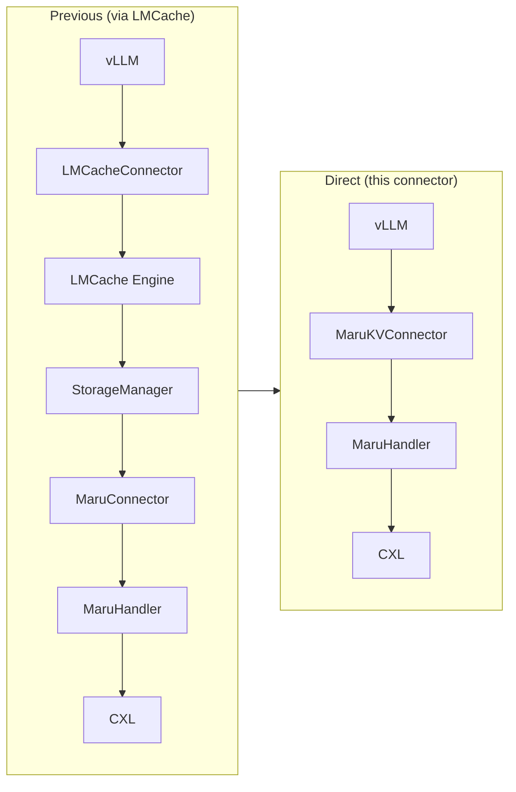
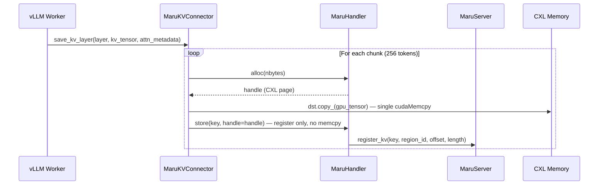
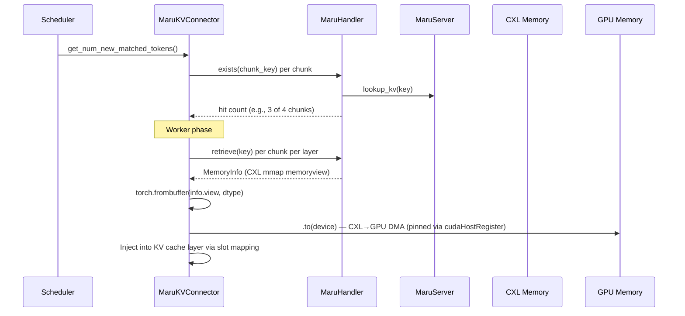

# vLLM

## Prerequisites

**vLLM v0.14+** — required for `KVConnectorBase_V1` support.

**Deferred loading requires vLLM v0.16.0+** (`maru_async_load`, also named `maru_enable_deferred_loading` in older configurations). Older versions do not retain GPU blocks when a request is cancelled while waiting for a KV load. Maru rejects deferred loading during initialization on those versions; upgrade vLLM or disable that option. Synchronous loading remains available on v0.14+.

**vLLM v0.29+** resolves one KV cache layout per model in the engine core
(`VLLM_KV_CACHE_LAYOUT` selects it; `NHD` and `HND` are aliases for `LBNHC`
and `LBHNC`) and hands every layer the logical page
`[blocks, KV heads, tokens, K|V]`, whatever the physical order. Maru reads the
resolved layout from the engine and splits each head's row into its K and V
halves, so for dense attention a chunk object holds the same K/V-major bytes as
a rank-5 cache of vLLM v0.25 and earlier, and the CPU and mixed backends accept
these pages. The packed placement kernels have no format for them, so chunk
transfers use per-layer copies on these versions. Tested with v0.32.

**Storing a hybrid model as several KV cache groups requires vLLM v0.30.0+.** A model whose layers keep different kinds of KV cache, such as sliding-window or Mamba-type layers next to full attention, has several KV cache groups; see {ref}`vllm-hybrid-models`. On older versions the connector does not declare hybrid support: vLLM then runs sliding-window models as one KV cache group and refuses Mamba hybrids at startup.

```bash
uv pip install vllm
```

See [vLLM installation docs](https://docs.vllm.ai/en/latest/getting_started/installation.html)
for GPU-specific options.

(vllm-model-support)=
## Model support

Whether MaruKVConnector can store a model's KV cache depends on the KV cache
structure that vLLM builds for the model. On the CXL backend (the default),
at any tensor parallel size:

| KV cache structure | Example models | Status |
|---|---|---|
| Full attention (MHA, GQA, MQA), one KV cache group | Llama-3.1-8B | Supported |
| MLA, one KV cache group | DeepSeek-V2-Lite | Supported; above TP=1, rank 0 alone stores the latent that every rank holds |
| Sliding window + full attention | gpt-oss-20b | Supported: as several KV cache groups on vLLM 0.30+, or as one group (see {ref}`vllm-hybrid-one-group`) |
| Mamba-type + full attention | Qwen3.5-0.8B | Supported on vLLM 0.30+ |
| Attention groups whose KV heads differ in count or size | MiMo-V2, Inkling | Refused at startup: vLLM gives such groups different block sizes, while the connector stores every group with one block size and one KV shape |
| DSA: MLA latent + indexer cache | DeepSeek-V3.2, GLM-5 | Refused at startup: vLLM 0.32 keeps the latent and the indexer cache, which differ in shape, in one group, while the connector stores every layer of a one-group model in the first layer's shape |
| MLA with other kinds of group | GLM-5.3-Flash | Refused at startup: the connector stores several groups only for full attention, sliding window and Mamba-type layers |

GPU tests of the supported structures ran with the example models on vLLM
0.32, at tensor parallel sizes 1 and 2. Structures not listed are not tested.
Models without attention layers, such as Mamba, are refused above TP=1.
Models with several KV cache groups have settings and limits of their own;
see {ref}`vllm-hybrid-models`. The CPU, mixed and remote_cxl backends take
only models with one KV cache group, at TP=1.

## Integration Architecture

MaruKVConnector is a native vLLM KV connector that enables direct KV cache sharing
between vLLM instances — **without any middleware**. With the default `cxl`
backend, the KV moves through CXL shared memory.



By removing the LMCache middleware layer, the direct connector achieves:

- **Fewer dependencies** — only vLLM + Maru (the `remote_cxl` backend also needs NIXL)
- **Zero-copy save path** (default `cxl` backend) — GPU → CXL via single `cudaMemcpy` (no intermediate CPU buffer)
- **Zero-copy load path** (default `cxl` backend) — CXL mmap (CUDA pinned) → GPU via DMA
- **No serialization overhead** — raw tensor bytes, no `MemoryObj` conversion

### Component Roles

MaruKVConnector implements vLLM's `KVConnectorBase_V1` interface with a dual-role design:

| Role | Component | Responsibility |
|------|-----------|----------------|
| **SCHEDULER** | `MaruSchedulerConnector` | Checks chunk-by-chunk which prefix is cached; builds metadata for worker |
| **WORKER** | `MaruWorkerConnector` | Performs actual GPU ↔ CXL data transfers per chunk per layer |

Both roles share the same `MaruHandler` connection to CXL shared memory.

## Data Path

### Store Path (GPU → CXL)

When a vLLM instance completes prefill, the connector stores KV cache in chunks:



The save path uses `handler.alloc()` to get a pre-mapped CXL buffer, then copies GPU tensor
data directly into it via `torch.Tensor.copy_()`. The subsequent `store(handle=)` call
only registers the key in the metadata server — no additional data copy occurs.

### Load Path (CXL → GPU)

When a second instance receives a request with a matching prefix:



The CXL mmap region is pinned via `cudaHostRegister` by MaruHandler's DaxMapper,
so `.to(device)` triggers a direct DMA transfer from CXL to GPU memory without
any intermediate CPU copy.

If CUDA registration fails for a region, the packed connector checks each slab's actual pin status before passing a host pointer to the placement kernel. Inline loads copy an unpinned slab to the GPU and run the placement kernel on that copy, as deferred loads already do for every slab. Stores gather into one reusable GPU slab and copy it to CXL before publishing the keys. Pinned slabs keep the direct kernel path, including in batches that also contain unpinned slabs. This preserves caching when pinning fails, at reduced transfer performance.

### Chunk-Based Storage

Tokens are divided into fixed-size chunks (default 256 tokens) for storage:

```
Prompt: [tok0..tok255 | tok256..tok511 | tok512..tok767 | tok768..tok900]
         chunk 0        chunk 1          chunk 2          (incomplete, not stored)
```

Each chunk key = `kv_{hash(tok0..end)}_L{layer}` — a rolling prefix hash that
encodes the full context up to that chunk, enabling partial prefix reuse.

### Partial Prefix Reuse

```
Instance A:
  Request: "The quick brown fox jumps over the lazy dog. Once upon a time..."
  → Stores chunk 0, 1, 2

Instance B:
  Request: "The quick brown fox jumps over the lazy dog. In a galaxy far away..."
  → chunk 0, 1 hit (common prefix), chunk 2 miss
  → Loads chunk 0, 1 from CXL, computes the rest
```

### Requests Maru does not cache

Maru keys a chunk by its token ids alone. A request whose KV also depends on something else neither loads from nor stores to Maru, on any backend: requests with images or other multimodal inputs, a LoRA adapter, a `cache_salt`, or prompt embeddings. vLLM computes them as usual, and vLLM's own prefix cache, when enabled (the default), still applies to them because it hashes these inputs. Keying such requests so they can hit is tracked in [#116](https://github.com/xcena-dev/maru/issues/116).

## Setup

**Start Maru server:**

```bash
maru-server
# Listens on tcp://0.0.0.0:5555 by default
```

**Launch vLLM with MaruKVConnector (dynamic loading):**

```bash
vllm serve <model> \
    --kv-transfer-config '{
        "kv_connector": "MaruKVConnector",
        "kv_connector_module_path": "maru_vllm",
        "kv_role": "kv_both",
        "kv_connector_extra_config": {
            "maru_server_url": "tcp://localhost:5555",
            "maru_pool_size": "4G"
        }
    }'
```

The `kv_connector_module_path` tells vLLM to dynamically import `MaruKVConnector`
from the `maru_vllm` package. No vLLM source code changes are required.

**Second instance (same node):**

```bash
vllm serve <model> \
    --port 8001 \
    --kv-transfer-config '{
        "kv_connector": "MaruKVConnector",
        "kv_connector_module_path": "maru_vllm",
        "kv_role": "kv_both",
        "kv_connector_extra_config": {
            "maru_server_url": "tcp://localhost:5555",
            "maru_pool_size": "4G"
        }
    }'
```

## Configuration

### CPU DRAM cache (M1)

Opt in with `maru_storage_backend="cpu"` to store KV in the worker's local DRAM.
Start the server with `maru-server --cpu-only`; this avoids all CXL/RM
initialization. The default backend remains CXL.

CPU mode requires `maru_cpu_pool_size`, a unique `maru_engine_id` per engine,
an explicit immutable-weights `maru_cache_namespace`, `--enforce-eager`, and
`kv_load_failure_policy="recompute"` in the KV transfer configuration. It supports
one worker, homogeneous unquantized KV layers and synchronous chunkwise transfers.
The worker faults the pool in and registers it with CUDA when it opens, as the
`cxl` backend's regions are, so that GPU copies run at the DMA rate and stores
do not fault in fresh pages. This locks the whole pool in memory and adds seconds
to startup for tens of GB. A pool larger than the memory available stays
pageable, and `maru_pin_pools=false` keeps any pool pageable. The worker opens
the pool in `register_kv_caches`; if that fails, the first request that loads or
stores opens it and waits for the page-lock, as the `cxl` backend's first
request waits for its region mapping.
A full pool skips new stores. Sharing, eviction and async/layerwise CPU transfers
are not enabled in M1.

The server tracks process-local CPU replicas and capacity. The scheduler uses a
metadata-only connection and cannot read CPU payloads. `marutop usage` displays
CPU pool usage. Expired sessions stop producing hits; M1 requires restarting
CPU workers after a metadata server restart.

See the [CPU example and lifecycle notes](https://github.com/xcena-dev/maru/blob/main/examples/vllm/cpu/README.md)
for the complete launch configuration, limits and handler read-lease API.

### CPU and CXL together (M2a)

Set `maru_storage_backend="mixed"`, provide both `maru_cpu_pool_size` and
`maru_cxl_pool_size`, and run a CXL-enabled server (without `--cpu-only`). Both
pools belong to the same worker; one prefix can span both media. The CPU mode's
single-worker, eager and synchronous-transfer requirements also apply.

`maru_write_order=["cpu", "cxl"]` fills CPU first and falls back to CXL when full.
Reverse the list for CXL-first placement. `maru_read_order` independently selects
an existing replica; its default is also `["cpu", "cxl"]`. Both pools are fixed:
when both are full, new stores are skipped. The directory records and reports
CPU/CXL pools separately through `l1_storage` and `marutop usage`.

This stage scopes both pools to the owning worker and isolates typed CXL keys
from the legacy shared cache. Cross-engine CXL access, automatic replication,
eviction and SSD are later milestones. See the
[mixed-mode example](https://github.com/xcena-dev/maru/blob/main/examples/vllm/mixed/README.md)
for launch configuration, memory lifetime and validation instructions.

### CXL on memory nodes over RDMA

Set `maru_storage_backend="remote_cxl"` to run engines on nodes without CXL. The KV
stays in the CXL memory of memory nodes and moves over RDMA: the worker reads
and writes it with one-sided RDMA, and only control messages go to maru-server
and to the memory node. Provide `maru_server_url`, `maru_pool_size` (the CXL
memory the engine gets at a time, as with `cxl`), a unique `maru_engine_id`, an
immutable-weights `maru_cache_namespace`,
`maru_remote_cxl_agent_key_file` (a copy of the memory nodes' remote CXL agent key,
default `~/.maru/remote-cxl-agent.key`) and, optionally, `maru_rdma_device` (the
worker's RDMA NIC, e.g. `mlx5_0:1`).


Resources flow as for the cxl backend: the resource manager gives regions to
maru-server and maru-server gives them to the worker, one region when its
storage session opens and one more each time its regions are full. Only the
step that maps a region moves, from the Handler to the memory node.

![Components of the remote_cxl backend. Worker nodes: MaruKVConnector calls MaruHandler, whose PoolRouter (with several pools) picks a request's pool and hands it to that pool's RemoteCxlStorageClient; all clients share one RdmaDataPath (RegionMapClient, StagingBuffer, NIXL). Metadata node: MaruServer with ReplicaDirectory (storage sessions), AllocationManager (resource manager requests) and RegionKeeper. Memory nodes of a shared CXL pool: the resource manager, and on every node a remote CXL agent whose RegionMapServer takes connections for RegionMapService, which holds the region at the resource manager (HOLD, checking its handle; UNHOLD after deregistering), maps it with DaxRegionMapper and registers it with NIXL](../image/remote_cxl_sw_structure.png)

Each memory
node runs a remote CXL agent (`maru-remote-cxl-agent`), a service shared by every app:
it maps the regions Handlers ask for and registers them with the node's NIC.
With NIXL installed, `./install.sh` sets it up as `maru-remote-cxl-agent.service`,
which starts and stops with the resource manager; its settings (NIC, port 9860,
key file) are in `/etc/maru/remote-cxl-agent.env`. It listens on the NIC's address
on the RDMA network, and every worker and maru-server proves the remote CXL agent
key (`/etc/maru/remote-cxl-agent.key`, created by the installer) on each
connection, so only processes that can read a copy of the key map regions, as
only users that can open the DAX device map them on a CXL-attached node. The
protocol itself is not encrypted, like the resource manager's, so keep the
RDMA network to the hosts of the deployment.
A memory node of a shared pool that runs no resource manager installs the
service alone (`install-maru-remote-cxl-agent --standalone`, which starts it at
boot on its own) and sets `MARU_RM_ADDRESS` to the node that does; the resource manager then listens on a network address, as in
the {ref}`multi-node configuration <installation-multi-node-config>`.
maru-server takes the pool's remote CXL agents with `--remote-cxl-agent host:port`
(one per memory node) and `--remote-cxl-agent-key-file`, and hands the list to
the workers. Engines read each other's keys under a server lease; a reader
gets a read handle, which maps a region but cannot release it. When a worker
stops, maru-server keeps its regions that hold keys and holds their mapping,
so the keys stay readable as a stopped cxl Handler's keys do; it gives a kept
region back when the resource manager is full. A region goes back only after
its remote CXL agent deregistered it, so a late RDMA WRITE fails at the NIC
instead of landing in the next owner's KV.

The backend stores KV chunkwise and needs `--enforce-eager`,
`kv_load_failure_policy="recompute"` and one worker per engine. It turns on
`maru_async_load` and `maru_async_store` unless they are set: loads run
between steps and stores after the forward, so an RDMA transfer that waits for
a slow memory node does not hold up the engine, and asynchronous loads run with
vLLM's asynchronous scheduling on. Asynchronous loads need vLLM 0.16 or later,
and an explicit `maru_rdma_staging_size` must then hold two requests (one for
loads, one for stores). Setting them to `false` runs loads and stores on the
engine thread; synchronous loads also need `--no-async-scheduling`. With
asynchronous stores the engine thread takes only a staging slot for a chunk,
waiting on no lock and no network; the thread that sends the store gives each
chunk its remote page, and a background thread asks for a new region or
evicts before the free pages run out, so that thread rarely waits. RDMA
transfers run outside the client's lock. The worker's staging buffer is
registered with CUDA,
so the copy kernel moves KV between the GPU and the staging buffer as it does
for mapped CXL memory. NIXL is required (`uv pip install nixl`, or `pip install nixl` without uv).
See the [remote CXL example](https://github.com/xcena-dev/maru/blob/main/examples/vllm/remote_cxl/README.md)
for one-host and multi-node launch steps.

#### Transfer errors and worker recovery

A timeout or a native NIXL status-query error does not establish that the NIC
has stopped accessing memory. Maru keeps the affected transfer handle and its
staging slots registered until completion and handle release are confirmed.
Other peers' completed or unposted READ slots are returned. Failed stores are
not published, and failed loads follow the configured recompute policy.

Persistent native errors can retain those slots for the lifetime of the worker.
Repeated errors can exhaust its staging capacity, causing stores to be skipped
and loads to miss. Look for `RDMA READ not confirmed`, `RDMA WRITE not confirmed`
and `RDMA transfers still own staging memory` in the worker log. Closing or
reconnecting the Handler alone may leave the registered memory retained.

To recover capacity, stop and restart the entire vLLM engine that owns the
affected worker. Confirm that its old worker processes have exited before
starting replacements; terminating only the HTTP frontend is insufficient if
the workers remain alive. The replacement creates a fresh NIXL agent and staging
buffer. Retired regions can become cold misses, so allow recomputation and cache
warm-up. Restarting only the memory-node agent does not establish that a live
worker's uncertain transfers have been reclaimed. Do not force-return their
slots or drop live RM holds to recover capacity. Safe automatic reclamation
inside a running worker remains follow-up work.

#### Several memory nodes and pools

**Shared pool.** Several memory nodes can share one CXL memory, as hosts on a
CXL switch do. Each of them runs a remote CXL agent; maru-server takes all of
them, with `--remote-cxl-agent` repeated or comma separated, and hands the list to
the workers. Each region is served by one memory node, picked by a hash of the
region number over that list, so the region's owner and its readers map it at
the same node and move its KV through that node's NIC. The memory nodes use the
same remote CXL agent key and the multi-host settings of
{doc}`System Setup <../getting_started/bios_setup>`.


**Several pools.** Each pool has its own maru-server. List them in
`maru_server_url`, comma separated (`"tcp://10.0.0.2:5555,tcp://10.0.0.3:5555"`):
the worker opens a storage session with each, and sends each request to one
pool, picked by a hash of the request's first chunk key, so all chunks of a
request stay in one pool. A pool whose maru-server does not answer when the
worker starts only makes its prefixes miss; the worker connects to it once it
answers.

### Connector settings

Settings in `kv_connector_extra_config`:

| Parameter | Type | Default | Description |
|-----------|------|---------|-------------|
| `maru_server_url` | str | `tcp://localhost:5555` | MaruServer address; with `remote_cxl`, a comma-separated list, one maru-server per pool |
| `maru_pool_size` | str/int | `1G` | CXL memory an engine gets at a time (`4G`, `500M`, etc.): its first allocation, and each further one when its memory is full; required with `remote_cxl`, where each allocation is one region |
| `maru_chunk_size` | str/int | `4M` | Maru page size (CXL allocation unit) |
| `maru_instance_id` | str | auto | Unique instance ID (default: auto-generated UUID) |
| `maru_eager_map` | bool | `true` | Pre-map other instances' CXL regions on connect |
| `maru_kv_chunk_tokens` | int | `256` | KV cache chunk granularity (in tokens) |

Asynchronous transfer settings, all opt-in:

| Parameter | Type | Default | Description |
|-----------|------|---------|-------------|
| `maru_async_load` | bool | `false` (`true` for `remote_cxl`, for models with several KV cache groups, and above TP=1) | Load cache hits on a background thread between steps instead of inside the forward pass |
| `maru_async_store` | bool | `false` (`true` for `remote_cxl`) | Complete the store after the forward pass instead of on the last attention layer |
| `maru_overlap_load_with_compute` | bool | `false` | Overlap an async load's per-layer transfers with attention compute (either storage format) |
| `maru_overlap_release_after_layers` | int | `1` | Layers that must be copied before an overlapped load is reported complete and vLLM may schedule the request; requires `maru_overlap_load_with_compute` |

Storage format — how a request's KV is grouped into CXL objects:

| Parameter | Type | Default | Description |
|-----------|------|---------|-------------|
| `maru_use_layerwise` | bool | `false` | `false` = chunkwise: one object per chunk holding every layer. `true` = layerwise: one object per (chunk, layer) |

Diagnostics and fallback guards — leave these at their defaults in normal
operation:

| Parameter | Type | Default | Description |
|-----------|------|---------|-------------|
| `maru_pin_pools` | bool | `true` | `cpu` and `mixed`: fault the pools in and register them with CUDA when they open, unless a CPU pool is larger than the memory available; `false` keeps them pageable |
| `maru_load_copy_ahead` | int | `2` | Chunk slabs a load without a placement kernel (vLLM 0.29+ layouts) copies to the GPU ahead of its per-layer injects, on a side stream; `0` copies each slab in line. Each thread and stream that loads keeps this many slabs of GPU memory for the life of the worker, each `2 × layers × chunk tokens × KV hidden size × dtype size` (32 MiB for Llama 3.1 8B at 256-token chunks). They are allocated on the first load, after vLLM has sized its KV cache, so `gpu_memory_utilization` does not account for them |
| `maru_load_admission_window` | int | `0` | Cap on asynchronous loads in flight; `0` submits all |
| `maru_log_timing` | bool | `false` | Emit per-request timing diagnostics to stderr |

#### Renamed parameters

These three knobs were renamed to name the axis a deployer chooses. The
former names are still accepted and log a deprecation warning:

| Former name | Current name |
|-------------|--------------|
| `maru_enable_deferred_loading` | `maru_async_load` |
| `maru_enable_write_behind` | `maru_async_store` |
| `maru_enable_layerwise_overlap` | `maru_overlap_load_with_compute` |

`maru_enable_async_loading` and `maru_enable_fused_load` were removed. They
gated a load path that the packed storage layout never entered, and no
measurement ever exercised it.

### Asynchronous load and store

By default both the cache-hit load and the populate store run to completion
inside the model worker's forward pass. The two settings below move that work
off the critical path; they are independent and can be enabled separately.

`maru_async_load` parks a cache-hit request while a background thread
performs the Maru lookup and the CXL→GPU transfer, then reports completion
through a CUDA event. The forward pass no longer waits on the retrieve RPC.
This is the mechanism vLLM itself calls an asynchronous load: the request
waits in `WAITING_FOR_REMOTE_KVS`.

A parked request initially holds blocks for its loaded prefix. It needs room
for the rest of its prompt and any speculative lookahead before it can run.
On vLLM < 0.23, Maru budgets this full requirement for parked requests and
earlier waiters, capped at the model's maximum length. A request that does not
fit stays in `WAITING` and keeps its place until vLLM gives it blocks. The
first request in line is admitted on its own; vLLM sizes the cache to fit one
maximum-length request.

On vLLM 0.23+ without speculative lookahead, Maru uses vLLM's reservation for
in-flight prefills without adding its own block budget. This allows loads to
overlap when their initial allocations fit, even if their complete prompts
would not all fit at once. With speculative lookahead (for example, draft-model
or EAGLE decoding), Maru retains its budget: the upstream reservation counts
prompt tails but can leave too little room for the oldest request's lookahead.
Methods without lookahead slots, such as ngram, use the ordinary version rule.
vLLM 0.31+ reserves the draft slots of every speculative method itself, so a
load Maru admits can still wait for vLLM's own reservation.

This budget counts GPU blocks; `maru_load_admission_window` below counts loads
in flight.

`maru_async_store` lets the store finish after the forward pass returns, so
the first token of the current step is not delayed by the GPU→CXL copy and
the metadata registration.

`maru_load_admission_window` bounds how many asynchronous loads may be in
flight at once. The default `0` submits every load immediately. Set a
positive value only if you need request-level backpressure.

### Storage granularity and overlap

`maru_use_layerwise` selects how a request's KV is grouped into CXL objects.
The two layouts differ throughout the store and load paths:

| | chunkwise (`false`, default) | layerwise (`true`) |
|---|---|---|
| One CXL object holds | every layer of one chunk | one (chunk, layer) pair |
| Key | `<chunk_key>` | `<chunk_key>_L<layer_idx>` |
| Keys per request | chunks | chunks x layers |
| CXL page size | per-layer size x layers | per-layer size |
| Completion marker | the chunk key itself, registered once every layer is written | a separate `_DONE` key |
| Store | one gathered D2H per chunk | one write per layer |
| Load | whole slab per chunk, contiguous pages coalesced | one retrieve per (layer, chunk) |

The key count is the practical difference: layerwise resolves one key per
(chunk, layer) instead of one per chunk, so both the key count and the
retrieve metadata RPC volume grow by the model's layer count. Chunkwise is
the default for that reason; layerwise remains available for deployments that
need per-layer object granularity.

Both layouts store MLA models. A chunkwise MLA object holds one latent plane
per layer where other models hold a K and a V plane, and moves through the
per-layer copies rather than the gather kernel.

`maru_overlap_load_with_compute` works with either storage layout and
requires `maru_async_load`; it pipelines a request's per-layer transfers
against attention compute. Under the chunkwise layout each layer is sliced
out of the chunkwise slabs; under the layerwise layout each layer's own chunk
objects are gathered directly. Every (chunk, layer) key is still resolved
before the request is released, so the layerwise layout pays its full
metadata RPC volume up front — only the transfers overlap compute. The
connector logs a warning and disables the knob when `maru_async_load` is
off.


The loader thread queues the per-layer copies while the request is still
parked. The load is reported complete — which is what lets vLLM schedule the
request — once `maru_overlap_release_after_layers` of them have landed, one
layer by default, so the request's prefill compute runs while the remaining
layers arrive rather than after them.
A cache-hit request computes only the tokens left over past its cached chunks,
so one layer of compute is shorter than one layer of transfer: the compute
fits inside the transfer and the transfer time is what sets time to first
token. All parked-request transfers share one stream. That keeps each at full
CXL bandwidth — splitting them across streams makes each transfer take as many
times longer as there are loading requests, raising that floor — and it means
a later request's first layer only lands once the earlier one has finished, so
requests take their turn without any extra admission mechanism.

The knob therefore applies at any concurrency. On a 16k prompt it lowered
cache-hit TTFT by 24%, 25% and 17% at 2, 4 and 8 concurrent requests, and
raised throughput throughout; per-token generation time rose 4-5% at 4 and 8
concurrent requests, which is the cost of every request starting earlier.

#### Choosing the release point

`maru_overlap_release_after_layers` sets how many layers must be copied
before the load is reported complete. The layers still in flight at that
point are waited for inside the request's own forward pass, and those waits
are taken on the model stream, which carries the whole batched step — so
reporting early charges one request's remaining load time to every request
scheduled alongside it.

Waiting for more layers first keeps that cost out of the batch: while the
request is unscheduled it is the only thing waiting on its own load. It does
not delay the request's own first token either, which needs the last layer no
matter when the request was scheduled — the hold is free while it stays inside
the delay the scheduler takes to re-admit the request anyway, and only past
that does the count begin costing time to first token.

Which way to err depends on whether a layer's copy or a layer's compute takes
longer:

- **Compute slower than the copy** — the forward pass never catches up, there
  is nothing left to wait on, and the default of `1` is already right.
- **Copy slower than compute** — the forward pass catches up almost at once
  and blocks on layers still in flight. Raising the count trades those blocks
  away.

Longer prompts and more concurrent loads both push a deployment toward the
second case. The value is an absolute layer count, not a fraction of model
depth, so one tuned on a 32-layer model does not carry to an 80-layer one,
and a value at or above a model's KV-layer count reports the load only after
the last layer — the overlap turned off in all but name. Sweep it per
deployment.

```bash
vllm serve <model> \
    --kv-transfer-config '{
        "kv_connector": "MaruKVConnector",
        "kv_connector_module_path": "maru_vllm",
        "kv_role": "kv_both",
        "kv_connector_extra_config": {
            "maru_server_url": "tcp://localhost:5555",
            "maru_pool_size": "4G",
            "maru_async_load": true,
            "maru_overlap_load_with_compute": true,
            "maru_overlap_release_after_layers": 7
        }
    }'
```

The count is read only by the overlap path, so `maru_overlap_load_with_compute`
must be on for it to mean anything — along with the overlap's own
prerequisite, `maru_async_load` enabled. Either storage format can use the
overlap, so `maru_use_layerwise` does not constrain this count. Raising the
count on its own changes nothing; the connector logs a warning saying so, and
a separate warning if the overlap was requested but its prerequisite is unmet.

### maru_kv_chunk_tokens

Controls how many tokens per chunk when storing KV cache:

- **Smaller** (64, 128): Finer prefix reuse granularity, more maru keys
- **Larger** (512, 1024): Fewer keys, but coarser reuse granularity
- **Default 256**: Good balance for most use cases
- **Auto-aligned**: Automatically adjusted to a multiple of vLLM `block_size`

### maru_pool_size

CXL memory an instance gets at a time: its first allocation, and each further
one when its memory is full. The `cxl` and `remote_cxl` backends use it the same
way; with `remote_cxl` each allocation is one region. (`cpu` and `mixed` take
fixed budgets instead: `maru_cpu_pool_size`, `maru_cxl_pool_size`.) The estimate
below sizes one allocation. Under tensor parallelism it applies to each rank,
and `num_kv_heads` is one rank's share: the model's KV heads divided by the TP
size, and at least 1 (see {ref}`vllm-tensor-parallelism`):

```
pool_size ≈ num_layers × kv_head_dim × num_kv_heads × 2(K+V) × max_cached_tokens × dtype_bytes
```

Example (Llama 7B, fp16):
```
32 layers × 128 head_dim × 32 heads × 2(K+V) × 4096 tokens × 2 bytes ≈ 2GB
```

(vllm-tensor-parallelism)=
## Tensor parallelism

The CXL backend supports tensor parallelism for the KV cache structures in
{ref}`vllm-model-support`. vLLM starts one connector per TP worker, and each
worker stores and loads only the KV it holds. Every rank
hashes a prompt to the same chunk keys, so a key must also name the slice: if
all ranks registered their heads under one key, the server would keep the
first and every other rank would load heads that are not its own.

Chunk keys therefore name a slice by what it holds:

| A worker holds | Chunk key | Example |
|---|---|---|
| Every KV head: TP=1, or an MLA latent that each rank holds in full | `kv_<hash>` | Unchanged from earlier releases |
| KV heads `[a, b)` | `kv_<hash>_h<a>-<b>` | Llama-3.1-8B (8 KV heads) at TP=2: `_h0-4` on rank 0, `_h4-8` on rank 1 |
| Rank `r`'s part of a slice named by rank: each Mamba-type state, and the attention KV of sliding-window and full layers when TP exceeds the KV heads (below) | `kv_<hash>_tp<TP>_r<r>`, then `_c<chunk_tokens>_g<group_id>` with several KV cache groups | Qwen3.5-0.8B at TP=2: `_tp2_r0_c544_g0` on rank 0 |

The layerwise format appends its `_L<layer>` and `_DONE` suffixes after the
slice. A model with several KV cache groups (see {ref}`vllm-hybrid-models`)
appends `_c<chunk_tokens>_g<group_id>` and names the KV heads of each
attention group, full or sliding window, as above: Qwen3.5-0.8B at TP=2 stores
`kv_<hash>_h0-1_c544_g3` on rank 0.

Ranks that hold identical KV share one slice name: the MLA latent, and the
heads vLLM replicates when there are more TP ranks than KV heads (4 KV heads
at TP=8 put each head on two ranks). The lowest of those ranks stores the
slice and the others only load it. A Mamba-type state is named by rank
instead: vLLM divides every state evenly over the ranks, and a rank's Gated
DeltaNet conv state gathers its share of the q, k and v channels, which no
head range describes. No two ranks hold the same part, so every rank stores
its own, including a rank that only loads replicated heads. A model with
several attention groups, such as gpt-oss, names its attention KV by rank as
well at a tensor parallel size above its KV heads: vLLM then replicates each
group's heads by that group's own count, which the connector cannot tell
from the model's. Every rank then stores its own copy of its heads. So does
a model whose sliding-window and full-attention layers vLLM keeps in one
group, as it does with its hybrid KV cache manager off
(`--disable-hybrid-kv-cache-manager`, or vLLM before 0.30): one rank's object
holds both kinds of layer, and two ranks that share a full-attention head can
hold different sliding-window heads.

Because keys name heads rather than ranks, engines of different TP sizes
share exactly the slices that hold the same heads. With 8 KV heads, TP=8 and
TP=16 engines share every slice, while TP=2 and TP=4 engines share none. A
slice is never read as a different set of heads. Mamba-type states differ
for every TP size, so a model with such a group hits only on chunks that an
engine of the same TP size stored.

The scheduler reports a chunk as cached only when every slice that the hit
needs is stored, so no rank is asked to load a slice the lookup did not
find. It has no rank of its own, but it knows the TP size and the model's KV
heads, so it lists every slice itself and checks all of them in one
`batch_exists`.

The ranks do not talk to each other. vLLM sends every worker the same
metadata and treats a load or store as finished only once every worker
reports it. A load that fails on any rank is handled for the whole request by
`kv_load_failure_policy`: under vLLM's default `"fail"` the request fails;
under `"recompute"` vLLM recomputes it from the first block any worker
reports as failed, or from its first token for a model with several KV cache
groups (see {ref}`vllm-load-failures`).

Above TP=1 every load is parked (`maru_async_load=true`, which needs vLLM
0.16+). The connector turns it on unless it is set, and refuses
`maru_async_load=false`. A parked load finishes on every rank, and vLLM
merges every rank's result, before the request computes. An inline load runs
in the step that computes its request, and a rank whose load fails is the
only one that knows: the all-reduce in every layer would spread its unfilled
KV to every rank, and the other ranks would store what they computed from it
([#135](https://github.com/xcena-dev/maru/issues/135)). For the same reason, a
layerwise-overlap load (`maru_overlap_load_with_compute`) whose per-layer
copies the loader thread cannot queue fails while the request is parked,
instead of having the forward issue them as it does at TP=1.

Each worker process connects its own MaruHandler:

- `maru_pool_size` applies to each TP rank, and every rank takes its first
  allocation when it connects, even one that stores nothing. Without
  replicated KV heads a rank stores 1/TP of every chunk, so ranks with
  `P / TP` each hold as many tokens as a single TP=1 worker with `P`. A rank
  that only loads replicated heads or an MLA latent stores none of them, only
  its own part of each Mamba-type state.
- A configured `maru_instance_id` becomes `<id>-tp<rank>`, so that the server
  sees each rank as its own owner. With data parallelism, replica `d` > 0
  adds its index, as `<id>-dp<d>-tp<rank>` (`<id>-dp<d>` at TP=1). Leaving
  the id unset already gives every process its own UUID.

Pipeline parallelism and decode or prefill context parallelism are refused at
startup: a pipeline stage would have to address its layers locally in the
slab and the placement kernel, which index them globally. The CPU, mixed and
remote_cxl backends still require TP=1.

(vllm-hybrid-models)=
## Hybrid models

vLLM puts layers that keep different kinds of KV cache into separate KV cache groups, for example sliding-window and full-attention layers, or Gated DeltaNet (Mamba-type) and full-attention layers. On vLLM 0.30+ the connector stores each group's part of a chunk as its own CXL object, keyed `<chunk_key>_c<chunk_tokens>_g<group_id>`, and reports a hit only for chunks that every group can resume from. A model with one group is stored as before.

The key names the chunk length because a chunk key hashes the prompt only up to the chunk's end. With a Mamba-type group a chunk is one vLLM block, and vLLM sizes that block from the per-rank state and attention page, so engines with different TP sizes (or KV cache dtypes) can use different chunks: Qwen3.5-0.8B has 544-token chunks at TP=2 and 272-token chunks at TP=4. Their objects for the same prompt prefix then get different keys, and neither engine loads the other's.

### Supported models

| Model | KV cache groups | Status |
|---|---|---|
| Qwen3.5 (tested: Qwen3.5-0.8B) | Gated DeltaNet (Mamba-type) + full attention | Supported; tested on vLLM 0.30 and 0.32 |
| gpt-oss (tested: gpt-oss-20b) | sliding window + full attention | Supported; tested on vLLM 0.30 and 0.32 |
| Other models whose groups are only full attention (`FullAttentionSpec`), sliding window (`SlidingWindowSpec`) or Mamba-type (`MambaSpec`), with one KV head count and head size in every attention group | | Pass the connector's group check; not tested |
| MiMo-V2, Inkling | sliding window + full attention, the sliding-window layers with KV heads of their own | Not supported yet; refused at startup |
| DeepSeek-V3.2, GLM-5 (DSA) | MLA latent + indexer cache, which vLLM 0.32 puts in one group | Not supported yet; refused at startup |
| GLM-5.3-Flash | MLA, indexer cache, `CircularBufferSpec` (`KpoolTailSpec` in vLLM 0.30), KDA (Mamba-type) | Not supported yet |
| Llama 4 | chunked local + full attention | Not supported yet |
| Other models with several groups where a group uses another type: MLA, static sink-token attention (`SinkFullAttentionSpec`), cross attention, or a subclass of a supported type such as `RSWASpec` | | Not supported yet |

The connector checks the group types and the attention groups' KV shapes at startup and refuses an unsupported model with what it found. It also refuses one group whose layers keep different KV cache specs (vLLM's `UniformTypeKVCacheSpecs`), as the DSA models' does: a one-group model is stored in its first layer's shape. A model that passes these checks can still be refused when the worker registers its KV cache, if the tensors do not match the groups' specs. A model whose extra groups are sliding-window or chunked-local attention can run as one group instead; see {ref}`vllm-hybrid-one-group`.

Tensor parallelism is supported (see {ref}`vllm-tensor-parallelism`); GPU tests of hybrid models ran at tensor parallel size 1, and at size 2 on vLLM 0.32. Hybrid models are supported on this connector only, not on the LMCache path.

### Required settings

The connector refuses to start a model with several groups unless:

- `maru_storage_backend` is `cxl` (the default). The CPU, mixed and remote_cxl backends take one group only.
- `maru_use_layerwise` is `false` (the default). Several groups are stored in chunkwise format only.
- Speculative decoding is off.
- Mamba-type groups use vLLM's `align` Mamba cache mode. vLLM picks it when prefix caching is on, which is the default. Keep prefix caching on: with `--no-enable-prefix-caching`, vLLM sets the mode to `none` even if `--mamba-cache-mode align` is given, and the connector refuses the model. Do not pass `--mamba-cache-mode all`.
- Every group uses vLLM's one `block_size`. vLLM normally sets the groups up this way.
- Every attention group has the same KV heads per rank and head size. vLLM gives groups whose heads differ different block sizes, and the connector stores every group in one shape.
- The attention backend keeps whole blocks. FlashInfer, and FlashAttention 4 with head size 256 on compute capability 10.x/11.x, split each block into smaller kernel blocks; FlashInfer is vLLM 0.30's default on B200 and GB200. This affects Gated DeltaNet models such as Qwen3.5 and Qwen3-Next, whose blocks are large. Use `--attention-backend TRITON_ATTN`, or `FLASH_ATTN` outside the FlashAttention 4 case. Sliding-window models with 16-token blocks, such as gpt-oss, are not affected.
- `maru_chunk_size`, if set, holds the largest (chunk, group) object. Leave it unset to size it automatically.
- Loads are parked (`maru_async_load=true`). The connector turns it on for a model with several groups unless it is set, and refuses `maru_async_load=false`: vLLM cannot take a failed inline load of such a model correctly; see {ref}`vllm-load-failures`.

```bash
vllm serve Qwen/Qwen3.5-0.8B \
    --kv-transfer-config '{
        "kv_connector": "MaruKVConnector",
        "kv_connector_module_path": "maru_vllm",
        "kv_role": "kv_both",
        "kv_load_failure_policy": "recompute",
        "kv_connector_extra_config": {
            "maru_server_url": "tcp://localhost:5555",
            "maru_pool_size": "4G",
            "maru_async_load": true
        }
    }'
```

On B200 or GB200, add `--attention-backend TRITON_ATTN`.

### What differs from a model with one group

- **Chunk size.** A Mamba-type group keeps its state only at block ends, so with such a group a chunk is one vLLM block (544 tokens for Qwen3.5-0.8B) and `maru_kv_chunk_tokens` is overridden with a warning. Without one, `maru_kv_chunk_tokens` works as before.
- **Hits** end at a chunk boundary: a 1,024-token gpt-oss prompt hits 768 tokens, where one group would hit 1,008. A Mamba-type group can resume only from a chunk where an earlier request's prefill step ended, because vLLM keeps the state only at step ends. For example, with `--max-num-batched-tokens 2048` a 2,300-token Qwen3.5-0.8B request running alone is prefilled in steps that end at 1,632, 2,176 and 2,300 tokens; only the first two are chunk ends. A later request that shares its first 1,700 tokens hits 1,632 tokens; one that shares its first 1,500 tokens hits nothing.
- **With a Mamba-type group, a repeated prompt can hit nothing.** A hit stops short of the prompt's last token. A prompt whose length is a multiple of the chunk and that was prefilled in one step keeps its only state at its last chunk, which the hit cannot include, so sending it again hits nothing. Benchmarks whose prompt length is a multiple of the chunk show this as stores without hits.
- **Stores** run right after the forward. Sliding-window and Mamba-type objects are always stored before the step ends, because vLLM frees those blocks while the request runs. `maru_async_store` defers only full-attention objects that use the `maru_kv_ops` kernel; vLLM 0.30's attention layouts have no kernel format, so on vLLM 0.30 every object is stored before the step ends.
- **Loads.** `maru_overlap_load_with_compute` is turned off with a warning for any model with several groups: Mamba-type state must be complete before the forward, and per-layer overlap of the attention groups alone is not implemented.
- **CXL space.** All groups share one pool and one page size, that of the largest (chunk, group) object. A chunk takes one page per attention group, plus one page per Mamba-type group at chunks where a prefill step ended. For gpt-oss-20b that is two 12-layer pages instead of one 24-layer page, so `maru_pool_size` estimates stay about the same. For Qwen3.5-0.8B a step-end chunk takes four pages, because its three Gated DeltaNet groups hold three times the chunk's attention KV; other chunks take one.

(vllm-load-failures)=
### Load failures

vLLM's `kv_load_failure_policy` decides what happens to a request whose KV load fails:

- `fail` (vLLM's default) ends the request with an error.
- `recompute` computes the request again; with several groups vLLM restarts it from the first token.

With several groups every load is parked, and Maru reports a failed parked load by its request. An inline load could be reported only by its blocks: vLLM 0.31 and later stop the engine on a block-level failure of a model with several groups, whatever the policy, since block ids are unique only within a group ([#126](https://github.com/xcena-dev/maru/issues/126)), and under `recompute` vLLM 0.30's V2 model runner resumes the recomputed request from the wrong position and can return wrong output ([vllm-project/vllm#49250](https://github.com/vllm-project/vllm/issues/49250)). The connector therefore turns `maru_async_load` on for such a model and refuses `maru_async_load=false`. Upstream changes that would allow inline loads again are tracked in [#127](https://github.com/xcena-dev/maru/issues/127).

After a failure is reported, the scheduler checks keys with MaruServer again instead of trusting earlier lookups. When vLLM asks again about a request whose load failed, the request is computed without Maru, with every backend.

(vllm-hybrid-one-group)=
### Running a hybrid model as one group

A model whose extra groups are sliding-window or chunked-local attention can run as one KV cache group with `--disable-hybrid-kv-cache-manager`; the connector's refusal messages suggest it. vLLM then keeps those layers' KV for every token, as for full attention, and Maru stores the model as it stores any one-group model. Mamba-type groups cannot be merged this way. This path is tested with gpt-oss, not with Llama 4.

- If some layers use a sliding window and others do not, as in gpt-oss, FlashInfer (vLLM 0.30's choice for gpt-oss on Blackwell) refuses the single group. Add `--attention-backend TRITON_ATTN`.
- On vLLM 0.30 a one-group model stores each miss layer by layer during the forward, which is much slower than the several-group store. For gpt-oss-20b with TRITON_ATTN (2,100-token prompts, 8 concurrent requests, vLLM prefix caching off, one RTX PRO 6000), mean miss TTFT was 3.3 s as one group and 0.44 s as several groups, against 0.31 s without Maru ([#113](https://github.com/xcena-dev/maru/issues/113)).

## Comparison with LMCache Path

| Aspect | Via LMCache | Direct (this connector) |
|--------|-------------|------------------------|
| Dependencies | vLLM + LMCache + maru | vLLM + maru |
| Middleware | LMCache Engine, StorageManager, RemoteBackend | None |
| Serialization | LMCache MemoryObj conversion | torch tensor ↔ bytes direct |
| Prefix matching | LMCache CacheEngineKey hashing | vLLM token prefix hashing |
| Configuration | LMCACHE_CONFIG_FILE YAML | kv_connector_extra_config JSON |
| Storage backends | `cxl` | `cxl`, `cpu`, `mixed`, `remote_cxl` |
| Save path (`cxl` backend) | GPU → CPU → bytes → alloc + memcpy → CXL | GPU → CXL (single DMA via alloc) |
| Load path (`cxl` backend) | CXL → clone → CPU → GPU | CXL → GPU (single DMA, pinned) |

## Troubleshooting

### MaruServer Connection Failure

```
ERROR: Failed to connect to MaruServer at tcp://localhost:5555
```

Verify `maru-server` is running and accessible.

### CXL Memory Exhausted

```
ERROR: Cannot allocate page for key ...
```

Increase `maru_pool_size` or restart maru-server to free memory.

### chunk_tokens Alignment Warning

```
WARNING: maru_kv_chunk_tokens 300 not aligned to block_size 16, adjusted to 288
```

Normal behavior. Automatically adjusted to a multiple of vLLM's block_size.

### BFloat16 Store Errors

```
TypeError: Got unsupported ScalarType BFloat16
# or
RuntimeError: can't convert bfloat16 to numpy
```

BFloat16 models (e.g., Llama 3) fail with numpy-based serialization because numpy
has no bfloat16 dtype. The connector handles this by using `torch.Tensor.contiguous()`
and raw byte views instead of `.numpy()`. If you see this error, ensure you are using
the connector from this PR or later — older versions may use numpy conversion paths.

### Garbage Output on Second Instance

KV cache data corruption usually means chunks were concatenated as 1D bytes
instead of being injected per-chunk. Ensure per-chunk injection is used
(the current connector handles this correctly).

For runnable examples, see
[vLLM Examples](../getting_started/examples/vllm/index.md).

> **See also:** [Architecture Overview](../design_doc/architecture_overview.md),
> [MaruHandler Design](../design_doc/maru_handler.md),
> [LMCache](./lmcache.md)
