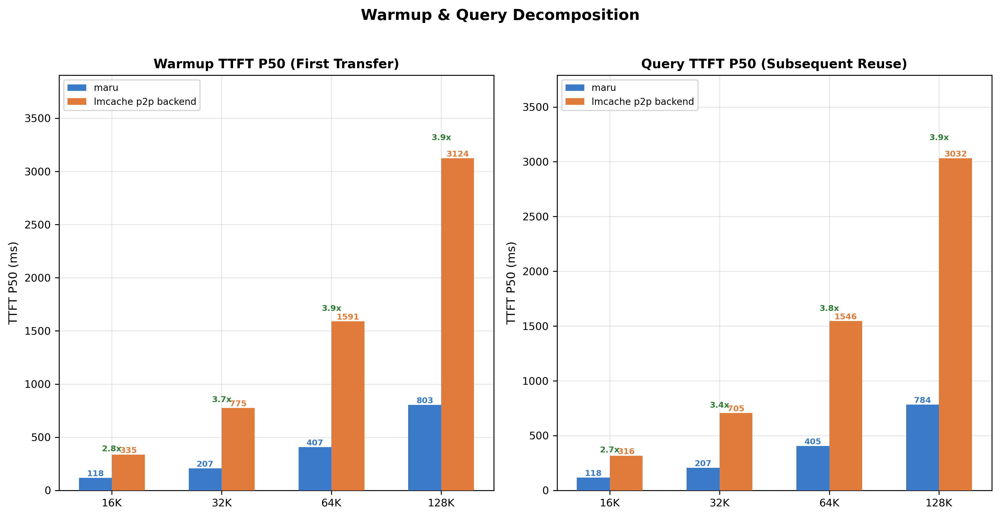
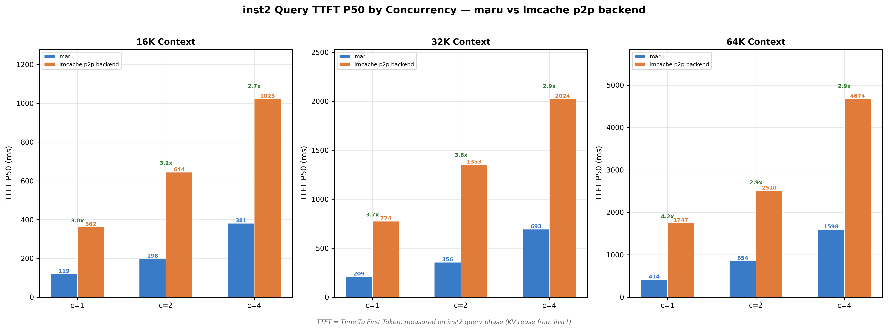
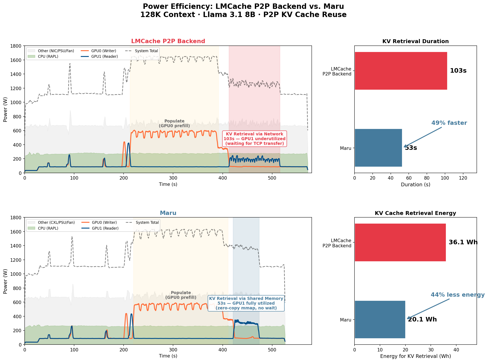

# TTFT and Power Efficiency Comparison with LMCache P2P Backend

## Overview

This benchmark compares Maru's directly mapped **`cxl` backend** with the LMCache P2P backend in the **single-node** configuration listed below. The P2P baseline is configured with NIXL/UCX and TCP loopback (`UCX_TLS=cuda_ipc,cuda_copy,tcp`). It is not an RDMA P2P comparison or a measurement of Maru's `remote_cxl` backend.

The two configurations use different storage tiers and payload paths: CPU DRAM with P2P transfers, and a directly mapped CXL pool with Maru metadata RPC. GPU loads and stores still copy bytes in the CXL configuration. Maru's separate `remote_cxl` backend uses worker-side CPU staging and RDMA; its transport, buffer and registration costs require their own measurements. All "Maru" results on this page refer to the reported `cxl` configuration and software versions, not every Maru backend or current connector version.


*Figure 1: TTFT (P50) comparison between Maru and the LMCache p2p backend across context sizes during warmup (first KV transfer) and query (KV reuse). Maru consistently achieves lower latency, with larger gains for bigger KV cache sizes.*

Figure 1 shows the TTFT (Time To First Token) P50 during the warmup phase (first KV transfer) and the query phase (subsequent KV reuse). The reported `cxl` configuration has lower TTFT across the plotted context sizes. The figure compares those complete configurations; it does not isolate a transport-only effect or evaluate `remote_cxl`.

## Concurrency Scaling


*Figure 2: Cache-hit TTFT (P50) under different concurrency levels. Maru maintains 2.7×–4.2× lower latency compared to the LMCache p2p backend while scaling to higher request concurrency.*

To further evaluate scalability, we measured cache-hit TTFT under different concurrency levels (Figure 2). Even as concurrency increases, Maru maintains significantly lower latency. Depending on the context size and concurrency level, Maru reduces TTFT by approximately **2.7×–4.2×** compared to the p2p backend.

These measurements show the scaling behavior of the two tested configurations at the plotted context sizes and concurrency levels. They do not establish the same ratios for multi-node serving, an RDMA P2P baseline or `remote_cxl`.

## Power Efficiency


*Figure 3: System-level power traces during P2P KV cache reuse (128K context). The LMCache p2p backend exhibits a prolonged KV retrieval phase (103s) with low GPU utilization, while Maru completes retrieval in 53s with higher GPU utilization throughout.*

Figure 3 compares the full power timeline for both backends during a 128K-context P2P benchmark. The populate phase (where GPU0 performs prefill and stores KV cache) is nearly identical in both duration and power draw, confirming that the two systems share the same computation workload.

The reported KV retrieval phase lasts 103 seconds for LMCache P2P, with lower GPU1 utilization in the trace. This phase timing is a workload measurement, not an isolated NIC transfer-time measurement.

The reported Maru `cxl` configuration completes this phase in 53 seconds, a 49% reduction. GPU1 loads from the mapped CXL pool rather than requesting a P2P payload transfer. GPU copies and metadata RPC remain part of that path, so the difference cannot be attributed to "no data movement" or "no network round-trips."

Notably, Maru draws slightly higher instantaneous power during retrieval (1,365W vs. 1,260W), which reflects higher GPU utilization — the GPU is actively computing rather than idling on network transfers. Despite the higher power draw, Maru consumes 44% less total energy for KV retrieval (20.1 Wh vs. 36.1 Wh), as the shorter retrieval time more than compensates for the increased power.

The shorter measured phase reduces energy for this workload. Throughput and energy under other concurrency levels, transports or backends require measurements under those conditions.

## Energy Efficiency

| Length | Recompute | Maru (`cxl`) | LMCache P2P | Maru / LMCache P2P |
|--------|-----------|------|-------------|---------------------|
| 16K    | 19.7      | 59.8 | 50.7        | 1.18                |
| 32K    | 22        | 101.2| 73.2        | 1.38                |
| 64K    | 18.2      | 130.5| 83          | 1.57                |
| 128K   | 13.6      | 173.7| 121.7       | 1.43                |

*Table 1: Tokens per joule (active energy) at the listed context lengths in this setup. The reported Maru / LMCache P2P ratios range from 1.18 to 1.57; the 128K ratio is 1.43.*

In these measurements, Maru `cxl` rises from 59.8 to 173.7 tokens/J and the P2P backend from 50.7 to 121.7, while recompute falls from 19.7 to 13.6. The relative ratio peaks at 1.57 for 64K and is 1.43 at 128K. These are observed energy results for the listed configurations; they do not establish the cause of each difference or an energy advantage for `remote_cxl` or over RDMA-based systems.

---

## Benchmark Setup

### Hardware Configuration

- **GPU**: NVIDIA RTX PRO 6000 (96GB) × 2
- **CPU**: AMD EPYC 9555 64-Core × 2 (128 threads)
- **DRAM**: 756 GB DDR5 DRAM
- **CXL Memory**: 6× CXL Type-3 Memory Expander (229 GB each, 1,374 GB total)
- **Topology**:
  - Single-node
  - 2 GPUs on separate NUMA nodes (GPU0→NUMA0, GPU1→NUMA1)
  - PCIe Gen5 x16
- **P2P transport configuration**: NIXL/UCX with TCP loopback on the same host (`UCX_TLS=cuda_ipc,cuda_copy,tcp`)

### Software

- **Model**: Meta-Llama/Llama-3.1-8B-Instruct (TP=1)
- **vLLM Version**: 0.13.0+cu128
- **LMCache Version**: 0.3.13.dev97
- **NIXL Version**: 0.10.1
- **Transfer Methods**:
  - **Maru (`cxl` backend)**:
    - CXL shared memory pool (200 GB, /dev/dax)
    - Each instance maps the shared pool; GPU transfers copy bytes to/from that mapping, while the metadata server records keys and locations
  - **LMCache P2P backend (NIXL)**:
    - UCX transport (cuda_ipc,cuda_copy,tcp) over TCP loopback
    - CPU DRAM storage (200 GB)
- **OS**: Ubuntu 24.04.3 LTS, Kernel 6.17.0-14-generic
- **CUDA**: 12.8.0, Driver 580.126.09

### Data

- **Dataset**: LV-Eval: A Balanced Long-Context Benchmark with 5 Length Levels Up to 256K

### vLLM Configuration

**vLLM Instance 1**

```bash
PYTHONHASHSEED=123 \
UCX_TLS=cuda_ipc,cuda_copy,tcp \
CUDA_VISIBLE_DEVICES=0 \
LMCACHE_CONFIG_FILE=/tmp/p2p_inst1_{nixl|maru}.yaml \
vllm serve meta-llama/Llama-3.1-8B-Instruct \
--port 6010 \
--gpu-memory-utilization 0.85 \
--trust-remote-code \
--disable-log-requests \
--no-enable-prefix-caching \
--kv-transfer-config '{"kv_connector":"LMCacheConnectorV1","kv_role":"kv_both"}'
```

**vLLM Instance 2**

```bash
PYTHONHASHSEED=123 \
UCX_TLS=cuda_ipc,cuda_copy,tcp \
CUDA_VISIBLE_DEVICES=1 \
LMCACHE_CONFIG_FILE=/tmp/p2p_inst2_{nixl|maru}.yaml \
vllm serve meta-llama/Llama-3.1-8B-Instruct \
--port 6020 \
--gpu-memory-utilization 0.85 \
--trust-remote-code \
--disable-log-requests \
--no-enable-prefix-caching \
--kv-transfer-config '{"kv_connector":"LMCacheConnectorV1","kv_role":"kv_both"}'
```

### LMCache Configuration

**NIXL P2P**

```yaml
chunk_size: 256
local_cpu: true
max_local_cpu_size: 64.0          # per-instance DRAM (GB)
use_layerwise: false

# P2P
enable_p2p: true
p2p_host: "localhost"
transfer_channel: "nixl"

# Controller
enable_controller: true
lmcache_instance_id: "lmcache_instance_{1|2}"

extra_config:
lookup_backoff_time: 0.001
p2p_socket_recv_timeout_ms: 30000
p2p_socket_send_timeout_ms: 10000
use_cxl: false
```

**Maru P2P**

```yaml
chunk_size: 256
local_cpu: true
max_local_cpu_size: 64.0          # DRAM scratch buffer
use_layerwise: false

# P2P/Controller disabled (Maru uses shared storage)
enable_p2p: false
enable_controller: false

# Maru remote backend
remote_url: "maru://localhost:6555?pool_size=64G"
remote_serde: "naive"

extra_config:
  save_chunk_meta: false
```
